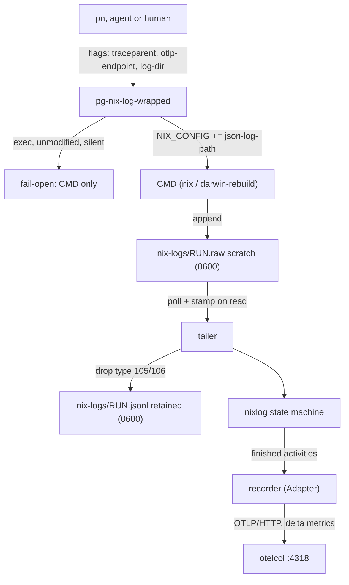

# ADR-0030: `pg-nix-log-wrapped` — a fail-open nix telemetry wrapper

**Date:** 2026-10-01
**Status:** Accepted 2026-10-29 (amended 2026-10-27 inline; root-apply statements superseded by [ADR 0038](0038-apply-builds-as-the-user-and-runs-only-profile-set-and-activate-as-root.md); body-vs-code drift recorded in "Amendment 2026-10-29")
**Deciders:** phillipgreenii

## Context

Epic `pg2-kqrrs` wants nix build activity (what was built locally, what was substituted, what
failed, how long) visible in the local OTel stack, without changing what any nix command does.
ADR [0028](0028-pn-nix-telemetry.md) recorded the Phase 1 spike (facts F1-F14, golden files). This
ADR records the design of the wrapper that Phase 3 (`pg2-kqrrs.7`) implements, and the places where
the implementation had to decide something the plan left open or amend it.

The epic named this ADR "0029". `0029` was taken in the meantime by the commit-time hook shim
experiment, so the wrapper's ADR is `0030`.

## Decision

### Packaging (D1)

A new sibling Go module `modules/pg-nix-log-wrapped` (own `go.mod`, `go.sum`, `gomod2nix.toml`),
built with `mkGoBinary`, exposed as `packages.pg-nix-log-wrapped` and
`overlays.default.pg-nix-log-wrapped`. It is NOT a second `cmd/` in `modules/pn`: `pn`'s
`subPackages = ["cmd/pn"]` stays, `lib.getExe pkgs.pn` keeps working, and `pn` consumes only the
binary path (`phillipgreenii.pn.telemetry.wrapperPath`); there is no Go import between them. Both
import `otelsetup` from `phillipgreenii/x`.

Checks: `pg-nix-log-wrapped-go-tests` (`mkGoTest`, ADR 0021/0024: the package build runs no tests),
`pg-nix-log-wrapped-golangci` (`mkGoLint`), and `pg-nix-log-wrapped-overlay-entry` (the overlay must
expose the package, or `lib.getExe pkgs.pg-nix-log-wrapped` fails at eval in a consumer).

No `runtimeDeps`: `mkGoBinary` would wrap the binary in a shell script, which breaks the W-3
own-inode PATH check and adds a process hop in front of every nix call.

### tldr, man page, completions

The command is user-facing, so it SHIPS a tldr page (`share/tldr/pages.common`). No man page (a
`--help` of one screen) and no completions (there is no cobra `completion` subcommand to generate
them). Registering the page with `programs.tldr.customPages` is a home-manager concern that belongs
to the module installing the package (the `pn` telemetry option), not to this build.

### Fail open is the invariant

Everything before CMD starts (flag resolution, directory, file, exporter construction) either
succeeds or the wrapper `exec`s CMD with its environment untouched, replacing itself
(`syscall.Exec`), silently. Stderr is silent in that mode: the OTel SDK's default error handler logs
to stderr, so the wrapper installs its own handler and discards the `log` package output; export
errors surface only under `PG_NIX_LOG_DEBUG=1`. After CMD starts, a tailer panic is recovered and
cannot affect CMD. A dead collector costs at most the bounded flush
(`PG_NIX_LOG_FLUSH_TIMEOUT`, default 2 s; an undocumented-in-`--help` test knob) and never the exit
code.

### Signals and exit codes (W-6)

CMD stays in the wrapper's process group. SIGTERM and SIGHUP are forwarded, exactly once. SIGINT is
caught but never forwarded: a terminal Ctrl-C already reaches CMD through the group, so forwarding
would deliver it twice. SIGINT MUST be caught rather than ignored, because an ignored disposition is
inherited across `exec` and would make CMD immune to Ctrl-C. A child killed by signal `n` yields
`128+n`; a missing CMD yields 127 with Go's own `exec: "x": executable file not found in $PATH`
message (`fork/exec p: no such file or directory` for a path), a non-executable CMD yields 126.

### Root (F14)

As euid 0 the wrapper reads flags only (no env, no `~/.config`), ALWAYS logs to
`/var/log/pg-nix-log-wrapped` (a non-symlink directory owned by the effective uid, not group/other
writable, mode 0750; otherwise fail open), and ignores `--log-dir`. `HOME` survives `sudo`
(`env_keep`), so ignoring it is a deliberate choice, not a side effect.

### Activity state machine (amendments from ADR 0028)

- **Failure inference (F6).** A level-0 message naming `Cannot build '<drv>'`, from `raw_msg` else
  `msg`, ANSI stripped. A drv whose dependency failed never starts; it is emitted as a zero-length
  failed `nix.build` span (`error.type = dependency_failed`) from the message alone.
- **Stopped builds are held.** Failure messages can arrive long after the `stop`
  (`--keep-going`), and an ended OTel span cannot change status. So a stopped `105` build is held
  until a message names it or the run ends. Metrics and Tempo already only see data at export time,
  so this costs no liveness that exists today. Substitutions and waits are emitted at `stop`.
- **Sub-250 ms substitutions** keep their metric count but get no span (`--min-substitute-span`,
  default 250 ms; ADR 0028 item 1).
- **`type:111`** text names the output path, not the drv; parsed from the quoted path.
- **Open activities at the end** (W-9 c) are closed with error status, `error.type = aborted`, and
  are NOT counted in `nix.derivations` (they neither built nor failed).
- **Dropping.** Result types 101 and 105 are dropped by a byte prefix/suffix check before any JSON
  decode; a failed check falls back to a full decode that drops by type, so key order is never
  relied on for correctness. _Amended 2026-10-27 (`pg2-sdbhh4.2`):_ progress results are still
  dropped unread, except those of the aggregate activities (type 104 Builds, type 103 CopyPaths) and
  of substitutions (type 108 and its type-100 CopyPath child), which are folded into an in-memory last
  value (the id is read from the byte suffix; a failed check still falls back to a full decode). Type
  101 lines are still skipped without decode.

### Signals added beyond the plan's table

`nix.derivations{outcome}` gains `failed` (build failures, including dependency failures) next to
`built` and `substituted`; `increase(...{outcome="built"})` is unaffected. `nix.build.duration` and
`nix.invocation.duration` carry only `status` (and `command`, plus since 2026-10-27 the bounded
`subcommand` operation label, for the latter); derivation names are span attributes only. Invocation
span attributes: `command`, `nix.subcommand`, `process.exit.code`, `error.type` on
non-zero exit, `nix.tailer.lag` (max seconds), `nix.plan.build`, `nix.plan.fetch`,
`nix.log.truncated` (when true), `nix.log.file`; since 2026-10-27 also `nix.builds.done`,
`nix.builds.expected`, `nix.builds.failed`, `nix.fetch.done`, `nix.fetch.expected` (final aggregate
progress, summed, only when seen), `nix.eval.duration` (seconds to the first non-evaluation activity,
or the whole invocation with `nix.eval.only = true`) and, on `nix.substitute` spans, `nix.substitute.bytes`.

_Amended 2026-10-27 (`pg2-sdbhh4.4`):_ the invocation's `error.type` on a non-zero exit is no longer
always `nonzero_exit`. It is one of the CLOSED set `signal` (exit `128+n`, or `error: interrupted by
the user`, which a real nix prints before exiting 1), `hash_mismatch`, `build_failed`,
`dependency_failed`, `eval_error`, `other`, or `nonzero_exit` when nothing more specific is known;
`nix.invocation.duration` gains a `failure_kind` label (same set, `other` instead of
`nonzero_exit`; `status=error` only). The failure messages are matched on the ANSI-stripped `msg`
(`raw_msg` has no `error:` prefix and a hash mismatch has none at all). Added invocation span
attributes `nix.error.message` (first `error:` message: hashes and URL credentials removed, 200
characters), `nix.failed.drvs`, `nix.ignored.eval_cache_busy`, `nix.db_busy` and
`nix.build.wait.count`; the free-text two are never metric labels. A fixed-output hash mismatch is a
failed `nix.build` (`error.type = hash_mismatch`, counted in `nix.derivations{outcome="failed"}`, as
are its dependents), with `nix.hash_mismatch.placeholder = true` when the specified hash is the all-A
placeholder.

### Polling only

The tailer polls every 20 ms (the spike measured lag of about one interval). The plan allowed kqueue
"only as a wake-up"; it is omitted because it adds a platform-specific code path to save an `fstat`
per 20 ms, which the spike showed is not needed.

### Config file schema

`~/.config/pn/telemetry.toml` is read by non-root runs. The wrapper reads two keys,
`endpoint = "http://127.0.0.1:4318"` (last resort) and `enabled` (boolean; `false` switches telemetry
off even when an env or file endpoint is set, but never overrides an explicit `--otlp-endpoint`; ADR
0028 "Amendment 2026-10-08" is authoritative for precedence). A malformed file, including a
wrongly typed key, is treated as absent. The home-manager module that renders it
(`phillipgreenii.pn.telemetry`) MUST emit both keys.

### `--check`

Prints the resolved endpoint and its source, whether a TCP connection to it succeeds, and whether the
log directory can be created and written. Exit 0 only when telemetry would actually run; 1 for
disabled, unresolved, unreachable or unwritable. It is the detector for a silent fail-open
misconfiguration.

## Consequences

- The wrapper is testable without OTel infrastructure: the test binary re-executes itself as the
  wrapper and as a fake nix (`internal/fakecmd`), collectors are loopback `httptest` servers, and
  the activity logic runs against the ADR 0028 golden files (copied to `internal/nixlog/testdata`,
  with a test that fails when they drift from `docs/adr/0028-fixtures`).
- A real-nix canary builds a unique derivation through the wrapper and asserts a `nix.build` span;
  it skips when `nix` is absent or inside a nix builder. A nix upgrade that changes the
  `json-log-path` shape fails it on a developer machine.
- Builds appear in Tempo only when the invocation ends (held builds, plus the invocation span
  itself). Live per-activity visibility is not provided; it would need a different export model.
- Root logs at `/var/log/pg-nix-log-wrapped` are readable only with sudo (an admin-group member can
  sudo; group membership alone grants nothing: the directory's group is `wheel` and the files are
  0600). The mode is deliberate (epic `pg2-kqrrs` D6 and the Phase 7 pass bar "files 0600 inside a
  root-owned 0750 directory"); `pg2-lur5p` item 4 reviewed it and kept it. A non-root observer sees
  root runs only as spans in Tempo.
- Note 2026-10-27 (ADR 0038, `pg2-sdbhh4.9`): "root logs" now means a legacy `sudo darwin-rebuild
switch` apply or an apply that fell back to it. With `[workspace].activate_command` set, apply's
  nix run is the user build, wrapped as a user wrapper, so its JSONL is in
  `${XDG_STATE_HOME:-$HOME/.local/state}/pn/nix-logs` and `/var/log/pg-nix-log-wrapped` gets no file
  for that apply; a non-root observer then reads it directly.
- A run's spans and metrics leave in one bounded flush at the end. A collector refusal or failure at
  that moment drops the whole batch, including `nix.invocation`, while the retained log file remains, so
  spans can be fewer than log files (`pg2-lur5p` item 1). The wrapper cannot retry inside the 2 s
  budget because the exporter's first retry wait is longer.

## Amendment 2026-10-27: the retained log is a filtered copy (`pg2-sdbhh4.1`)

Operator ruling (Phillip, 2026-10-26): progress lines are not useful in the retained log. nix is now
pointed (`json-log-path`) at a pre-created scratch `<stem>.raw`, and the wrapper writes the filtered
`<stem>.jsonl` (drops `type 105` and `type 106` results, keeps `type 101`; `nix.log.file` names the
`.jsonl`). The retained cap (64 MiB, `nix.log.retained.truncated`) stops writing only; the parse cap
(256 MiB, `nix.log.truncated`) counts retained bytes. The `.raw` is deleted after the `.jsonl` is
complete (normal exit and forwarded signals); the sweep finalizes the `.raw` of a dead pid into its
`.jsonl` (a SIGKILLed wrapper must not lose its run) and counts live `.raw` files toward the 2 GiB
cap without ever evicting them. Statements above that the log is "raw" or that the file nix appends
to is the retained one describe the original design. Details: wrapper README "Retained logs".

## Amendment 2026-10-29: accepted after a body-vs-code check (`pg2-89ny4y`)

Every design claim above was checked against `modules/pg-nix-log-wrapped` at the commit this ADR
is accepted in. The design ships; the places where the body no longer matches are:

- **Retry inside the flush budget (supersedes the last Consequences bullet).** "The wrapper cannot
  retry inside the 2 s budget because the exporter's first retry wait is longer" is no longer true.
  `internal/app/app.go:55-58` sets `RetryInitialInterval = 100 * time.Millisecond` and `app.go:337`
  passes `otelsetup.WithRetry(RetryInitialInterval, r.flushTimeout())` (commits `4411df4` and
  `0b7e896`, 2026-10-14, `pg2-sfp7i`). One transient refusal (HTTP 503 from the collector's memory
  limiter) is retried inside `PG_NIX_LOG_FLUSH_TIMEOUT` and no longer drops the batch; a collector
  that stays down still costs at most the flush budget and never the exit code.
- **Unmatched `--override-input` guard (a bounded exception to "fail open").** Commit `af2449c`
  (2026-10-26, `pg2-jvzmgf`) added `internal/app/overrideguard.go`: when CMD carries
  `--override-input` and nix's json log says the name matches no flake input, a run that would
  have exited 0 exits `ExitUnmatchedOverride = 3` (`PG_NIX_LOG_ALLOW_UNMATCHED_OVERRIDE=1` turns it
  off). Runs without that flag, and runs that already fail, are untouched. The same commit makes
  such a run observed (log tailed, no export) even when telemetry is off or unresolved
  (`app.go:215-230`, `setupGuardOnly`); every other run keeps the exact `exec` passthrough.
- **Root reads flags only: scope of the statement.** It holds for the telemetry inputs (endpoint,
  traceparent, `telemetry.toml`: `config.Resolve` returns after the flag when `Euid == 0`,
  `internal/config/config.go`). The escape-hatch variables `PG_NIX_LOG_DISABLE`, `OTEL_SDK_DISABLED`,
  `PG_NIX_LOG_DEBUG` and `PG_NIX_LOG_FLUSH_TIMEOUT` are honored for any euid (`config.Disabled`,
  `app.go:156,277`); sudo normally drops them, so this only matters under `sudo -E`.
- **Root logs, F14 (confirmed, not drifted).** `logdir.Select` and `logdir.Prepare`
  (`internal/logdir/logdir.go:52-110`): euid 0 always uses `/var/log/pg-nix-log-wrapped`, ignores
  `--log-dir`, creates it 0750, and rejects a non-directory, a directory not owned by the euid, or a
  group/world-writable one (the wrapper then fails open). On this machine the directory exists as
  `drwxr-x--- root wheel` (observed 2026-10-29). ADR 0038 only narrows WHICH applies reach it (see
  the note in Consequences), not the mechanism.
- **Confirmed unchanged:** packaging as a sibling module with no `runtimeDeps`
  (`modules/pg-nix-log-wrapped/default.nix`, `flake.nix:371`) plus the three checks
  (`flake.nix:1756,1799,1811`); the shipped tldr page and no man page or completions (`default.nix`);
  signal handling and exit codes 126/127/128+n (`app.go:196-208,407-443,577-590`); 20 ms polling
  (`internal/tailer/tailer.go:26`); the failure-kind closed set and `nix.derivations{outcome}` with
  `failed` (`nixlog.go:64-82`, `recorder.go:28,130-143`); `nix.subcommand`, `nix.eval.duration`,
  the aggregate-progress attributes and `nix.substitute.bytes` (`app.go:343-548`,
  `recorder.go:110`); `--check` exit codes (`app.go:597-640`); the `enabled`/`endpoint` config schema
  with malformed-file-as-absent (`config.go:fileConfig`, `Resolve`); the filtered retained copy
  (`nixlog.RetainDrop`, `internal/retain`); the golden-file drift test
  (`internal/nixlog/nixlog_test.go`) and the real-nix canary
  (`cmd/pg-nix-log-wrapped/main_test.go:756`).

## Not verified here (resolved 2026-10-29)

- Behaviour under a real `sudo`: resolved by the machine's own root runs. The root directory
  `/var/log/pg-nix-log-wrapped` exists as `drwxr-x--- root wheel` and holds root-run logs from the
  legacy apply flow (observed 2026-10-29), which matches the F14 section.
- A live collector, Tempo, Prometheus: resolved by the Phase 8 observation review
  (`docs/reviews/2026-10-14-pn-nix-telemetry-observation-findings.md`): `nix.invocation` and
  `nix.build` spans in Tempo (999 `nix.invocation` spans from 2026-10-07T02:28Z, with
  `nix.tailer.lag`), and the delta counters in Prometheus. That review also found the Prometheus
  counter pipeline undercounts (collector side, not the wrapper); that finding is tracked
  separately and does not change this design.
- A killed collector mid-run: pinned by tests, not by a live-stack check:
  `TestDeadCollectorNeverChangesExitCodeOrStderrAndIsBounded` (`internal/app/app_test.go:929`) and
  `TestTransient503OnTracesIsRetriedInsideTheFlushBudget` (`cmd/pg-nix-log-wrapped/main_test.go:708`).
