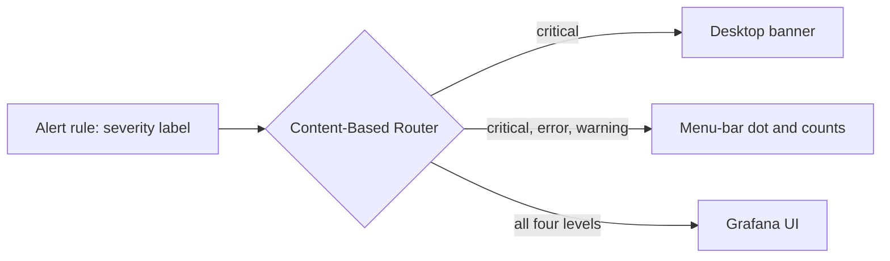

# ADR-0035: Grafana alert severity standard

**Date:** 2026-10-21
**Status:** Accepted
**Deciders:** Phillip Green II (levels, daemon default and overrides ruled 2026-10-21; written by Claude)

## Context

Grafana alert rules are defined by many tools and modules across the workspace repos, each choosing
its own `severity` label. A census of the label values on 2026-10-20 found `warning` on 232 rules,
`critical` on 77, `error` on 8 and `info` on 6. No page defined what the levels mean, so a rule
author could not tell which level a condition deserved, and a consumer could not tell what a level
promised.

Three forces shape the decision:

- **Delivery is keyed on severity.** The local alert notifier posts a desktop banner only for
  `severity=critical` (the amendment of 2026-10-08 to ADR 0040 of the support-apps repo, narrowed
  because 651 of 700 banners in one 24-hour window were warnings). Every other level is muted on the
  desktop and stays visible in the Grafana UI.
- **A menu-bar indicator now exists.** It shows one dot for the worst active severity plus counts,
  so non-critical levels are visible without a banner and the banner policy had to be revisited.
- **`error` already means something.** The eight `error` rules are connector alerts such as
  "authentication failing": a component is broken and needs a person, but nothing else is down.
  That is a distinct, useful meaning between `critical` and `warning`.

Daemon "not running" alerts are generated from a watch list and today all render as `warning`, which
the desktop policy mutes. A 90-hour outage of a daemon went unnoticed partly for that reason, so the
daemon alert needs a deliberate default and a way to raise it for the daemons that matter most.

The attention severities of the desk tool (`low`, `medium`, `high`, `critical`) are a separate
system and are out of scope.

## Decision

The full normative text is the convention page [docs/alert-severity.md](../alert-severity.md). In
summary, the standard adopts the following.

### A closed set of four levels

A Grafana alert rule's `severity` label MUST be exactly one of `critical`, `error`, `warning`,
`info`, ordered by that precedence. The set is an enumeration (a closed set), not a free-form
string, so every consumer can route on it exhaustively.

| Level      | Meaning                                                               | Desktop banner | Menu-bar indicator | Grafana UI |
| ---------- | --------------------------------------------------------------------- | -------------- | ------------------ | ---------- |
| `critical` | Stopped, or data at risk. Act now.                                    | yes            | yes                | yes        |
| `error`    | A component is failing, will not self-heal, and nothing else is down. | no             | yes                | yes        |
| `warning`  | Degraded or at risk. May self-heal.                                   | no             | yes                | yes        |
| `info`     | No action implied.                                                    | no             | no                 | yes        |

`error` is kept, and keeps its name: it is the level between `critical` and `warning`, separated
from `warning` by "will not self-heal" and from `critical` by "nothing else is down".

### Delivery

Severity is the one routing key (Content-Based Router). The desktop banner stays critical-only,
unchanged from the 2026-10-08 amendment. The menu-bar indicator shows `error` and `warning` as well
as `critical`, so those levels reach the operator without a banner. A missing or unrecognized level
produces no banner (fail-safe default) and is a defect in the rule.

### Daemon "not running" default and override

The "not running" alert for a continuous daemon MUST default to `error`. The rule generator MUST
accept a per-daemon override, declared as data beside the watch list, whose value is one of the
four levels and is validated at evaluation time (Default plus Per-Instance Override; the rule
template stays a Template Method that takes the level as a parameter).

The default is `error` rather than `warning` because a daemon that is supposed to stay up and is not
is a failure that will not self-heal once launchd has given up, and `warning` is invisible on the
desktop. It is not `critical` because most daemons do not stop the rest of the workspace.

#### Initial overrides

These three daemons are overridden to `critical` (ruling, Phillip, 2026-10-21):

- `org.nixos.beads-dolt-server`
- `com.phillipg.pg-desk-serve`
- `com.phillipg.pg-router-daemon`

Every other continuous daemon stays at the default `error`. Other daemons MAY be overridden later,
by editing the override data and nothing else.

### Rule authors and generators

Rule authors MUST choose the level from the condition and MUST NOT write another value (`high`,
`low`, `medium`, `suggestion`) into a Grafana `severity` label. A tool that lifts Grafana alerts
into another severity vocabulary maps the four levels itself.

## Consequences

### Positive

- One definition replaces per-tool guesswork; a rule author has a decision procedure.
- Desktop volume is protected: banners stay critical-only, and the only daemons that banner are the
  three that matter most.
- Daemon outages stop being invisible. Under the default, a not-running daemon shows in the menu-bar
  indicator, and the three outage-class daemons also banner.
- The set is closed, so the generator can reject a typo at build time instead of shipping a rule no
  receiver routes.

### Negative

- Existing rules that use other values, or that were levelled by loudness rather than meaning, MUST
  be migrated. Each repo that defines Grafana rules owns that follow-up work; this standard does not
  enforce it by itself.
- Every continuous daemon not on the override list moves from `warning` to `error`, which raises the
  menu-bar indicator's worst-severity colour whenever one is down.
- Three daemons now produce a critical banner when they stop, which adds banners and, for a daemon
  that already has its own critical liveness rule, can duplicate one unless that overlap is trimmed.

### Neutral

- Interval-based jobs are outside the daemon default and keep a level chosen by the normal
  decision procedure.
- The desk tool's attention severities are unaffected.

## Alternatives Considered

### Drop `error` and keep three levels

Collapse to `critical`, `warning`, `info`. Rejected by the operator: a level between `critical` and
`warning` is useful, and eight rules already use it for a distinct meaning. A broken credential is
not an emergency, but it will not recover by waiting, and `warning` would hide that.

### Rename `error`

Choose a different name (for example `major`). Rejected: the name is already in use and
understood, and a rename would force a migration of existing rules for no gain in meaning.

### Banner for `error` as well

Extend the desktop banner to `error`. Rejected: the volume problem that narrowed the banner policy
is a reason to keep it narrow, and the menu-bar indicator now provides visibility for `error`
without an interruption.

### Default daemon alerts to `warning` or `critical`

`warning` is muted on the desktop and is what hid a 90-hour outage. `critical` for every daemon
would bring banner volume back. `error` with an explicit override list gives visibility everywhere
and an interruption only where the operator chose one.

### An open set, or a separate delivery label

Let each rule add a delivery label alongside severity. Rejected: two keys can disagree, receivers
would have to reconcile them, and severity already carries the meaning that delivery follows from.

## Related Decisions

- Convention page: [docs/alert-severity.md](../alert-severity.md).
- See also: phillipgreenii-nix-support-apps `docs/adr/0040-host-metrics-and-local-alert-notifier.md`
  (amendment 2026-10-08, desktop delivery is critical-only; finding 2026-10-19, a warning-level
  "daemon not running" alert is silent by design).
