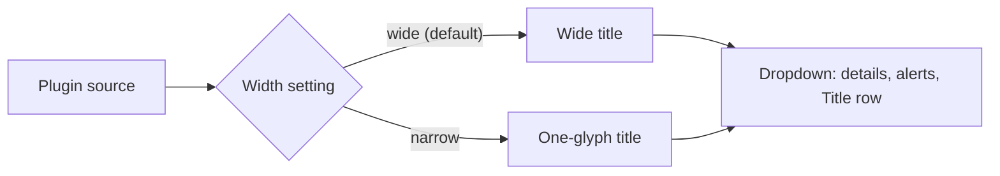

# ADR-0036: SwiftBar plugins offer a wide and a narrow title

**Date:** 2026-10-22
**Status:** Accepted
**Deciders:** Phillip Green II (rule ruled 2026-10-21/22 in the post-apply review of `pg2-cincn`; written by Claude)

## Context

The workspace repos ship several SwiftBar menu-bar plugins, each written by a different tool or
module. On a laptop the notch leaves very little room in the menu bar, so with no external monitor
the operator needs a very narrow title; with room to spare a richer one is useful. Each plugin chose
its own title, and until 2026-10-22 no page said that a plugin must offer both widths.

A survey of the installed plugins on 2026-10-22, read from their source, found four plugins in three different states:

- `pa-monitor-swiftbar` already offers wide and narrow, persisted in
  `$XDG_STATE_HOME/pa-monitor-swiftbar/title-width` and switched by a dropdown Title row that runs
  `--set-title-width wide|narrow`.
- A second plugin (the attention-items menu) offers the same two widths with the same flag, and a
  state file under its own name.
- `host-activity` also offers both widths and a Title row, but its state file is
  `$XDG_STATE_HOME/host-activity/title-width` and its switch is the action
  `host-activity action run title-width-narrow|wide`, not a flag; this is not an exception, because no rule on the plugin interface exists (see c3 below). An earlier survey that called it
  non-conforming was wrong (commit `28dcdb6d` of the support-apps repo, 2026-10-08).
- `pg-task-focus-swiftbar` offers neither a narrow title nor a setting, and its title carries
  housekeeping prompts (for example "New day: roll over") that are not the primary state.

Two forces shape the decision:

- **The width is a per-user display preference.** It has to survive restarts and has to be switchable
  from the menu itself, so it needs a persisted setting and a Title row.
- **The mechanism diverges.** Three plugins use two switch mechanisms and two or three conventions
  for the setting's path. The operator has not yet ruled which is canonical.

## Decision

The full normative text is the convention page [docs/swiftbar-title-width.md](../swiftbar-title-width.md).
In summary, the standard adopts the following.

### Every plugin offers both widths

Every SwiftBar menu-bar plugin in the workspace repos MUST offer a `wide` and a `narrow` title,
defaulting to `wide`. The narrow title SHOULD be a single colour-coded glyph, and for a task or focus
plugin an icon that looks like a task or focus. A Title row in the dropdown MUST switch between the
two and the choice MUST persist in a file (a missing, empty or unrecognised value reads as `wide`).

### Primary state only in the title

The title shows only the primary state (for a task plugin, the active task). Alerts, errors and
housekeeping prompts belong inside the dropdown (Pipe-and-Filter output: one title line, then a
separator, then the details).

### Refresh rate

A plugin MUST NOT refresh faster than it needs to. 5 to 10 seconds is fine, and a countdown shows a
coarse clock, not seconds-by-second.

### Default mechanism for new plugins, with the open choices recorded

The reference implementation is `pa-monitor-swiftbar`. Until the operator rules, a NEW plugin SHOULD
use its mechanism as the default (it is not a mandatory interface): the flag `--set-title-width wide|narrow`, and the state file
`$XDG_STATE_HOME/<plugin>/title-width` with `<plugin>` the plugin's own name. Two questions are
recorded as OPEN and are not decided here, and a third is closed:

| Id  | Question                                                                                   |
| --- | ------------------------------------------------------------------------------------------ |
| c1  | What `<plugin>` means in the state-file path (script name, package name, per-plugin id).   |
| c2  | Whether the flag is MANDATORY, or the contract is only "a Title row persisting a setting". |
| c3  | CLOSED, not applicable (2026-10-29 ruling, below).                                         |

`host-activity` is recorded as conforming, and nothing here requires it to change. Operator ruling
2026-10-29 (Phillip, verbatim): "i don' think we have formalized any consisten rules or best
practices on the interface for swiftbar plugins. until we do that, then there is no \"exception\"
because there is no rule."

### Discoverability

A pointer to the convention page, containing the name `swiftbar-title-width`, lives in the
`CLAUDE.md` of each repo that ships a SwiftBar plugin and in the workspace-rules source that
generates the workspace-root `CLAUDE.md`, so an agent working on a plugin finds the rule. The
workspace-root change takes effect for sessions only after the operator runs `pn workspace apply`.

## Consequences

### Positive

- One definition replaces per-plugin choices, so a new plugin has a checklist to satisfy.
- The notch-safe width is always one click away, and the setting survives restarts.
- The title stays a quiet indicator of the primary state; alerts have a home in the dropdown.

### Negative

- `pg-task-focus-swiftbar` MUST be reworked (`pg2-incbn`), and the attention-items plugin needs a
  conformance check (`pg2-wpk91`). This standard does not enforce either by itself.
- The mechanism is not yet uniform: until c1 and c2 are ruled, plugins MAY differ in the switch they use, and that is not a violation.

### Neutral

- `pa-monitor-swiftbar` already conforms; `host-activity` is recorded as conforming and `pg2-hpfsb`
  is closed.

## Alternatives Considered

### One title width for every plugin

A single compact title. Rejected by the operator: with a larger display the room is wasted, and a
wide title is useful there.

### Choose the width automatically from the display

Detect the notch or the number of displays. Rejected: SwiftBar gives the plugin no reliable signal,
and the operator wants a deliberate switch he controls.

### Rule the mechanism now

Make the flag mandatory and rename the `host-activity` action. Not taken: the operator has not ruled
it (c1 and c2; c3 is closed), so the page states a default for new plugins and leaves the choice open.

## Related Decisions

- Convention page: [docs/swiftbar-title-width.md](../swiftbar-title-width.md).
- See also: [ADR 0035](0035-grafana-alert-severity-standard.md) (the alert menu-bar indicator shows
  one dot for the worst severity, which is that plugin's narrow glyph).
