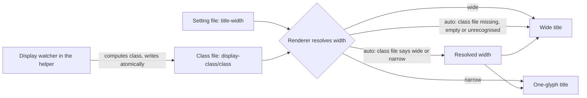

# ADR-0039: SwiftBar title width gains an `auto` value that follows the primary display

**Date:** 2026-10-28
**Status:** Accepted
**Deciders:** Phillip Green II (operator rulings 2026-10-27, interactive session; decisions D1 to D5 by the plan author after an independent read-only review the same day; written by Claude)

Amends [ADR 0036](0036-swiftbar-plugins-offer-wide-and-narrow-titles.md). ADR 0036 stays Accepted and
its text is not edited; where this ADR and ADR 0036 differ, this ADR wins for the title-width
setting, the Title row text and the streaming-plugin redraw rule.

## Context

ADR 0036 makes every SwiftBar plugin offer a `wide` and a `narrow` title and lets the operator switch
between them from a Title row. It rejected choosing the width automatically because SwiftBar gives a
plugin no reliable display signal. Two things changed:

- The operator wants the switch to follow the display without a click: the same laptop is
  sometimes alone (notched, little room) and sometimes docked to a large display (room to spare).
- A signal can be computed OUTSIDE the plugins, by a small helper that knows about displays (a
  Gang-of-Four Observer on the display configuration). The rejected alternative assumed each plugin
  would have to detect it; one shared producer removes that objection.

Operator rulings (Phillip, 2026-10-27):

- Only the PRIMARY display counts. SwiftBar renders on every display, but the operator uses it only on
  the primary one; the others may be too scrunched and that is accepted.
- Detection is EVENT-DRIVEN (a watcher), not poll-on-render.
- The rule stays simple: notch plus width only. No display-name overrides and no display-count
  signal.
- The minimum width is CONFIG, defaulting to 1800 points.

## Decision

The normative text is the convention page [docs/swiftbar-title-width.md](../swiftbar-title-width.md),
which this ADR amends. The shared contract is below. Every bead of the display-class auto set
implements it, so a change to it MUST change every such bead or none.

### A third value, `auto`

The title-width setting accepts `wide`, `narrow` or `auto`. In `auto` the renderer reads the class
file (below) and renders the title of the width it names. The setter (`--set-title-width`, or
`host-activity`'s action) accepts `auto` and still rejects anything else with exit 2, writing
nothing.

### The class file (Producer-Consumer through a file)

A display-class helper computes the class and is the only writer. Plugins only read it and never
classify. The originating beads call this file the "flag file"; this ADR and the convention page call
it the class file, because the page already uses "flag" for the `--set-title-width` command-line flag.

- **Path.** `<state base>/display-class/class`.
- **Contents.** `wide` or `narrow` plus a newline, nothing else (D5).
- **State base.** `$XDG_STATE_HOME` if it is non-empty AND absolute, else `$HOME/.local/state`. Every
  reader and every writer MUST use this one rule. SwiftBar's environment and launchd's environment
  are not the same shell, so this is a rule and not an assumption.
- **Write.** Atomic: a temporary file in the same directory, then a rename. The helper writes it at
  startup and whenever the ON-DISK content differs from the computed class (compared against the
  FILE, not an in-memory copy, so a deleted or garbage file is repaired).
- **Read.** A missing, empty or unrecognised class file reads `wide` (D3).
- `<state base>/display-class/` is a non-plugin directory in the state tree. Open decision c1 of
  ADR 0036 (what `<plugin>` means in the state path) is unaffected.

### Classification (the helper only)

1. The primary display is the one `CGMainDisplayID()` returns (it holds the menu bar). It is NOT
   `NSScreen.main`, the display with keyboard focus, which changes as the operator clicks around.
2. If the primary display has a notch, the class is `narrow`.
3. Else if its width in POINTS (not pixels; the "looks like" size of a scaled mode) is at least
   `minWideWidth`, the class is `wide`.
4. Else the class is `narrow`.

`minWideWidth` defaults to 1800 points. Measured: this machine's built-in "Color LCD" is 1512 x 982
points (3024 x 1964 pixels) and notched; no external display was measured, so 1800 is a tunable
guess. A notched display is always `narrow`, whatever its width.

### The Title row cycles three ways

The Title row cycles `wide`, then `narrow`, then `auto`, then `wide`. It shows the current mode AND
the action (ADR 0036 requires both), and in `auto` also the resolved width. Exact text:

- `Title: wide (click for narrow)` (unchanged)
- `Title: narrow (click for auto)` (was `click for wide`)
- `Title: auto, <resolved> now (click for wide)`, where `<resolved>` is `wide` or `narrow`, for
  example `Title: auto, narrow now (click for wide)`

The row stays the last block above Refresh and still runs the plugin itself with
`--set-title-width <next>` (or `host-activity`'s action).

### Streaming plugins compare the resolved width

A streaming plugin re-reads the setting AND the class file on every frame or tick, and compares the
RESOLVED width (not the setting word) to decide whether to redraw. Comparing the word means a class
flip never redraws, or redraws every tick.

### Refresh is best effort

After a change the helper asks SwiftBar to refresh, BEST EFFORT. Failure is logged and never fatal,
and no behaviour may depend on it: the class file alone is correct, and polled plugins pick the
change up at their next interval.

### Decisions D1 to D5

| Id  | Decision                                                                                                                                                            |
| --- | ------------------------------------------------------------------------------------------------------------------------------------------------------------------- |
| D1  | A plugin's default stays `wide`; `auto` is opt-in per plugin. Making `auto` the default, or adding one machine-wide switch, is a later operator decision.           |
| D2  | Purely event-driven, no periodic safety-net poll. A DEAD watcher is caught by the launchd health check; a HUNG one is not (accepted).                               |
| D3  | A missing, empty or unrecognised class file reads `wide`, even on a notched display (the ADR 0036 fail-safe: an unreadable setting never hides information).        |
| D4  | The helper's config is JSON (`pkgs.formats.json`, Go stdlib), not TOML, so no third-party Go dependency and no `gomod2nix.toml --with-deps` regeneration is forced. |
| D5  | The class file holds one word and no timestamp.                                                                                                                     |

D1 and D3 are operator-overridable (see [Overriding D1 and D3](#overriding-d1-and-d3)). D2, D4 and D5
are implementation choices of the helper; the operator MAY override them too, but doing so touches only
the helper.

### Backward compatibility

A plugin that predates `auto` treats any setting value other than `narrow` as `wide`, never errors
and never rewrites the file on read (verified by reading all four readers on 2026-10-27). The four
plugins can therefore be converted independently and in any order, and an old plugin reading `auto`
shows `wide`.

### Overriding D1 and D3

The operator MAY override D1 and D3. The override is a new ADR that supersedes the affected part of
this one, together with:

- D1 (default stays `wide`): the sentence "MUST be wide until told otherwise" in the convention page's
  contract, and the default branch of each plugin's setting reader. A machine-wide switch would
  additionally need a new setting owned by the helper.
- D3 (a missing class file reads `wide`): the class-file read rule in the convention page's
  "Class file" section, and the `auto` branch of each plugin's reader. A different fallback (for
  example `narrow` on a notched machine) also needs the helper to write the file at every start.

## Consequences

### Positive

- A docked laptop gets the wide title and an undocked one the narrow title without a click.
- One producer classifies; plugins stay trivial readers, so the four plugins can be converted
  independently and in any order.
- The class file is a plain file: a plugin works with no IPC, and a failed refresh breaks nothing.

### Negative

- A DEAD watcher on a notched laptop leaves the class file stale or missing. A missing file reads
  `wide` (D3), so the wide title shows in the notch area until the operator picks `narrow`. A stale
  file keeps its last class. The launchd health check catches a dead watcher; a hung one is accepted
  (D2).
- `auto` costs one more click state in the Title row, and the row text changes: tests that matched
  `Title: narrow (click for wide)` MUST be updated, not deleted.
- The 1800-point minimum is an unmeasured guess for external displays.

### Neutral

- Only the primary display counts; other displays may render a bar too scrunched, and that is
  accepted.
- ADR 0036 stays as written; it is amended, not superseded.

## Alternatives Considered

### Each plugin detects the display

Rejected: SwiftBar gives a plugin no reliable signal, which is the reason ADR 0036 rejected automatic
selection. Putting the logic in one helper means one implementation and one test of the rule.

### Poll the display on every render

Rejected by the operator: detection is event-driven. A poll in every plugin multiplies the cost, and
a streaming plugin has no render to hook.

### Make `auto` the default

Not taken (D1): it changes every existing bar at once and removes the operator's explicit choice. It
is a later operator decision.

### Fall back to `narrow` on a notched display when the class file is missing

Not taken (D3): it breaks the ADR 0036 fail-safe that an unreadable setting never hides information,
and a plugin cannot know the display is notched without classifying.

### Hold a timestamp in the class file

Not taken (D5): a timestamp invites a staleness rule and a second reader format; the one-word file is
enough, and the launchd health check is the liveness signal.

## Related Decisions

- Convention page: [docs/swiftbar-title-width.md](../swiftbar-title-width.md).
- Amends: [ADR 0036](0036-swiftbar-plugins-offer-wide-and-narrow-titles.md).
- Set of beads (spike `pg2-n4s1l0`, helper `pg2-ijejjy`, enable `pg2-jb7gkc`, plugins `pg2-ogkx1x`,
  `pg2-7qj1yd`, `pg2-vs90xh`, `pg2-hzqqv1`, live verify `pg2-u0tonu`); this ADR and the page are
  `pg2-hnos8z`.
