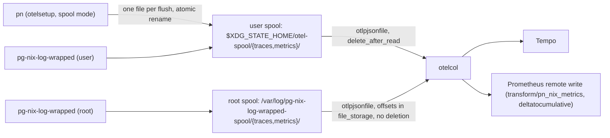
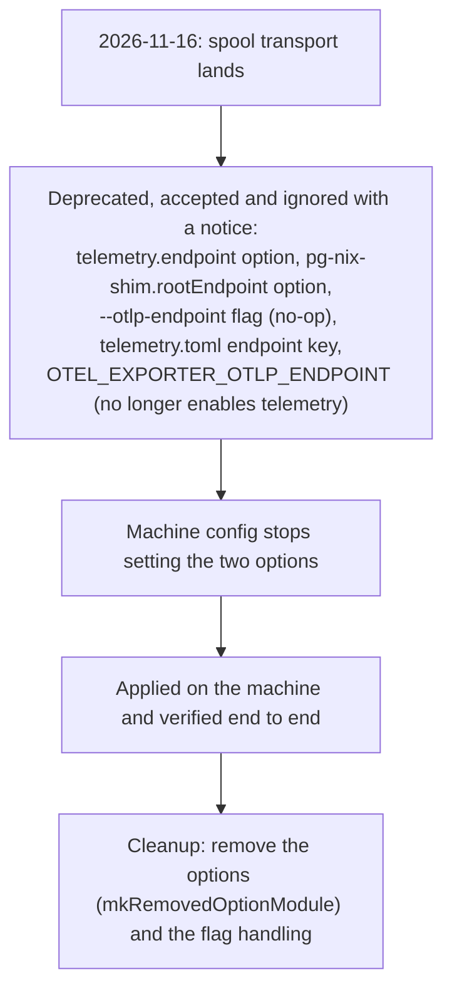

# ADR-0044: pn and `pg-nix-log-wrapped` export telemetry through a file spool, not OTLP over HTTP

**Date:** 2026-11-16
**Status:** Accepted (supersedes the transport parts of [ADR 0028](0028-pn-nix-telemetry.md): endpoint resolution, `--otlp-endpoint`, the `endpoint` key and the reachability probe; and the endpoint wording of [ADR 0030](0030-pg-nix-log-wrapped.md))
**Deciders:** phillipgreenii

## Context

pn and `pg-nix-log-wrapped` used to push OTLP over HTTP to a local collector on `127.0.0.1:4318`.
During a `pn workspace apply` on 2026-11-12, with a host load average of 104 to 140 on 11 CPUs, the
collector took 2.8 seconds to answer an empty POST. The exporter timeout was shorter, so every
60-second metric push and every trace batch failed, the Go SDK printed `failed to upload metrics`
and `traces export: ... processor export timeout` into the operator's terminal for the whole apply,
and the data was lost. An apply can also restart the collector, so a push transport that needs the
collector to be up at the moment of the write is the wrong shape for the tool that restarts it.

Operator rulings (Phillip, 2026-11-12), quoted:

1. "use file based, not HTTP" and "using HTTP for pn workspace apply was always wrong since it can
   restart the service as part of the apply."
2. "roundtripper is too much of a hack": no fake HTTP client that captures an OTLP body.
3. "tuning sweep to 1 day and 200MB".
4. On the root-run spool location: "path is fine".
5. On the exporter structure: "ok, so we will need to build this, but do it in a way which is
   flexible enough to handle if the format changes. we will not use the hacky http loop back for
   production, i'm ok doing it as part of a test. so we will need the objects and json arguments
   and similar/same interfaces so that swapping between http and log do not affect the code. we can
   then verify that by using the loop back to ensure they match."

## Decision

1. **Writers MUST NOT push OTLP over HTTP.** pn and the wrapper write OTLP-JSON files into a spool
   directory and never wait on the collector. The collector reads the files whenever it is up.
   Root runs use the same mechanism.
2. **File layout.** Each flush MUST be one file, written atomically: write
   `<dir>/<signal>/.<name>.tmp` (a name the receiver glob does not match), `Sync` it, then rename
   it inside the same directory to `<service>-<UTC timestamp>-<pid>-<rand>-<seq>.jsonl`. Files are
   created lazily (an empty flush writes nothing). Each line is a standalone, valid
   `ExportTraceServiceRequest` or `ExportMetricsServiceRequest` of at most 4 MiB, which is below the
   receiver's 16 MiB line limit. User spool files are mode 0600 in 0700 directories, created with
   `O_EXCL|O_NOFOLLOW`; a symlinked spool directory or one owned by another uid MUST be rejected
   (the writer fails open).
3. **Per-file identity.** The collector fingerprints a file by its first 1000 bytes, and run files
   share an identical resource header, so a second file is silently skipped and deleted. Every
   published file MUST carry a per-file resource attribute `pn.spool.file_id` prepended to the
   resource attributes, so it falls inside the first 1000 bytes. `transform/pn_nix_metrics` deletes
   it from metrics before `deltatocumulative`, so it never becomes a Prometheus label; on traces it
   stays as a resource attribute.
4. **Format seam.** The file-exporter specification is at Development status. An `Encoder`
   (one standard OTLP export request in, one or more self-contained records and a file extension
   out) isolates the format; a changed format is a new Encoder plus a collector receiver for its
   extension, and callers do not change. The sweep MUST match any extension an Encoder registers.
5. **Same interfaces as HTTP.** The spool trace exporter is built on the public
   `otlptrace.Client` interface and the spool metric exporter implements `sdkmetric.Exporter`, the
   same types the HTTP exporters yield. `otelsetup.Init` picks the transport in two small
   factories; everything else (resource, batcher, periodic reader, histogram View, delta selector,
   flush, shutdown) is one shared path. Swapping transport is a `Config` change.
6. **The HTTP loopback is test-only.** A transport-parity contract suite sends the same instruments
   through the HTTP exporter into an in-process `httptest` receiver and through the spool exporter,
   and compares the decoded results. Production packages MUST NOT import `httptest` or the helper
   package (a `go/parser` import scan pins it). The HTTP transport stays in the `x/otelsetup`
   library (it is the oracle and remains a supported transport for other callers); only the
   consumer-facing endpoint options of pn and the wrapper are deprecated, below.
7. **Encoding.** OTLP-JSON is not plain protojson (ids are hex, enums are integers), so the default
   Encoder uses the collector's `pdata` marshalers. A dated findings summary (spike, 2026-11-12):
   `go.opentelemetry.io/collector/pdata` v1.65.0 resolves with the library's Go 1.25.9 and
   protobuf v1.36.12 without upgrading anything, while v1.66.0 and later declare Go 1.26.0 and
   force upgrades, so pdata MUST NOT move past v1.65.0 except with a deliberate Go bump of the
   library. It lives in a subpackage of the library, not a nested module (a nested module would
   create a module cycle and contradict decision 5); consumers that do not import the spool
   download the same module list, and importing adds seven modules. Every Encoder MUST pass the
   oracle: build requests from `go.opentelemetry.io/proto/otlp`, encode, decode with the
   collector's own `ptrace` and `pmetric` JSON unmarshalers, re-marshal, and require `proto.Equal`.

### Root spool and its exposure trade-off

The root wrapper (under `sudo`) always writes to its own spool `/var/log/pg-nix-log-wrapped-spool`,
a SIBLING of `/var/log/pg-nix-log-wrapped` (mode 0750, root-owned, holds raw nix logs that MUST stay
private and that the user-run collector cannot traverse). The root spool is root-owned mode 0755
with files 0644, created without following symlinks and with ownership verified before every write;
an existing symlink or a directory not owned by root makes the root wrapper fail open silently. The
root wrapper ignores any spool directory flag value (a spool flag only signals "enabled"), exactly
as it ignores `--log-dir`.

Accepted trade-off: files 0644 in a 0755 directory expose build metadata (flake paths, derivation
names) to every local user. This is accepted on a single-user machine and MUST be revisited if the
machine becomes multi-user. The root enable switch is the `rootSpool` key of `/etc/pg-nix-shim.json`
(rendered by the nix-darwin module); the old `rootEndpoint` key is tolerated as "telemetry wanted"
with a deprecation notice until it is removed.

### Collector side

- User spool receivers read `${XDG_STATE_HOME}/otel-spool/{traces,metrics}/*.jsonl` with
  `start_at: beginning`, `delete_after_read: true`, `max_log_size: 16MiB`,
  `force_flush_period: 0` and `poll_interval: 1s`. "File present" therefore means "not yet handed
  to the pipeline", which makes backlog and stuck signals meaningful and keeps the disk small.
  `delete_after_read` requires `--feature-gates=filelog.allowFileDeletion` on every collector start
  and every `otelcol-contrib validate` (validate builds receivers and fails without it), and it
  requires `start_at: beginning` written explicitly.
- Root spool receivers are separate instances with ids distinct from the user ones, with offsets in
  `file_storage/filelog` and NO deletion (the collector user cannot delete from a root-owned
  directory). The root wrapper's sweep bounds the directory.
- Read order MUST be oldest first. The default is newest first, and `deltatocumulative` then drops
  every older delta of a backlog (spike: four files with deltas 1, 2, 4, 8 exported 8 by default
  and 15 with ascending order). The landed receivers use `ordering_criteria` by `mtime` ascending
  (behind the alpha gate `filelog.mtimeSortType`) and `max_concurrent_files: 2`; a later finding
  showed that files of one metric stream read concurrently in one poll could still be reordered
  and lose a delta (5 of 8 two-file runs with the default), which the two settings fix. A collector
  upgrade that removes the alpha gate will fail the config validate checks, by design.
- A glob over a missing spool directory does not error and picks the directory up when it appears.
- `max_log_size: 16MiB` is mandatory: a 2,000,611-byte line with the 1 MiB default is dropped
  silently and the file is deleted.

### Sweep and bounds

Operator ruling (tuning sweep to 1 day and 200MB). Each writer sweeps its own spool: files older
than 24 hours are deleted, then oldest first while the directory exceeds 200 MiB or 5000 files;
a file modified in the last 10 minutes (or with a future mtime) is never deleted; stale `.tmp`
files older than 10 minutes are removed; names that do not match the run-file pattern are ignored;
symlinks are not followed. The sweep is throttled by a `.sweep` marker (it runs only when the
marker is older than 10 minutes). The user spool is swept by every user run; the root spool by the
root wrapper at each root run, because a user process cannot delete root-owned files. A file the
collector deleted between the sweep's `Lstat` and `Remove` counts as success and is NOT counted as
swept.

### Accepted loss modes

`delete_after_read` deletes a file when the consumer callback returns (spike finding: when the
batch processor accepts the data, before export), with no persistent queue behind it. The following
losses are accepted and MUST be documented wherever the spool is described:

1. A collector crash inside the batch window (5 seconds or 1024 items) loses data the spool no
   longer holds, plus the in-memory `deltatocumulative` state.
2. A `memory_limiter` refusal drops the data (the receiver does not retry) and the file is deleted
   anyway; the receiver logs nothing. The loss is countable only on the collector's own series
   `otelcol_receiver_refused_metric_points` and `otelcol_receiver_refused_spans` with
   `receiver=~"otlpjsonfile/.*"`, which an alert watches.
3. A file that was read, dropped and deleted is invisible to `pn workspace doctor`, whose "stuck"
   check only sees files still present.
4. After an outage longer than Prometheus's out-of-order window, replayed delta metrics are
   rejected and `deltatocumulative` drops out-of-order samples. Traces are unaffected.
5. Wiping the collector's `file_storage` re-ingests every file still in the root spool (up to the
   24-hour sweep window) and double counts those deltas. `exclude_older_than` was measured to work
   but is not set, because any value below the sweep window can drop legitimately unread files
   after a long outage. A storage wipe is an operator action.

### Observability and detection

Metric names and labels of the existing pn and wrapper series DO NOT change. The guards are the
transport-parity contract test, the hermetic collector integration check (real pinned
`otelcol-contrib`, no listening ports) and `lint-promql-metrics`. Two counters are added, declared
in the shared metric catalog and incremented at call sites: `pn.spool.swept_files` (attributes
`spool=user|root`, `reason=age|cap`) and `pn.spool.write_errors`. The collector uses
`UnderscoreEscapingWithoutSuffixes`, so the Prometheus series are `pn_spool_swept_files` and
`pn_spool_write_errors`, with no `_total` suffix. `swept_files{spool="user"}` IS data loss (the
collector deletes every file it reads, so a swept file was unread); root sweeps are informational.
Alerts MUST NOT use `increase()` or `rate()` on these delta-then-cumulative counters (they miss the
first sample after an idle gap); they use the last-cumulative-in-window minus last-before-window
shape of the existing plan-size alert, with a missing earlier sample counting as 0. Counters get no
zero-valued `Add(0)` at init (it would make every flush non-empty and flood the spool).

`write_errors` reports TRANSIENT failures only: a persistent `EACCES` or `ENOSPC` switches the
process to the no-op and nothing is emitted. The persistent-failure detectors are therefore
`pn workspace doctor` and `pg-nix-log-wrapped --check`, not a metric. The library and the wrapper
MUST stay silent on a spool write failure (debug output only, `PG_NIX_LOG_DEBUG=1`), consistent with
the existing fail-open convention; pn MAY print one `pn: telemetry:` line per run for its own
failure.

`pn workspace doctor` findings are warnings, never errors, and the check is silent when telemetry
is off: the oldest user-spool file older than 30 minutes ("stuck"; it names the collector label
`com.phillipg.otel-stack.otelcol` and the next step `launchctl list com.phillipg.otel-stack.otelcol`),
the collector label not loaded, a resolved user spool directory that differs from
`${XDG_STATE_HOME}/otel-spool` (the only directory the collector watches), a leftover `endpoint`
key, and an unusable spool directory. A file stuck because of a writer bug (for example a
fingerprint collision, which the collector skips and never deletes) also trips "stuck".

### Configuration and the deprecation timeline

Resolution for a non-root run is the `--otel-spool-dir` flag, then `spool_dir` in
`~/.config/pn/telemetry.toml`, then `${XDG_STATE_HOME:-$HOME/.local/state}/otel-spool` (an absolute
path is required). An explicit flag beats `enabled = false`; in spool mode an absent `enabled` key
is off. The endpoint probe is deleted.

- `telemetry.endpoint` (home module) and `pg-nix-shim.rootEndpoint` (darwin module) are accepted
  and ignored with a `warnings` entry. `rootEndpoint` while non-null still renders
  `rootSpool = true`, so root telemetry is never silently off between module and machine-config
  changes. They MUST NOT be removed before the machine configuration stops setting them (a removed
  option breaks evaluation) and the installed spool export has been verified after an apply.
- `--otlp-endpoint` is accepted as a deprecated no-op for one release on both binaries.
  `OTEL_EXPORTER_OTLP_ENDPOINT` and the `endpoint` key no longer enable telemetry. pn is the only
  emitter of the notices for the key and the variable (one line per run, prefix `pn: telemetry: `,
  always on stderr, not suppressed on non-TTY); the wrapper prints only for a flag it received, and
  pn never passes `--otlp-endpoint`, so an apply does not print one line per nix call.
- `PN_NIX_LOG_OTLP_ENDPOINT` (read by `update-locks-lib.bash`) is renamed `PN_NIX_LOG_SPOOL_DIR`.

## Consequences

- A slow, busy or restarting collector no longer affects a pn or nix run, and an apply prints no
  export errors.
- Telemetry can be lost silently in the modes listed above; the swept-files and refused-points
  alerts, `doctor` and `--check` are the detectors, and a persistent write failure is visible only
  there.
- Local users can read root-run build metadata from the root spool.
- Only the `${XDG_STATE_HOME}/otel-spool` directory is watched by the collector, so a custom
  `spool_dir` produces files nobody reads (doctor warns).
- The collector needs the `filelog.allowFileDeletion` and `filelog.mtimeSortType` feature gates
  everywhere it validates or starts with these receivers.
- Other daemons (pa-monitor, host-activity and so on) keep OTLP over HTTP; they do not use the
  spool.
