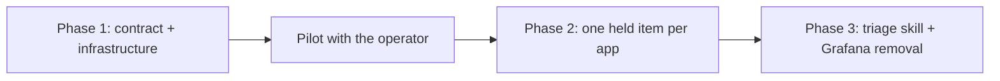

# ADR-0046: Alert rules as Prometheus rule files, with runbooks and declarative inhibition

**Date:** 2026-11-21
**Status:** Accepted
**Deciders:** Phillip Green II (approved 2026-11-21; written by Claude)

## Context

Alerts on the host arrive in clusters. Most of a cluster is symptoms of one host condition (low
disk space, host load), yet triage files one tracker issue per alert, so agents drain symptoms
while the cause goes untreated. The operator wants three things:

1. Every alert keeps evaluating; a symptom whose cause is firing is suppressed (no desktop
   notification) and recorded against the cause, not filed on its own.
2. Every alert has a runbook: what it means, where to check, possible causes, resolution.
3. A contract for how an app defines rules, tests, runbooks and inhibition, proven on one pilot
   app before the other apps are converted.

Today Grafana evaluates every rule and notifies through its embedded Alertmanager. That
Alertmanager offers no declarative inhibition, and consumers read its API with identities that
depend on Grafana-specific labels. A standalone Prometheus Alertmanager provides inhibition and an
API that reports `inhibitedBy`. Prometheus rule files give a rule shape that `promtool` can test.
Loki's ruler can evaluate log rules and notify the same Alertmanager.

Shared contract code has to live in this repo because the producing repos may not take each other
as flake inputs.

## Approval record

The design this ADR records was approved by the operator.

- Who: Phillip (the operator).
- When: 2026-11-21.
- Verbatim: "approved".
- What was approved: the design text at its seventh draft, after four review rounds.

A binding operator constraint of 2026-11-16 shaped the phasing and MUST be honoured by every
follow-on change. Verbatim: "we need to have the contract established before we allow drain agents
to start digging into the apps and converting them. if we need to do one migration together to
ensure the contract fits, i'm ok with that."

Operator rulings that shaped the design, recorded as given:

- Log rules are evaluated by Loki's ruler and notify the standalone Alertmanager (2026-11-16). This
  supersedes an earlier ruling to convert them to Prometheus counters, after review showed counters
  do not reproduce `count_over_time` semantics.
- The pilot is the `pg-claude-code-recorder` app ported together with the host metrics rules.
- The initial inhibition sources are `host-disk-low` and `host-cpu-load-15m-critical`; memory
  pressure is not a source because its metrics are not trusted enough for tools to rely on.
- Inhibition names direct rule uids, not cause classes.
- Runbooks come from a build step, not only HTML but also generated index pages (the operator
  expected "a build step. not just html, but also to generate index").
- A suppressed symptom with no issue gets a `caused-by` edge to its cause and no issue of its own.

## Decision

The full normative text is the convention page [docs/alert-runbooks.md](../alert-runbooks.md). In
summary:

1. **Rule contract.** Alert rules become Prometheus-shaped rule files (PromQL), carrying `rule_uid`,
   `severity` and optional `inhibited_by` labels and `title`, `summary`, `description`,
   `runbook_id` annotations, with `alert:` equal to `rule_uid`. A ported rule keeps its Grafana uid.
   The `severity` vocabulary stays the closed set of [ADR 0035](0035-grafana-alert-severity-standard.md).
2. **Log rules on Loki's ruler.** The same contract in LogQL, a build-owned store rule directory,
   a shared line-count test harness owned by this repo, and a recording-rule fallback for history
   when `ALERTS` is not remote-written.
3. **Declarative inhibition.** Sources are declared by the module that owns the cause rule; the
   Alertmanager module generates one static inhibit rule per source; `inhibited_by` on a symptom
   names its sources by uid. Only late cause rules are sources.
4. **Standalone Alertmanager in two steps.** A parallel run (null receiver, Grafana forwards to
   both Alertmanagers), then a cutover (the standalone one notifies, the embedded one is muted,
   consumers flip to the new `alertmanager` backend).
5. **Issue identity by match-time normalization.** A normalized fingerprint that drops
   Grafana-specific and external labels, compared at match time against the stored primary and
   alias fingerprints, with one golden test-vector file shared by every implementation. No
   migration, no duplicate issues.
6. **Runbooks for every rule.** Required sections, a per-repo registration of runbook directories
   keyed by app, a build step that renders HTML, generates index pages and a JSON index, and
   injects `runbook_url` into each rule, served as static files.
7. **Contract checks C1 to C8 per repo and X1 to X5 in the machine build,** each with a negative
   fixture, exported from this repo as a flake module together with one shared options module.
8. **Phasing.** Phase 1 builds the contract and infrastructure and ends with a pilot worked with the
   operator. Phase 2 converts one app per held work item, blocked by the pilot. Phase 3 updates the
   triage skill and removes Grafana alerting.

## Consequences

### Positive

- A symptom stops filing its own issue while its cause fires; triage records it against the cause.
- Every rule carries a runbook link that is checked at build time, so a dead link fails the build.
- One rule shape and one notification path remain after the cutover.
- A port that breaks the contract fails a check in its own repo, not after deployment.
- Issue identity survives the migration without a migration step or duplicate issues.

### Negative

- Two alerting systems run side by side until the cutover and the final cleanup, and every
  not-yet-ported rule still lives in Grafana.
- Roughly two hundred rules must be ported app by app, each with baseline copying, mapping and
  runbook writing.
- A new standalone Alertmanager, a Loki ruler configuration and a runbook server add services to
  operate.
- Log-rule tests approximate evaluation by counting fixture lines; the static diff covers what
  that cannot.

### Neutral

- Inhibition cannot be unit tested with promtool; one opt-in end-to-end test against a real
  Alertmanager covers it, outside `checks` per [ADR 0024](0024-build-tagged-suites-need-their-own-check.md).
- Four spikes (forwarded Grafana labels, embedded mute, edge idempotence, `ALERTS` remote-write)
  are facts verified inside Phase 1, not open decisions.

## Related

- [docs/alert-runbooks.md](../alert-runbooks.md): the convention page.
- [ADR 0035](0035-grafana-alert-severity-standard.md): the severity vocabulary the rules use.
- [ADR 0024](0024-build-tagged-suites-need-their-own-check.md): integration suites sit outside
  `checks`.
