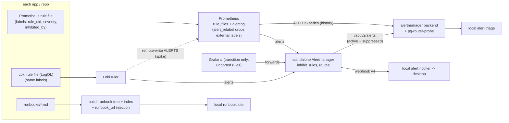
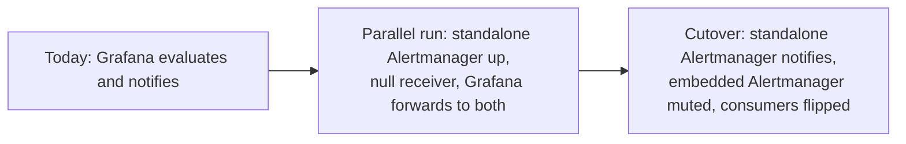
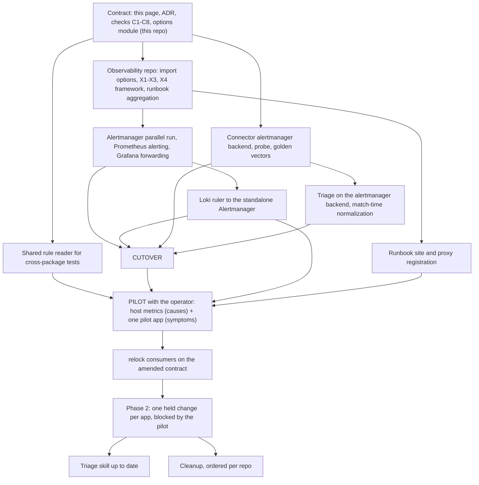

# Alert rules, runbooks and inhibition

This page is the convention page for how an app defines alert rules, tests them, documents them
with a runbook and declares which host condition suppresses them, once alert evaluation moves from
Grafana-managed rules to Prometheus rule files (Loki rule files for log rules) and notification
moves to a standalone Prometheus Alertmanager. The decision is recorded in
[ADR 0046](adr/0046-alert-rules-as-prometheus-files-with-runbooks-and-inhibition.md). The
`severity` label vocabulary is NOT redefined here: it stays the closed set of
[alert-severity.md](alert-severity.md).

Contents: [Scope](#scope), [Architecture](#architecture), [Rule contract](#rule-contract),
[Log rules](#log-rules), [Inhibition](#inhibition),
[Alertmanager, Grafana wiring and cutover](#alertmanager-grafana-wiring-and-cutover),
[Consumers and issue identity](#consumers-and-issue-identity), [Runbooks](#runbooks),
[Contract checks](#contract-checks), [Per-app port checklist](#per-app-port-checklist),
[Phases](#phases), [Constraints](#constraints), [Spikes](#spikes), [Related](#related).

## Scope

This page covers every alert rule defined by an app or module in the workspace repos, whether it is
evaluated by Prometheus (PromQL) or by Loki's ruler (LogQL), and the Alertmanager that receives
their alerts. A repo that writes such a rule MUST follow it. The deployment repo supplies host
names, URLs and its own rules through options; this page names none of them.

In this page "the deployment repo" is the repo that assembles the machine configuration and
consumes every other repo. "Shared contract code" lives in this repo (`nix-repo-base`) because the
producing repos may not take each other as flake inputs.

## Architecture

The intent is that every alert keeps evaluating, a symptom whose cause is firing is suppressed (no
desktop notification) and recorded against the cause instead of being filed on its own, and every
alert has a runbook.



Anti-goals (failure even if the migration "works"):

- A symptom suppressed by a cause that is not its cause (this is why only the late cause rules are
  inhibition sources).
- A rule evaluated by BOTH Grafana and Prometheus at once.
- A ported rule that fires differently, or with different labels, than the Grafana rule it replaces.
- A tracker issue re-filed as a duplicate because an alert fingerprint changed.
- A runbook link that opens nothing, or the wrong runbook.
- An app ported before the contract has been proven on the pilot.

Non-goals: fixing host load or disk pressure themselves; memory pressure as an inhibition source
(its metrics are not trusted enough for tools to rely on); PagerDuty alerts (another backend in the
same fan-out, untouched).

## Rule contract

A Prometheus rule file looks like this.

```yaml
# packages/<app>/alerting/rules.yaml (Prometheus rule file)
groups:
  - name: <app>
    rules:
      - alert: <app>-tips-stale # MUST equal rule_uid
        expr: <promql>
        for: 10m
        labels:
          rule_uid: <app>-tips-stale # the old Grafana uid, unchanged
          severity: warning
          inhibited_by: "host-cpu-load-15m-critical"
        annotations:
          title: "<app> tips stale" # the old Grafana rule title
          summary: "..."
          description: "Short: what fired, first check."
          runbook_id: <app>/tips-stale
```

- **R1.** Every alerting rule MUST carry the `rule_uid` label (matching `^[a-z0-9-]{1,40}$`, unique
  across ALL registered files, Grafana and Prometheus) and the `severity` label, and the `title`,
  `summary`, `description` and `runbook_id` annotations. Its `alert:` name MUST equal its
  `rule_uid` (existing promtool baselines already name alerts by uid, so they keep working; the
  human title moves to the `title` annotation). It MUST NOT carry a hand-written `runbook_url`
  (enforced by C2). Each rule group's `interval:` MUST equal the interval of the Grafana group it
  replaces.
- **R2.** A ported rule MUST keep its Grafana uid as `rule_uid`. A new rule gets a new uid and MUST
  be listed in the repo's `new-rules` list (C6).
- **R3.** `inhibited_by` is optional. When present it MUST match
  `^[a-z0-9-]+(,[a-z0-9-]+)*$` (no spaces). Each entry MUST name a registered inhibition source
  (only X2 can enforce this, since sources are declared in other repos) and MUST appear in the
  runbook's "Possible causes".
- **R4.** A Grafana `noDataState: Alerting` MUST become an explicit absence form chosen so the
  alert's label set equals the Grafana one (for example `absent_over_time(...)` wrapped to drop
  selector labels), with a promtool test for the no-data case.
- **R5.** A per-rule Grafana `execErrState: Error` MUST be replaced by two meta-rules: one on
  Prometheus' `prometheus_rule_evaluation_failures_total` by `rule_group` (owned by the Prometheus
  module) and one on the Loki ruler's evaluation-failure metric scraped from the Loki job (owned by
  the Loki module), so a log rule that errors at runtime still alerts.
- **R6.** The SAME change that registers the Prometheus rule MUST register a Grafana delete entry
  for the uid (the existing delete-file pattern; the launchd-health generator relies on its own
  reconciler instead).
- **R7.** Tests MUST run `promtool test rules` against the REAL rule file. Before porting, the
  app's Grafana rule YAML AND its existing test files MUST be copied unchanged to
  `alerting/grafana-baseline/`. Check C7 then requires:
  - every baseline test case present in the new tests with identical `input_series`, and
    `exp_alerts` equal after the documented mechanical mapping (add `rule_uid` and `title`; drop
    Grafana-only labels); Loki baseline fixtures MUST be carried over with identical log lines, and
    the harness result (firing or not) per fixture MUST equal the baseline's expectation;
    `promql_expr_test` cases on a `wrapped:<uid>` recording rule are rewritten mechanically onto
    that rule's `expr`;
  - a static field diff per uid between the baseline Grafana rule and the Prometheus rule: `for`,
    `keepFiringFor` to `keep_firing_for`, labels, severity, group interval, and `noDataState:
Alerting` to an R4 form with a no-data test case;
  - every baseline uid on the repo's `ported` list or its `retired` list, so a dropped rule cannot
    pass silently.

  New cases MUST cover, per `rule_uid`: at least one firing and one not-firing case, no-data where
  R4 applies, and the log-rule cases below. Rules with no baseline tests get new tests. Baselines
  are removed in the final cleanup phase. Fields promtool cannot exercise (`keep_firing_for`,
  absence semantics) are covered by the static diff, not by tests.

Registration. `phillipgreenii.observability.prometheusRuleFiles` is a list of paths, beside the
existing `alertRuleFiles`. This repo MUST export ONE options module declaring every option an app
module sets (`prometheusRuleFiles`, `lokiRuleFiles`, `alertRunbookDirs`,
`alertmanager.inhibitionSources`, and the existing `alertRuleFiles` and `logSources` stubs).
Sibling repos' evaluation tests MUST import it instead of writing inline stubs, and the repo that
owns the observability stack MUST import the same module rather than declaring the options again
(two declarations fail the machine build).

## Log rules

Log rules are evaluated by Loki's ruler and sent to the standalone Alertmanager. They are NOT
converted to Prometheus counters: counters do not reproduce `count_over_time` semantics (a lone
event in a 24 hour window would fire for about five minutes, `increase()` drops a new series' first
sample, and every collector restart resets its counters).

- Loki rule files use the same group and rule shape as Prometheus rule files, with a LogQL `expr`
  that folds the Grafana reduce and threshold steps into one comparison, for example
  `sum(count_over_time({service_name="pg-claude-code-recorder"} | json | event="shutdown_overrun" [24h])) > 0`.
- The [rule contract](#rule-contract) applies unchanged: `alert:` equals `rule_uid`, the same labels
  and annotations, `inhibited_by`, group `interval:` equal to the Grafana interval, and
  `for`/`keep_firing_for` carried over. Absence uses LogQL `absent_over_time`. A value rule stays a
  LogQL query.
- Registration: `phillipgreenii.observability.lokiRuleFiles` (list of paths), declared in the
  shared options module. The build MUST generate a store directory `<dir>/fake/rule-N.yaml` (`fake`
  is Loki's single-tenant id when authentication is off) and the Loki module MUST point
  `ruler.storage.local.directory` at it, so the build owns the exact rule set: a de-registered file
  stops evaluating at the next apply, with no runtime copy or cleanup. The `ruler:` block MUST also
  set `alertmanager_url` (the standalone Alertmanager), `alert_relabel_configs` matching
  Prometheus', and `external_url` (Loki leaves `generatorURL` empty without it, and consumers link
  from it).
- A template that generates one log rule per log source MUST point all of them at one runbook.
- Tests. Neither promtool nor `logcli` evaluates a LogQL metric query offline. A shared harness
  (owned by this repo) therefore cuts `sum(count_over_time(P [W]))` to its pipeline P, counts the
  fixture lines P selects, and compares with the threshold read from the folded `> N`, with
  per-shape variants for ratio, `unless`, `unwrap` and `absent_over_time`. C8 requires a firing and
  a not-firing fixture per log `rule_uid`; the static diff of C7 pins the selector, the window W,
  `for` and labels, which the line-count harness cannot see. Whole-expression evaluation against a
  throwaway Loki with pushed fixtures MAY exist as an opt-in check. Syntax is checked with
  `lokitool rules check` and `lokitool rules lint`.
- History. The ruler remote-writes its alert state to Prometheus so log-rule episodes come from the
  same `ALERTS` query (a spike, see [Spikes](#spikes)). If it does not, each log rule MUST become a
  Loki RECORDING rule named `log_rule:<rule_uid with - replaced by _>` with a `rule_uid` label
  (the exact LogQL, remote-written each minute, `or vector(0)` to stay continuous) plus a
  Prometheus alert on the recorded series. The fallback applies automatically when `ALERTS` is not
  remote-written.

## Inhibition

- Inhibition sources are declared by the module that owns the cause rule:
  `phillipgreenii.observability.alertmanager.inhibitionSources = [ "host-disk-low" ];`. The initial
  set (operator ruling) is `host-disk-low` and `host-cpu-load-15m-critical`. Early-warning rules
  MUST NOT be sources. Inhibition names direct rule uids, not cause classes.
- The Alertmanager module MUST generate one static inhibit rule per source.

```yaml
inhibit_rules:
  - source_matchers: ['rule_uid="host-disk-low"']
    target_matchers: ['inhibited_by=~"(.*,)?host-disk-low(,.*)?"']
```

- While a source fires, every alert naming it is `suppressed`, with `status.inhibitedBy` holding
  the source alerts' Alertmanager FINGERPRINTS (not uids); consumers resolve them to `rule_uid`
  through the same alert list. When the source resolves, the symptom becomes active again.
- Race. The sources are the LATE rules, so a symptom often fires and gets a tracker issue before
  its cause fires. Triage MUST handle both orders (see
  [Consumers and issue identity](#consumers-and-issue-identity)).
- promtool cannot test inhibition. The Alertmanager module MUST carry one end-to-end inhibition test
  against a real Alertmanager (post a source and a target, read `inhibitedBy`). It spans a daemon,
  so it is an opt-in `integration-checks` attribute, NOT a member of `checks` and not in the unit
  gate. The generated config's routes are unit-tested with `amtool config routes test`.

## Alertmanager, Grafana wiring and cutover

The move is two steps, so nothing changes for today's consumers until they are ready.



Parallel run:

- An Alertmanager launchd agent on 127.0.0.1:9093, its config generated from options: routes,
  `inhibit_rules`, and a NULL receiver only.
- Prometheus gets `rule_files` (the build's injected copies, with `runbook_url`, of the files
  registered in `prometheusRuleFiles`; C1 runs on the registered source files, X4 on the injected
  copies; the Loki directory is built from injected copies the same way), `alerting.alertmanagers`,
  and `alert_relabel_configs` dropping every `external_labels` key, so alerts in Alertmanager and
  the `ALERTS` series carry the same labels. The R5 meta-rule is loaded.
- Grafana gets an Alertmanager datasource (implementation `prometheus`) with
  `handleGrafanaManagedAlerts: true`, forwarding to both its embedded and the standalone
  Alertmanager. The embedded one keeps notifying; the standalone one notifies nothing.
- A spike establishes which labels Grafana forwards (`__alert_rule_uid__`, `grafana_folder`). If no
  rule uid arrives, the cutover adds a `rule_uid` label to every Grafana rule at provisioning time.

Cutover, after the consumers can read the standalone Alertmanager:

- The standalone Alertmanager's receiver becomes the local alert notifier (a webhook v4 receiver),
  and its routes MUST reproduce today's policy (`group_by [alertname]` plus 10s/1m/4h;
  `severity!="critical"` to the null receiver).
- Grafana's embedded Alertmanager stops notifying: a catch-all child route with an `always` mute
  timing (mute timings are not allowed on the default policy).
- Consumers switch to the `alertmanager` backend (a configuration flip, already tested).
- Any Grafana `rule_uid` label rewrite from the spike lands here, after the normalized fingerprint
  that excludes it is live.
- After apply, verify sleep and wake resolve-and-re-fire behaviour.

## Consumers and issue identity

- A new `alertmanager` backend for the connector reads `list` from the standalone `/api/v2/alerts`
  including suppressed alerts, with state and `inhibitedBy` resolved to cause `rule_uid`s in
  extensions. `history` comes from ONE Prometheus instant query returning the raw range vector
  `ALERTS{alertstate="firing"}[7d]` (a 7 day range query at a 30 second step would exceed
  Prometheus' 11,000 points per series limit); episodes are contiguous runs, merging gaps shorter
  than a set tolerance so a sleep gap does not split an episode. History can be shorter than 7 days
  when the storage size cap bites.
- After the cutover, current alerts MUST come ONLY from the `alertmanager` backend (it sees
  forwarded Grafana alerts too); the Grafana backend's alert `list` is disabled. History comes from
  the Grafana backend for unported rules and from `ALERTS` for ported rules, disjoint by `rule_uid`.
- Normalized fingerprint: `<rule_uid>|<sorted k=v of labels minus: __*__, alertname, grafana_folder,
rule_uid, inhibited_by, escalation, datasource_uid, ref_id, and every Prometheus external_labels
key>`. (`escalation` is excluded because `pg-router-probe` already strips it while triage keeps
  it.) `rule_uid` comes from the `rule_uid` label, falling back to `__alert_rule_uid__`. One GOLDEN
  test-vector file (inputs to expected fingerprint), owned by the repo that owns the connector, MUST
  be run by every implementation (the Go suite and the deployment repo's triage tests), so the
  implementations cannot drift.
- Match-time normalization, no migration. Both consumers MUST compare `normalize(stored)` (primary
  and every alias) against `normalize(live)`, and MUST write the normalized form on new issues. An
  issue filed at any point before or after the cutover matches from either source, so there is no
  migration window to get wrong. `normalize` MUST be idempotent on an already-normalized value
  (covered by the golden vectors).
- Triage:
  - a suppressed candidate with no issue gets a `caused-by` edge to the cause's issue plus a
    comment, and NO issue of its own; if the cause has no issue yet, triage files or finds it first
    in the same run (cause before symptoms), then adds the edge; it MUST NOT file the symptom's own
    issue;
  - a symptom that ALREADY has an issue and becomes suppressed gets the `caused-by` edge and one
    comment; the issue stays open and closes on its own resolution;
  - the edge writer MUST skip an existing edge and comment only when it adds one;
  - the menu-bar indicator and the desk attention feed MUST recognise the new source name.
- `pg-router-probe` reads the standalone Alertmanager, takes identity from `rule_uid`, and files
  escalations for `active` alerts only; `suppressed` is skipped explicitly and its cause logged,
  with a test. The `__values__` annotation and Grafana dashboard URL are replaced (values from the
  rule's annotations, link from `generatorURL`).
- The local alert notifier needs no code change (it reads only standard webhook v4 fields); the
  pilot confirms the notification id and link.

## Runbooks

- Location: `<rule dir>/runbooks/<name>.md`. `runbook_id` is `<app>/<name>` and resolves to that
  file through the registered directory. There is no frontmatter: the rule's `runbook_id` is the
  only link, and the index (uid to runbook) is derived from the rules. One runbook MAY serve
  several rules; a template points all its generated rules at one runbook.
- Required sections, in this order:

```markdown
## What it means

## Where to check

## Possible causes

- host-cpu-load-15m-critical: <how host load produces this alert; how to tell it apart>
- <the alert's own failure modes>

## Not caused by (optional)

## Resolution
```

- Registration: `phillipgreenii.observability.alertRunbookDirs` is an attribute set
  `{ <app> = path; }`, per repo. The key supplies the `<app>` half of `runbook_id` (a store path
  loses the directory's name); two repos registering the same app key MUST fail X5.
- A build step (a derivation in the repo that owns the observability stack) MUST aggregate every
  registered directory and:
  - render each runbook to HTML at `<runbook_id>.html` (the Markdown source kept beside it),
    rewriting relative `.md` links between runbooks to `.html` and FAILING on a link that resolves
    to nothing in the tree;
  - GENERATE index pages: a top index listing every app, one index per app listing its runbooks,
    and a by-alert table (each `rule_uid` to its runbook, severity, `inhibited_by`, engine), all
    derived from the registered rules, so a rule without a runbook shows as undocumented;
  - write `runbook-index.json` (the same data, for triage and research tooling);
  - install the result at a stable path.
- The build MUST inject `runbook_url = <runbookBaseUrl>/<runbook_id>.html` into the provisioned
  copy of each rule, so the link shows in Alertmanager, Grafana and notifications.
- Serving: a minimal static-file server launchd agent over that path, on a port allocated with the
  other observability defaults. `runbookBaseUrl` MUST be set by the deployment repo, which also
  registers the site with its local proxy. Nothing renders at request time.

## Contract checks

Every producing repo runs these over what it registers. They are exported from this repo as a flake
module plus option stubs.

| Check | Requirement                                                                                                                                                                                                                                                                                     |
| ----- | ----------------------------------------------------------------------------------------------------------------------------------------------------------------------------------------------------------------------------------------------------------------------------------------------- |
| C1    | `promtool check rules` on every registered Prometheus rule file; `lokitool rules check` and `lokitool rules lint` on every registered Loki rule file.                                                                                                                                           |
| C2    | R1 and R3 formats (including no hand-written `runbook_url`); `rule_uid` unique within the repo.                                                                                                                                                                                                 |
| C3    | Every `runbook_id` resolves to a file in the repo's registered directories with the required headings; every `inhibited_by` uid appears in that runbook's "Possible causes".                                                                                                                    |
| C4    | Every rule without a runbook is on the repo's undocumented list; the list only shrinks (Ratchet); an entry MAY name a template, covering all its generated rules.                                                                                                                               |
| C5    | Every Loki rule's `service_name` selector names a log source registered in the repo.                                                                                                                                                                                                            |
| C6    | Port record: every uid on the repo's `ported` list is a Prometheus or Loki `rule_uid` AND has a Grafana delete entry (the launchd-health generator is exempt); every Prometheus or Loki `rule_uid` is on `ported` or `new-rules`; no uid is both a Grafana rule and a ported rule.              |
| C7    | Baseline equivalence and static field diff (R7).                                                                                                                                                                                                                                                |
| C8    | `promtool test rules` (and the shared log-rule harness) actually RUN over every registered file's tests, and every `rule_uid` has at least one non-empty and one empty `exp_alerts` (log rules: a firing and a not-firing fixture), plus the no-data cases where they apply. C1 is syntax only. |

Generated rule sets (launchd-health, logsource-health, mysql-probe, and any template whose uids are
hashed per instance from machine configuration): `ported`, `new-rules`, `retired`, C7 and C8 MUST
accept a TEMPLATE entry in place of uids, as C4 does. The template's checks run over a fixed set
of fixture instances the template's own tests define, so a per-repo check never needs machine
configuration. A TEMPLATE entry on `ported` is satisfied when the template emits one Grafana delete
entry per generated uid (checked over the same fixture instances); launchd-health stays exempt
because of its reconciler. The machine build (X1) checks the real hashed uids.

Machine build checks run across repos, in the alerting derivation of the repo that owns the
observability stack.

| Check | Requirement                                                                                                                                                                                                    |
| ----- | -------------------------------------------------------------------------------------------------------------------------------------------------------------------------------------------------------------- |
| X1    | `rule_uid` unique across all repos and both engines.                                                                                                                                                           |
| X2    | Every `inhibited_by` entry is a registered inhibition source; every source is a registered `rule_uid`.                                                                                                         |
| X3    | Every `runbook_id` resolves in the aggregated tree.                                                                                                                                                            |
| X4    | `amtool check-config` and route tests on the generated Alertmanager config; the generated Loki ruler config and rule directory load cleanly; the generated Prometheus rule set contains the two R5 meta-rules. |
| X5    | `alertRunbookDirs` app keys are unique across repos.                                                                                                                                                           |

Every check MUST have a negative fixture (an input the check rejects).

Cross-package rule readers. Several packages read ANOTHER package's Grafana rule YAML or code (router
handler contract tests reading the router's `alerts.yaml`, desk tests reading the probe's source and
parsing `data[].model.expr` to catch rules on metrics nothing emits, and signals-registration flake
checks). These MUST move onto one shared rule reader that understands both formats, and a port MUST
neither break nor delete them.

## Per-app port checklist

Porting an app is a Template Method over these steps; the pilot proves the checklist and amends it.
An app's port is complete only when every item holds:

1. The baseline is copied first (R7), unchanged.
2. A native rule file is registered, with R1 to R5 satisfied.
3. Grafana delete entries are registered (R6) and the uids are on `ported`.
4. Log rules are on the Loki ruler.
5. `inhibited_by` is set wherever the runbook lists a host cause.
6. Tests satisfy R7 and C8.
7. A runbook exists for every rule (the undocumented list shrinks).
8. App docs are updated.
9. Repo checks C1 to C8 are green, and the cross-package readers named for the app are still green.
10. A post-apply verification reads Prometheus `/api/v1/rules` AND the Loki ruler's
    `/prometheus/api/v1/rules`: every ported rule is loaded with its `rule_uid` and a
    `runbook_url`, and no ported uid remains in Grafana's rule list.

## Phases



Each arrow that crosses repos implies a relock of the consumer before the next step starts.

- Phase 1 builds the contract and the infrastructure and ends with a PILOT worked WITH the
  operator: it ports the host metrics rules (both inhibition sources, the disk math rules, the
  inline CPU rules) and the `pg-claude-code-recorder` rules (19 Prometheus and 2 Loki rules, 3
  no-data rules, a disk-space symptom), with runbooks, amends this page and the checks with what did
  not fit, and closes only when the operator says the contract fits.
- Phase 2 is one HELD work item per app, blocked by the pilot and created after consumers are
  relocked on the amended contract; each one's acceptance criteria are the
  [per-app checklist](#per-app-port-checklist). Large rule sets MAY split by rule group.
- Phase 3, after every Phase 2 item closes: update the triage skill (drop the Grafana backend,
  refresh docs, let research tooling read runbooks through the index), then clean up in an order
  that breaks no repo. Consumer repos drop their `alertRuleFiles` registrations, files, baselines,
  refId-wrapping and `logcli` test scripts; then the observability repo removes `alertRuleFiles`,
  the Grafana alerting provisioning and validator modes, the launchd-health reconciler and the
  embedded-Alertmanager mute; then this repo drops the `alertRuleFiles` stub; then the connector
  repo removes the Grafana alert backend. Relock between steps.

Order MUST be respected: no app is ported before the pilot has closed.

## Constraints

- Public repos MUST carry no employer-specific details; the deployment repo supplies them.
- No import from derivation: rule YAML is read and rewritten inside build derivations only.
- `rule_uid` MUST be at most 40 bytes. Issue identity is carried by match-time normalization of the
  stored primary and alias fingerprints; no alias migration is performed.
- Load, soak and daemon-spanning tests MUST sit behind opt-in checks, not the unit gate (the
  integration-checks rule of [ADR 0024](adr/0024-build-tagged-suites-need-their-own-check.md)).
- This page uses RFC 2119 language and mermaid diagrams.

## Spikes

These are facts a Phase 1 step verifies, not decisions:

- Which labels Grafana forwards to an external Alertmanager.
- Whether the embedded Alertmanager's catch-all muted child route fully silences it.
- Whether adding a `caused-by` edge to the tracker is idempotent for an existing edge.
- Whether Loki's ruler remote-writes its alert state (`ALERTS`) to Prometheus; otherwise the
  recording-rule fallback applies automatically and the pilot confirms it.

## Related

- [ADR 0046](adr/0046-alert-rules-as-prometheus-files-with-runbooks-and-inhibition.md): the decision
  and its approval record.
- [alert-severity.md](alert-severity.md): the closed set of `severity` levels every rule uses.
- [ADR 0024](adr/0024-build-tagged-suites-need-their-own-check.md): why integration suites sit
  outside `checks`.
