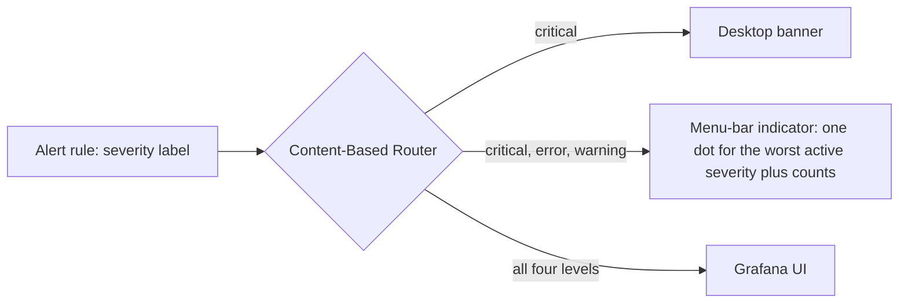
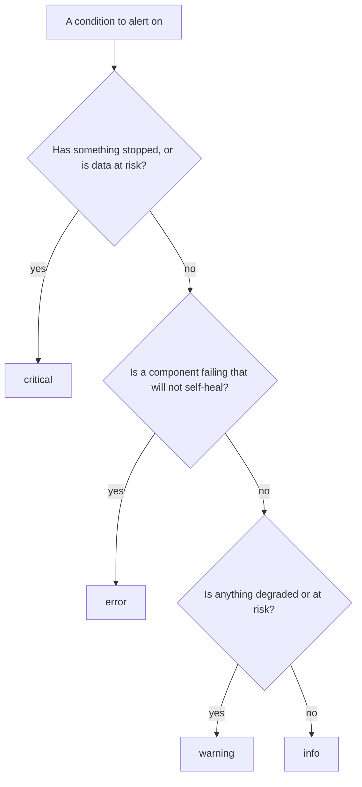
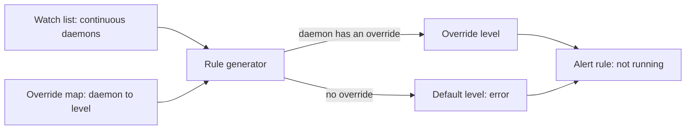

# Alert severity standard

This page is the convention page for the `severity` label on Grafana alert rules in the workspace
repos. It defines the closed set of levels, what each level means and when it is appropriate, the
delivery each level implies, and the default and per-daemon override for daemon "not running"
alerts. The decision is recorded in [ADR 0035](adr/0035-grafana-alert-severity-standard.md).

Contents: [Scope](#scope), [Levels](#levels), [Delivery](#delivery),
[Choosing a level](#choosing-a-level), [Rule requirements](#rule-requirements),
[Daemon alerts](#daemon-alerts), [Related](#related).

## Scope

This standard covers the `severity` label of Grafana alert rules, wherever a rule is defined (a
package's `grafana/alerting/` provisioning file, a module that renders rules, a generated
per-resource rule). Every tool or app that defines a Grafana alert rule MUST follow it.

It does NOT cover any other severity vocabulary. In particular, the attention severities of the
desk tool (`low`, `medium`, `high`, `critical`) are a separate system with their own meaning and
MUST NOT be written into a Grafana alert rule's `severity` label. A tool that lifts firing Grafana
alerts into another system MAY map the four levels below onto that system's own scale, and that
mapping belongs to the receiving tool, not to this standard.

## Levels

The set of levels is closed. A Grafana alert rule's `severity` label MUST be exactly one of these
four lower-case values.

| Level      | Meaning                                                                         | Appropriate when                                                                                       | Not appropriate when                                                      |
| ---------- | ------------------------------------------------------------------------------- | ------------------------------------------------------------------------------------------------------ | ------------------------------------------------------------------------- |
| `critical` | Something has stopped, or data is at risk. The operator MUST act now.           | A service the rest of the workspace depends on is down, or data loss or corruption is under way.       | The condition can wait for the next working session, or it may self-heal. |
| `error`    | A component is failing and will not self-heal. Nothing else is down.            | One component needs a person (a broken credential, a failing integration), and the rest keeps working. | The component recovers on its own, or its failure stops other components. |
| `warning`  | Degraded or at risk. The condition may self-heal and needs no immediate action. | A resource trends toward a limit, a queue is slow, a transient fault may clear by itself.              | The condition is already a failure that will not clear without a person.  |
| `info`     | A fact worth recording. No action is implied.                                   | The rule documents an event or a state change for later review.                                        | Anyone is expected to do something about it.                              |

The levels are ordered `critical` > `error` > `warning` > `info`. "Worst active severity" in this
page means the highest level among the alerts currently firing.

## Delivery

Severity is the single routing key for delivery (the Content-Based Router pattern): a rule
declares what the condition IS, and the receivers decide what to do with it. A rule MUST NOT
encode a delivery choice in any other label. Every level is visible in the Grafana UI.

| Level      | Desktop banner | Menu-bar indicator | Grafana UI |
| ---------- | -------------- | ------------------ | ---------- |
| `critical` | MUST deliver   | MUST show          | MUST show  |
| `error`    | MUST NOT       | MUST show          | MUST show  |
| `warning`  | MUST NOT       | MUST show          | MUST show  |
| `info`     | MUST NOT       | MUST NOT           | MUST show  |

The desktop banner rule is unchanged from the amendment of 2026-10-08 to ADR 0040 of the
support-apps repo (see [Related](#related)): only `severity=critical` alerts reach the desktop as a
banner. The reason is volume. In one 24-hour window the notifier
logged 700 banners and 651 of them were warnings, and a banner that fires that often stops being
read. Because the menu-bar indicator shows `error` and `warning`, those levels stay visible without
a banner.

The menu-bar indicator shows one dot coloured for the worst active severity, together with a count
per level. An alert with no valid `severity` label MUST NOT produce a banner (see
[Rule requirements](#rule-requirements)).

## Choosing a level

Rules for the choice:

- A rule author MUST pick the level from the condition, not from how loud the alert should be. If a
  condition seems to deserve a banner, it MUST first meet the `critical` meaning.
- A rule author SHOULD choose the lower level when two levels fit, because `critical` costs the
  operator an interruption.
- `critical` SHOULD be reserved for conditions where waiting makes things worse. A rule that is
  `critical` only because it is important is mis-levelled.
- `error` is distinct from `warning` by the "will not self-heal" test: if a person has to do
  something for the condition to clear, it is `error` or higher.
- `error` is distinct from `critical` by blast radius: if the failing component takes other
  components down with it, it is `critical`.

## Rule requirements

- Every Grafana alert rule MUST carry exactly one `severity` label whose value is one of the four
  levels.
- A rule MUST NOT use another value (for example `high`, `low`, `medium`, `suggestion`, `page`) as
  its `severity` label.
- A rule MUST NOT omit the label. An alert without a valid level is a defect in the rule and MUST
  be fixed at the source.
- A consumer that receives an alert with a missing or unrecognized level MUST treat it as
  non-critical (no desktop banner) and SHOULD surface it as a defect rather than guess a level.
  This is a fail-safe default: an unknown value fails toward silence on the desktop, never toward a
  banner.
- A rule generator (a template that renders many rules) MUST take the level as data and MUST
  validate it against the closed set at evaluation time, so a typo fails the build instead of
  silently producing a rule that no receiver routes.

## Daemon alerts

A "not running" alert is generated per daemon from a watch list. It follows the Default plus
Per-Instance Override pattern: one default level for the whole class, and an override that sets a
different level for a named daemon.

- The "not running" alert for a continuous daemon MUST default to `error`. Continuous means the
  service manager keeps the daemon alive, so its absence is itself the failure.
- The generator MUST accept a per-daemon override that sets the level for one daemon. A daemon
  with no override MUST get the default.
- An override value MUST be one of the four levels, and the generator MUST reject any other value.
- The override MUST be declared as data next to the watch list (a mapping from daemon identity to
  level), so a reviewer sees every non-default daemon in one place and changing a level does not
  need a change to the rule template.
- An override to `critical` SHOULD be reserved for a daemon whose absence stops the rest of the
  workspace or puts data at risk. Each override SHOULD carry a one-line reason.
- A daemon that already has its own purpose-written liveness rule at the right level SHOULD NOT also
  be overridden, so one outage does not produce two banners.
- This default covers continuous daemons only. A periodic or interval job is not a continuous
  daemon, and its alert level MUST be chosen by the [Choosing a level](#choosing-a-level) rules.

The initial set of overrides, and the reason for the default, are recorded in
[ADR 0035](adr/0035-grafana-alert-severity-standard.md).

## Related

- [ADR 0035](adr/0035-grafana-alert-severity-standard.md): the decision to adopt this standard.
- See also: phillipgreenii-nix-support-apps `docs/adr/0040-host-metrics-and-local-alert-notifier.md`
  (amendment 2026-10-08, desktop delivery is critical-only).
