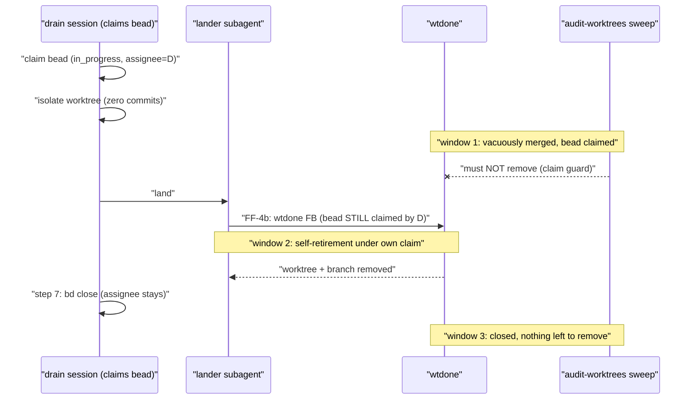

# Design note: should `wtdone` grow a `--require-unclaimed` flag?

> Status: **RECOMMENDATION (bead `pg2-des38`, 2026-10-14); not yet ruled on by the operator.**
> Written as the ordering analysis that bead part 2 required before any change to `wtdone`.
> `wtdone` itself (`packages/wtdone` in `phillipgreenii-nix-agent-support`) is unchanged.

## 1. Question

`pg2-gdzr8` added a drain-claim guard to the `audit-worktrees` skill so a merged-looking
`drain/<bead-id>` worktree whose bead is claimed is not removed. That guard is prose: an action
subagent that skips it still removes a live worktree, because `wtdone` only looks at processes
anchored by `lsof`, and a drain-pool session's cwd is the workspace root, not the worktree.

Should `wtdone` get a bd-aware, opt-in `--require-unclaimed` flag as defence in depth?

## 2. Facts the analysis rests on

Each is read from the current sources, not assumed.

- **Every drain retirement runs `wtdone` while the bead is still claimed.** `drain-one` step 6
  lands through a lander subagent; `ff-merge-to-main` FF-4b then runs `cd "$CC"; wtdone "$FB" --cc
"$CC"` right after FF-2b's merge. Only afterwards, in step 7 (FINISH), does the orchestrator run
  `bd close`. For a coordinated set, `cleanup-workforest` (which tears members down through
  `wtdone` via `pnwf cleanup`) is likewise ordered BEFORE `bd close`. So at the moment of
  retirement the bead is `in_progress`, with the draining session's own actor as assignee and a
  live lease.
- **`wtdone` has no bead awareness.** It takes a branch name, resolves the worktree, runs the
  `lsof` allow-list guard, and removes. It has no `bd` dependency and no notion of an actor.
- **`bd close` leaves the closer's `assignee` on the row** (observed: `pg2-gdzr8` is `closed` with a
  non-empty `assignee`). A claim check therefore has to key on `status != closed`, not on assignee
  alone. (This was a latent defect in the `audit-worktrees` 3a guard text and is fixed in the same
  change as this note.)
- **The branch-to-bead mapping is a convention** (`drain/<bead-id>`), not data `wtdone` holds.
- **Claim state is shared and mutable**, so any check-then-remove sequence has a time-of-check to
  time-of-use window.

## 3. Ordering analysis

- **Window 1 (isolated, not yet worked).** The hazard `pg2-gdzr8` fixed. A claim check blocks it
  whether it lives in the skill or in `wtdone`.
- **Window 2 (own retirement under own claim).** The decisive constraint. A `wtdone
--require-unclaimed` that refuses a claimed bead would refuse every drain retirement, because
  the retirement is ordered before the close by design. The flag can therefore never be on by
  default, and it can never be passed on the FF-4b or `cleanup-workforest` routes unless it also
  exempts the caller's own claim.
- **Window 3 (closed).** Nothing to guard; a later sweep removes any leftover (for example after a
  refused FF-4b) once the bead is `closed`.
- **Concurrent sweep during window 2.** The sweep sees `in_progress` and skips. That is correct:
  the drain session is about to retire the worktree itself, and if its retirement is refused the
  sweep removes the leftover after the bead closes.

Reordering drain-one (close the bead, then retire) is NOT a way out: a refused retirement (an
anchored process, a dirty tree) would then leave a closed bead beside a live worktree, which is
exactly the state a sweep reads as removable. `drain-one` step 7 deliberately sequences cleanup
and then `bd close`, and this note does not propose changing that order.

## 4. Options

| option                                                           | what it buys                                              | cost                                                                                                                                                                                      |
| ---------------------------------------------------------------- | --------------------------------------------------------- | ----------------------------------------------------------------------------------------------------------------------------------------------------------------------------------------- |
| A. Status quo: prose guard in `audit-worktrees`, pinned          | zero new coupling; every skill route is audited (Step 3d) | enforcement is by instruction following; a subagent that ignores it is not stopped                                                                                                        |
| B. Opt-in `wtdone --require-unclaimed`, passed only by the sweep | mechanical refusal on the sweep's own `wtdone` calls      | `wtdone` gains a `bd` dependency, a branch-to-bead token rule, and a bd-outage failure mode; does NOT cover the `integrate-branch` and `cleanup-workforest` routes; TOCTOU window remains |
| C. `--require-unclaimed-except <actor>` plumbed to FF-4b         | would also cover drain retirement                         | the actor id must be threaded drain-one, lander brief, `integrate-branch`, `ff-merge-to-main`, `pnwf cleanup`, `wtdone` across two repos; any gap makes self-retirement fail              |

## 5. Recommendation

**Do not add the flag now (option A).** The policy, in RFC 2119 terms:

- `wtdone` MUST NOT refuse a branch merely because its bead is claimed, and MUST remain bead-free
  by default: drain retirement (window 2) runs it under the retiring session's own claim.
- The `audit-worktrees` skill MUST remain the sole owner of the claim check, and MUST keep every
  `wtdone` route listed in its Step 3d with a guard or a reason; the
  `audit-worktrees-drain-claim-guard` flake check pins that wording.
- A future `wtdone --require-unclaimed` MAY be added ONLY as an opt-in flag (default off, never
  implied by environment), and a caller that is itself the claim holder (drain-one, its lander,
  `cleanup-workforest`) MUST NOT pass it.

Why not B now: it protects only the sweep's direct `wtdone` calls, which are the routes with the
smallest blast radius (3a merged, 3c abandoned, 3c stopped), while the routes that can also reach
a live worktree (`integrate-branch` FF-4, `cleanup-workforest`) stay outside it. It adds a bd
dependency to a deliberately dependency-light tool and a new fail-closed mode (bd unreachable
blocks removal), for a TOCTOU-limited gain. Why not C: cross-repo plumbing through five layers
with a silent-failure mode (a missed layer breaks self-retirement) is not proportionate to a
hazard the pinned guard already closes.

**Revisit when** either (1) an incident shows an action subagent bypassed the guard and removed a
live drain worktree, or (2) a second caller outside `audit-worktrees` starts dispatching `wtdone`
from a non-owning context. In either case file one bead in `phillipgreenii-nix-agent-support`
(label `agent-support`) for option B, scoped to a sweep-only opt-in. No follow-up bead is
warranted today.
