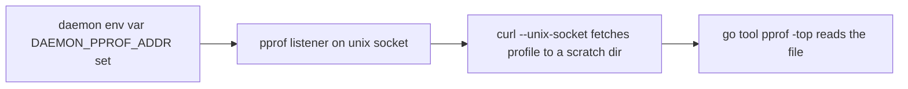

# Go daemon profiling runbook

This page is the runbook for capturing CPU, heap and goroutine profiles from a Go daemon that
exposes the opt-in pprof endpoint, reading the result with `go tool pprof -top`, and keeping
captured profiles out of version control. It is the authoritative home of the `curl --unix-socket`
recipe and of the SIGQUIT warning; other docs link to it rather than duplicate it.

Contents: [Overview](#overview), [Enabling the endpoint](#enabling-the-endpoint),
[Capture a CPU profile with curl over a unix socket](#capture-a-cpu-profile-with-curl-over-a-unix-socket),
[Capture heap and goroutine profiles](#capture-heap-and-goroutine-profiles),
[Reading `go tool pprof -top` output](#reading-go-tool-pprof--top-output),
[Do not use SIGQUIT for a goroutine dump](#do-not-use-sigquit-for-a-goroutine-dump),
[Do not commit profiles](#do-not-commit-profiles).

## Overview

A daemon that follows the standard opens a profiling listener only when asked. The listener serves
only the `net/http/pprof` routes under `/debug/pprof/`, on its own mux, and is reachable over a
unix socket (or a loopback `host:port`). Profiling is a three-step loop: confirm the endpoint is on,
fetch a profile with `curl`, and read it with `go tool pprof`.



## Enabling the endpoint

- The listener is OFF unless the daemon's `<DAEMON>_PPROF_ADDR` environment variable is set (for
  example `PA_MONITOR_PPROF_ADDR`). With the variable unset, the daemon opens nothing.
- The value MUST be an absolute unix-socket path or a loopback `host:port` (`127.0.0.1`,
  `localhost`, `::1`). Wildcard, remote and relative values are refused with one stderr line, and
  the daemon keeps running without a listener.
- A Home-Manager or darwin module that exposes `pprof.enable` (default `true`) sets the variable to
  `$XDG_STATE_HOME/<daemon>/pprof.sock`. That path is the `SOCK` used in the recipes below. The
  socket is created mode 0600, so only the owning user can reach it.
- A loopback `host:port` value is also valid. In that case `curl` takes a normal URL
  (`http://127.0.0.1:PORT/debug/pprof/...`) and no `--unix-socket` flag.

## Capture a CPU profile with curl over a unix socket

`go tool pprof` cannot dial a unix socket (verified 2026-10-12: an `http+unix://` source fails with
`lookup http+unix: no such host`). That is why `curl` fetches the profile to a file first, and
`go tool pprof` then reads the file.

```bash
curl --unix-socket SOCK 'http://pprof/debug/pprof/profile?seconds=30' -o cpu.pb.gz
go tool pprof -top cpu.pb.gz
```

`SOCK` is the socket path from [Enabling the endpoint](#enabling-the-endpoint), normally
`$XDG_STATE_HOME/<daemon>/pprof.sock`. The host name `pprof` in the URL is a placeholder; with
`--unix-socket`, `curl` ignores it and connects to the socket.

The request blocks for about `N` seconds, where `N` is the `seconds` value: `/debug/pprof/profile?seconds=N`
holds the response open while the CPU is sampled, and the server deliberately sets no write timeout.
Do not give `curl` a client timeout (`--max-time`) shorter than `N`, or the capture is cut off and
you get no profile. Run the daemon under the load you want to see for the whole `N` seconds.

## Capture heap and goroutine profiles

Both use the same curl-over-unix-socket form, with the standard `net/http/pprof` routes. Neither
holds the connection open, so they return at once.

```bash
# Heap: live allocations as of the last garbage collection
curl --unix-socket SOCK 'http://pprof/debug/pprof/heap' -o heap.pb.gz
go tool pprof -top heap.pb.gz

# Goroutines: a snapshot of every goroutine, grouped by stack
curl --unix-socket SOCK 'http://pprof/debug/pprof/goroutine' -o goroutine.pb.gz
go tool pprof -top goroutine.pb.gz
```

For a human-readable goroutine dump with full stacks, use the text form instead of the profile
form, and read it directly:

```bash
curl --unix-socket SOCK 'http://pprof/debug/pprof/goroutine?debug=2'
```

This is the safe way to get a goroutine dump. See
[Do not use SIGQUIT for a goroutine dump](#do-not-use-sigquit-for-a-goroutine-dump).

## Reading `go tool pprof -top` output

`go tool pprof -top FILE` prints the heaviest functions first. The header reports the sample
duration and total, and each row has these columns:

| Column | Meaning                                               |
| ------ | ----------------------------------------------------- |
| flat   | Cost in the function itself, excluding what it calls. |
| flat%  | `flat` as a share of the profile total.               |
| sum%   | Running total of `flat%` down the list.               |
| cum    | Cost in the function plus everything it calls.        |
| cum%   | `cum` as a share of the profile total.                |

How to read it:

- CPU profile: a large `flat` marks the function actually burning CPU. A large `cum` with a small
  `flat` marks a caller whose callees are expensive; follow it down. A mostly idle daemon shows a
  total far below the sample window, which is normal.
- Heap profile: the default sample is `inuse_space` (live bytes). Use
  `go tool pprof -sample_index=alloc_space -top heap.pb.gz` to see total allocation instead of what
  is live, which finds churn rather than leaks.
- Goroutine profile: each row counts goroutines parked in that function. A count that grows
  between two captures taken minutes apart is a leak suspect.

Use `-top -cum` to sort by cumulative cost, and `-nodecount=N` to widen the list.

## Do not use SIGQUIT for a goroutine dump

MUST NOT send SIGQUIT to a daemon to get a goroutine dump. Most of these daemons trap only
SIGTERM and SIGINT, so SIGQUIT is not handled: the Go runtime prints the goroutine dump and then
exits, which kills the daemon. Use the `goroutine?debug=2` capture in
[Capture heap and goroutine profiles](#capture-heap-and-goroutine-profiles) instead; it returns the
same information and leaves the daemon running.

## Do not commit profiles

A captured `.pb.gz` embeds binary and path information (build paths, symbol names and the host's
file layout). A captured profile MUST NOT be committed to any repository.

- Write captures to a scratch directory outside the working tree (for example a `mktemp -d`
  directory), not into a repo checkout.
- Run `go tool pprof` against that scratch copy, and delete it when you are done.
- If a profile must be shared, attach it to the ticket or bead out of band; do not add it to git.
