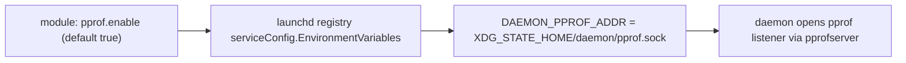

# Go daemons

This page is the convention page for Go daemons in the workspace repos: services that run under
launchd and expose the opt-in pprof endpoint. It owns the two Home-Manager/darwin module
requirements below. The capture recipe, how to read a profile, and the warning about goroutine dumps
live in the [Go daemon profiling runbook](go-daemon-profiling-runbook.md); this page links there
instead of repeating them.

Contents: [Overview](#overview), [Shared package](#shared-package),
[Daemon requirements](#daemon-requirements), [Module requirements](#module-requirements),
[Profiling a running daemon](#profiling-a-running-daemon), [Related](#related).

## Overview

A daemon opens a profiling listener only when its `<DAEMON>_PPROF_ADDR` environment variable is set.
The module that deploys the daemon sets that variable by default, so profiling is available on a
deployed daemon without a rebuild.

## Shared package

A Go daemon MUST use `github.com/phillipgreenii/x/pprofserver` to open the endpoint, rather than
wiring `net/http/pprof` itself. The package implements the daemon requirements below.

## Daemon requirements

The decision is recorded in
[ADR 0034](adr/0034-opt-in-pprof-endpoint-for-go-daemons.md). In summary, a daemon:

- MUST open no listener unless `<DAEMON>_PPROF_ADDR` is set.
- MUST accept only an absolute unix-socket path or a loopback `host:port`, and MUST refuse anything
  else with one stderr line while it keeps running.
- MUST create the socket mode 0600, replace a stale socket, and never remove a regular file.
- MUST serve the pprof routes on its own mux with no write timeout.

## Module requirements

Every Home-Manager (or darwin) module that deploys a Go daemon:

- MUST expose `pprof.enable`, and its default MUST be `true`.
- MUST set the daemon's `<DAEMON>_PPROF_ADDR` environment variable to
  `$XDG_STATE_HOME/<daemon>/pprof.sock` through the launchd registry's
  `serviceConfig.EnvironmentVariables`.
- SHOULD set the variable only while `pprof.enable` is `true`.

## Profiling a running daemon

For the capture recipe, reading the output, and the warning about goroutine dumps, follow the
[Go daemon profiling runbook](go-daemon-profiling-runbook.md), in particular its sections
"Capture a CPU profile with curl over a unix socket" and "Do not use SIGQUIT for a goroutine dump".

## Related

- [ADR 0034](adr/0034-opt-in-pprof-endpoint-for-go-daemons.md): the decision to adopt the standard.
- [Go daemon profiling runbook](go-daemon-profiling-runbook.md): capture and reading profiles.
