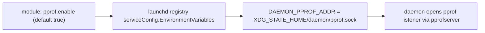
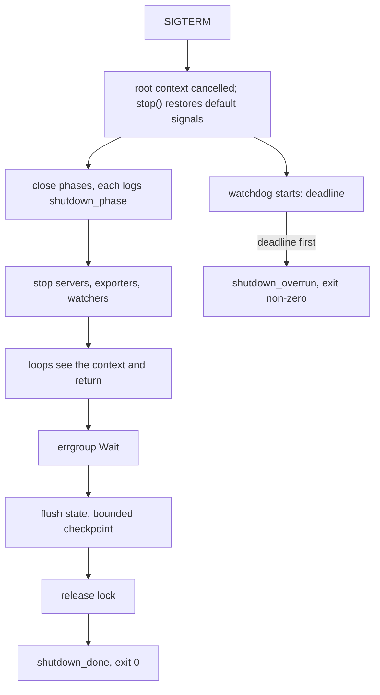

# Go daemons

This page is the convention page for Go daemons in the workspace repos: services that run under
launchd. It sets two kinds of requirements: the opt-in pprof endpoint, and bounded, crash-safe
shutdown. It owns the Home-Manager/darwin module requirements below. The capture recipe, how to read
a profile, and the warning about goroutine dumps live in the
[Go daemon profiling runbook](go-daemon-profiling-runbook.md); this page links there instead of
repeating them.

Contents: [Overview](#overview), [Shared package](#shared-package),
[Daemon requirements](#daemon-requirements), [Shutdown requirements](#shutdown-requirements),
[Module requirements](#module-requirements),
[Profiling a running daemon](#profiling-a-running-daemon), [Related](#related).

## Overview

A Go daemon under launchd has two conventions. First, it opens a profiling listener only when its
`<DAEMON>_PPROF_ADDR` environment variable is set; the module that deploys the daemon sets that
variable by default, so profiling is available on a deployed daemon without a rebuild. Second, it
stops within a bounded time when launchd sends SIGTERM, so a restart during `pn workspace apply`
never leaves the old instance holding a lock the new instance needs.

## Shared package

A Go daemon MUST use `github.com/phillipgreenii/x/pprofserver` to open the endpoint, rather than
wiring `net/http/pprof` itself. The package implements the daemon requirements below.

## Daemon requirements

The decision is recorded in
[ADR 0034](adr/0034-opt-in-pprof-endpoint-for-go-daemons.md). In summary, a daemon:

- MUST open no listener unless `<DAEMON>_PPROF_ADDR` is set.
- MUST accept only an absolute unix-socket path or a loopback `host:port`, and MUST refuse anything
  else with one stderr line while it keeps running.
- MUST create the socket mode 0600, replace a stale socket, and never remove a regular file.
- MUST serve the pprof routes on its own mux with no write timeout.

## Shutdown requirements

A daemon that is stopped while it is busy (a long sweep, a child process, a database call) can
outlive launchd's `ExitTimeOut`; launchd then SIGKILLs the job while a detached process still holds
its lock, and the replacement instance crash-loops. A Go daemon:

- **S1** MUST hold one root context, cancelled on SIGTERM, and hand it to every goroutine, loop,
  child process and server through one named helper built on `errgroup`. No component MAY start a
  goroutine that the root context cannot stop.
- **S2** MUST check the context inside every loop at natural boundaries (between files, between
  batches, between retries), MUST make every wait cancellable, and MUST leave consistent state when
  it stops early.
- **S3** MUST start child processes with `exec.CommandContext` and a `WaitDelay`.
- **S4** MUST release its lock last. Between "stop" and "lock released" it MAY run only a bounded
  checkpoint, such as a flush with a timeout.
- **S5** MUST bound shutdown with a deadline. When the deadline passes, it MUST log what was in
  flight and exit non-zero. The deadline plus 7 s MUST NOT exceed launchd's 60 s `ExitTimeOut` cap.
- **S6** MUST make the hard exit of S5 crash-safe: the next start MUST recover without losing user
  data, and the exit MUST NOT fall inside an operation that cannot be recovered (finish or skip a
  candidate between steps, never abort inside one).
- **S7** MUST log `shutdown_started`, one `shutdown_phase` per step with its duration,
  `shutdown_done` on a clean stop, and `shutdown_overrun` (naming the phase and the in-flight work)
  on a deadline exit.
- **S8** SHOULD test shutdown with `testing/synctest` or short real timeouts, and SHOULD check for
  leaked goroutines with `goleak`. A test of a cancellable wait MUST fail when its fix is reverted.

A stateless exporter that holds no lock and exits on default SIGTERM within the bound conforms; it
needs no root context or phase logging.

### Recommended tooling

| Need                    | Use                                                                                     |
| ----------------------- | --------------------------------------------------------------------------------------- |
| Signal to cancellation  | `signal.NotifyContext`, one per process                                                 |
| Second signal kills     | `context.AfterFunc(ctx, stop)` so a second SIGTERM gets default handling                |
| Goroutine lifecycle     | `golang.org/x/sync/errgroup`                                                            |
| Deadline watchdog       | `context.AfterFunc` plus `time.AfterFunc` plus `os.Exit`                                |
| Child process           | `exec.CommandContext` with `cmd.WaitDelay`                                              |
| Database calls          | the `*Context` methods (`QueryContext`, `ExecContext`, ...)                             |
| Leak checks in tests    | `go.uber.org/goleak`                                                                    |
| Dropped contexts (lint) | `golangci-lint` `contextcheck`                                                          |
| Test time               | `testing/synctest` for a bare seam on a real clock, or a real clock with short timeouts |

### Shutdown flow

## Module requirements

Every Home-Manager (or darwin) module that deploys a Go daemon:

- MUST expose `pprof.enable`, and its default MUST be `true`.
- MUST set the daemon's `<DAEMON>_PPROF_ADDR` environment variable to
  `$XDG_STATE_HOME/<daemon>/pprof.sock` through the launchd registry's
  `serviceConfig.EnvironmentVariables`.
- SHOULD set the variable only while `pprof.enable` is `true`.
- MUST set `serviceConfig.ExitTimeOut` greater than the daemon's shutdown deadline and no more than
  60 s. launchd silently clamps a larger value to 60 s (measured on macOS 26 / Darwin 25.6.0), so a
  larger value does not buy more time. The pg-router launchd module in `nix-agent-support` is the
  precedent.
- MUST, when a wrapper script backgrounds the daemon, forward TERM to it and wait for it, so launchd's
  signal reaches the daemon and the job stays alive until the daemon exits.

## Profiling a running daemon

For the capture recipe, reading the output, and the warning about goroutine dumps, follow the
[Go daemon profiling runbook](go-daemon-profiling-runbook.md), in particular its sections
"Capture a CPU profile with curl over a unix socket" and "Do not use SIGQUIT for a goroutine dump".

## Related

- [ADR 0034](adr/0034-opt-in-pprof-endpoint-for-go-daemons.md): the decision to adopt the standard.
- [Go daemon profiling runbook](go-daemon-profiling-runbook.md): capture and reading profiles.
