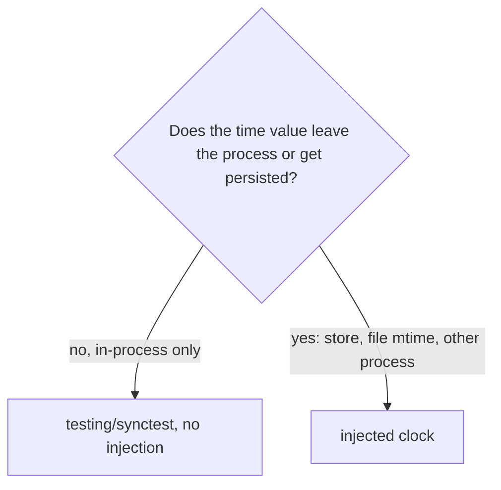

# Go convention for time in tests

Applies to every Go module in this workspace (Go 1.25 or newer; `testing/synctest` is stable since 1.25).

## Rule

- Tests of in-process, time-dependent concurrent code (timers, tickers, `time.Sleep`, timeouts,
  debounce, retry backoff, `context.WithTimeout`) MUST use `testing/synctest` and MUST NOT wait on the
  wall clock. No clock is injected for this case.
- Production code MUST take an injected clock (an interface, or a `func() time.Time`) only where time
  is persisted or crosses a process boundary: a timestamp written to or read back from a store, a file
  mtime, a deadline handed to another process. A `synctest` bubble cannot fake those, because the fake
  clock exists only inside the bubble.
- A clock type shared across apps SHOULD move into the shared `x` module only when a second app needs
  the one that currently lives in an app's `internal/clock`. Until then, keep it local.
- A test MUST NOT add a real `time.Sleep` to wait for a goroutine; use `synctest.Wait` instead.

Rationale (operator ruling, Phillip, 2026-11-11): an injected clock is the operator's preferred style,
"However, i defer to what the go best practices are." Inside a bubble, `time.Now`, timers and
`time.Sleep` use a fake clock that advances when every goroutine in the bubble is blocked.



## Case 1: in-process timing, use synctest

```go
func TestDebounceFiresOnce(t *testing.T) {
	synctest.Test(t, func(t *testing.T) {
		var calls atomic.Int32
		d := NewDebouncer(50*time.Millisecond, func() { calls.Add(1) })
		d.Trigger()
		d.Trigger()
		time.Sleep(50 * time.Millisecond) // fake clock: returns instantly
		synctest.Wait()
		if got := calls.Load(); got != 1 {
			t.Fatalf("calls = %d, want 1", got)
		}
	})
}
```

## Case 2: persisted or cross-process time, inject a clock

```go
// Recorder stamps rows that are read back later, possibly by another process.
type Recorder struct {
	now func() time.Time // production: time.Now
	db  Store
}

func (r *Recorder) Record(ctx context.Context, ev Event) error {
	return r.db.Insert(ctx, ev, r.now().UTC())
}

func TestRecordStampsRow(t *testing.T) {
	fixed := time.Date(2026, 11, 11, 12, 0, 0, 0, time.UTC)
	db := newFakeStore()
	r := &Recorder{now: func() time.Time { return fixed }, db: db}
	if err := r.Record(t.Context(), Event{}); err != nil {
		t.Fatal(err)
	}
	if got := db.rows[0].At; !got.Equal(fixed) {
		t.Fatalf("At = %v, want %v", got, fixed)
	}
}
```

## Related

- [Go daemons](go-daemons.md): the daemon standard these tests support.
- The Unit Tests section of `code-file-standards.md` (in `nix-agent-support`) is the place that links
  to this page.
