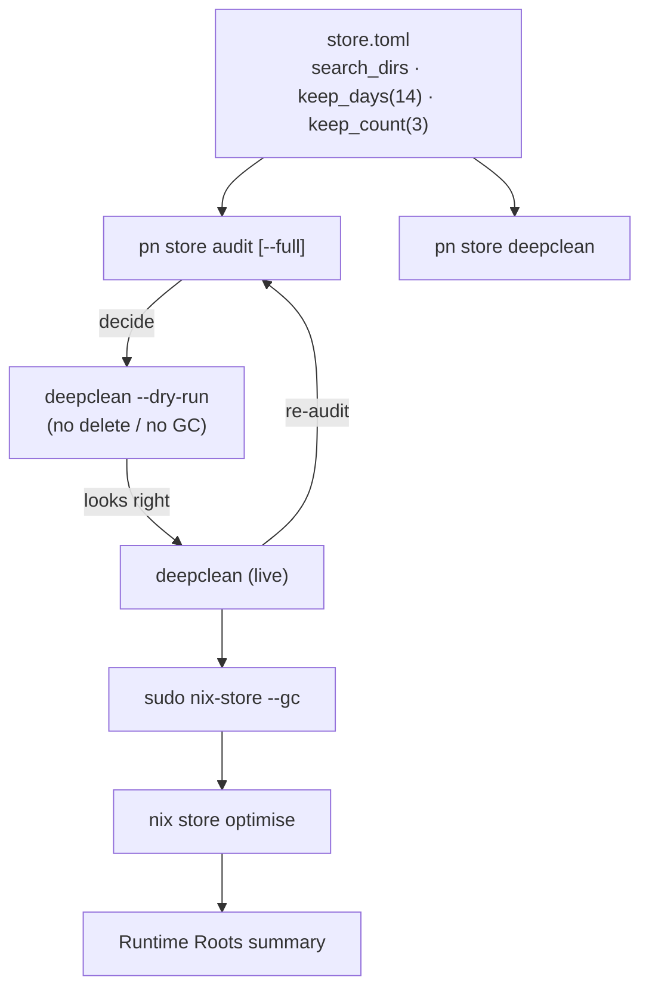
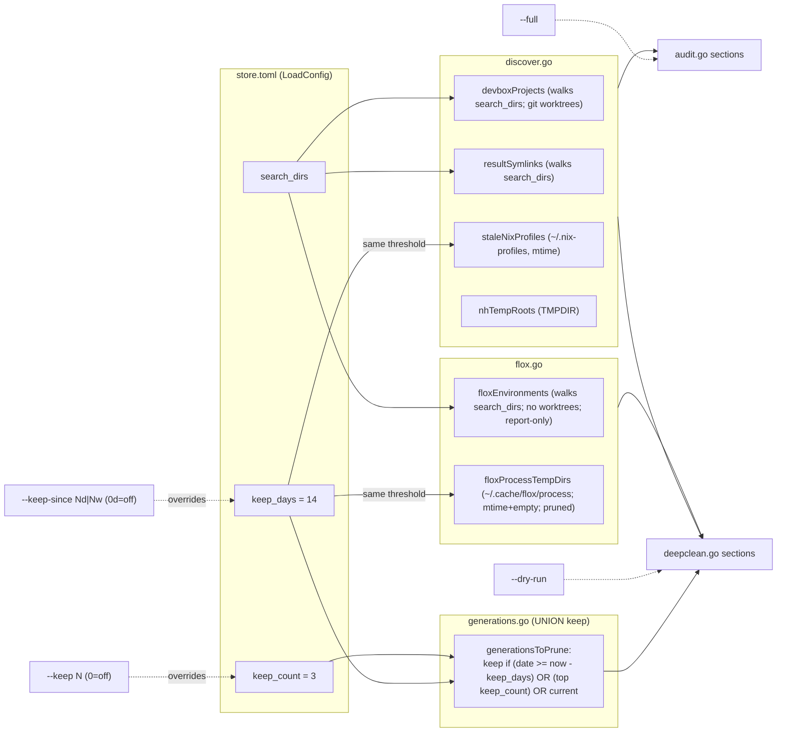

# pn store — Nix store maintenance

`pn store` audits and reclaims space in the local Nix store. It has two commands:

- `pn store audit` — read-only report of profile generations, closure sizes, and store volume usage.
- `pn store deepclean` — prunes old generations and stale GC roots, garbage-collects, then, only with `--optimise`, optimises (hard-links duplicate files in) the store.

> Versioning and `--help` are owned by cobra: use `pn --version` and `pn store <cmd> --help`.
> There are no per-subcommand version flags.

## Configuration — `~/.config/pn/store.toml`

| Key                    | Type         | Default | Meaning                                                                                                                                      |
| ---------------------- | ------------ | ------- | -------------------------------------------------------------------------------------------------------------------------------------------- |
| `search_dirs`          | `[string]`   | `[]`    | Roots scanned for devbox project profiles and `result` symlinks. Use absolute paths.                                                         |
| `keep_days`            | `int`        | `14`    | Time-based retention: generations newer than this are protected from pruning.                                                                |
| `keep_count`           | `int`        | `3`     | Count-based retention: the N most recent generations are protected from pruning.                                                             |
| `optimise_min_free_gb` | `int`        | `10`    | Free GiB `/nix` must have before `deepclean --optimise` starts its optimise step (`deepclean` only).                                         |
| `post_gc_clear_dirs`   | `[string]`   | `[]`    | Directories removed (`rm -rf`) right after the GC (`deepclean` only). `~/` expands to `$HOME`; otherwise absolute. A missing dir is skipped. |
| `post_gc_commands`     | `[[string]]` | `[]`    | Argv-form commands run, in order, after the GC and after `post_gc_clear_dirs`.                                                               |

A missing file or missing key falls back to the defaults above. Example:

```toml
search_dirs = ["/Users/me/projects"]
keep_days = 7
keep_count = 5
```

### Post-GC hook (`post_gc_clear_dirs`, `post_gc_commands`)

Some caches hold executables that link to `/nix/store` paths; `nix-store --gc` can delete those
paths and leave the cached binaries dangling. `pn` stays generic: the repo that owns such a cache
lists it in its home config (`phillipgreenii.pn.store.postGcClearDirs` / `postGcCommands` in the
home-manager module, rendered into `store.toml`), and `pn` knows no tool-specific paths.

```toml
post_gc_clear_dirs = ["~/.cache/some-binary-cache"]
post_gc_commands = [["some-tool", "--clear"]]
```

Semantics (`pn store deepclean`, live runs only):

- Runs immediately after `sudo nix-store --gc`, before `nix store optimise`, and also when the GC
  itself fails (a GC that died midway may already have deleted linked paths).
- Every entry is attempted. A failing entry is reported on stderr, does not stop the others (or the
  optimise step), and makes `deepclean` exit non-zero. A missing directory is not a failure.
- `$HOME` itself, `/`, and relative paths are refused.
- `--dry-run` only lists what would run (`Would run after GC:`). With neither key set nothing is
  printed.

The `keep_days` value is reused as the mtime threshold for stale `~/.nix-profiles/` entries
and for orphaned Flox activation temp dirs (`Flox Temp Dirs`, deepclean only).

## Retention semantics — UNION keep

A generation is **kept** if it satisfies **any** of:

1. It is the `(current)` generation (always kept).
2. Count protection: it is among the most recent `keep_count` generations (`keep_count = 0` disables this).
3. Time protection: its date is on or after `now - keep_days` days (`keep_days = 0` disables this).

Everything else is pruned. Because the rule is a **union**, raising either bound keeps more;
to prune aggressively you MUST lower **both** (`--keep-since 0d --keep 1`).

## `pn store audit`

```
pn store audit [--full]
```

Emits these sections, in order:

1. `System Profiles` — generations + closure size for `/nix/var/nix/profiles/system` (uses sudo to list).
2. `Home Manager` — the HM profile, or `(not installed)`.
3. `User Profiles` — each profile under `~/.local/state/nix/profiles/` (excluding `home-manager` and generation links).
4. `Devbox Global` — the devbox global profile, or `(not installed)`.
5. `Devbox Projects` — devbox profiles discovered under `search_dirs` (follows git worktrees), or `(no search dirs configured)`.
6. `Nix Store` — `Volume used: <size>` (the `/nix/store` APFS volume's own used bytes; macOS-only via `df`+`diskutil`).

`--full` adds `Reclaimable (dead paths): <size>` to the `Nix Store` section. This estimate runs
`sudo nix-store --gc --print-dead` and is slow.

> Audit has no `Devbox Util` section — that profile is only handled by `deepclean`.

## `pn store deepclean`

```
pn store deepclean [--dry-run] [--keep-since <Nd|Nw>] [--keep <N>] [--optimise [--force]]
```

| Flag                    | Default             | Meaning                                                                                |
| ----------------------- | ------------------- | -------------------------------------------------------------------------------------- |
| `--dry-run`             | off                 | Show what would be cleaned; perform no deletes and no GC.                              |
| `--keep-since <Nd\|Nw>` | config `keep_days`  | Time retention. `<N>d` days or `<N>w` weeks (×7). `0d` disables time protection.       |
| `--keep <N>`            | config `keep_count` | Count retention. `0` disables count protection. The current generation is always kept. |
| `--optimise`            | off                 | After the GC, run `nix store optimise` (idle-gated, niced; see below).                 |
| `--force`               | off                 | With `--optimise`: skip the idle gate. The free-space check still applies.             |

It processes these sections, in order, pruning per the retention rule above:

1. `System Profiles` (sudo)
2. `Home Manager` — if an orphaned standalone HM profile is detected (the standalone profile coexists
   with a darwin-integrated `current-home`), it removes the profile symlink + generation links; otherwise prunes generations.
3. `User Profiles`
4. `Devbox Global`
5. `Devbox Util`
6. `Devbox Projects` (from `search_dirs`)
7. `Flox` — **report-only, prunes nothing.** Shows the combined disk usage of Flox's global data
   dirs (`~/.local/share/flox` + `~/.cache/flox`) and, per `.flox` environment found directly under
   `search_dirs` (no git-worktree following — see below), its own disk usage. Flox has no local
   generation history analogous to the others: `flox generations` operates only on environments
   pushed to FloxHub (verified live, flox 1.17.0 — a local-only environment errors with
   "Generations are only available for environments pushed to floxhub"), and each local
   environment already keeps exactly one GC-rooted build per name via a
   `.flox/run/<system>.<name>` indirect root, which `/nix/var/nix/gcroots/auto/` already protects
   correctly. (The earlier idea of also symlinking `~/.local/share/flox/environments/` into
   `/nix/var/nix/gcroots/flox-environments` was investigated and rejected: it targets a path that
   doesn't exist on this machine and Flox already self-registers its own GC roots — see bead
   `pg2-8k05k`.)
8. `Flox Temp Dirs` — orphaned `.tmpXXXXXX` activation staging directories under
   `~/.cache/flox/process/`, pruned once confirmed **both** recursively empty and older
   than `keep_days` (a directory that still has real content, or is too young, is never
   touched — see `flox.go` for how this staging path leaks and why that heuristic is
   safe). Separate from the report-only `Flox` section above.
9. `Result Symlinks` — `result` / `result-*` symlinks pointing into `/nix/store` under `search_dirs`.
10. `Stale Nix Profiles` — symlinks under `~/.nix-profiles/` older than `keep_days`.
11. `NH Temp Roots` — `nh-darwin*/result` symlinks under `$TMPDIR`.

Then a `Summary`:

- **Dry run:** `DRY RUN — no changes made`, per-category `Would prune` counts, and a `Reclaimable estimate (dead paths)`.
- **Live:** `Store before:`, the live-streamed `sudo nix-store --gc` output, `Store after:`,
  per-category `Pruned generations:` counts, and a `Runtime Roots` summary (store paths held only
  by running processes — restarting apps and re-running may free more). With `--optimise`, the
  optimise step's output sits between the GC and `Store after:`.

### The optimise step (`--optimise`)

`nix store optimise` is not incremental: it walks every store path, reads and hashes every regular
file, and looks each up in `.links/<hash>`. On a 427 GB store with about 454,000 `.links` entries
it ran for over 3.5 hours under host load. It is therefore **off by default**; a plain
`pn store deepclean` does the GC only. With `--optimise` it runs after the GC (so it never
optimises paths about to be deleted), subject to these rules:

- **Idle gate** — skipped, with a message and exit status `75` (not a failure), unless the machine
  is on AC power (`pmset -g batt`) and the 1-minute load average (`sysctl -n vm.loadavg`) is below 4. A signal that cannot be read counts as not idle. `--force` skips this gate.
- **Free-space check** — refused, with a message and exit status `75`, when `/nix` has less than
  `optimise_min_free_gb` GiB free (default 10; a `store.toml` key). `--force` does not skip it: a
  full volume makes GC and optimise slow and risky.
- **Priority** — runs as `nice -n 10 taskpolicy -b nix store optimise` (`taskpolicy` on macOS
  only): background QoS suits a long batch job nobody waits on.
- **Progress** — prints the start time, elapsed time and `.links` entry count at the start and at
  the end, so a later run can estimate cost. It does not print a percentage: nix cannot report one.

A skipped optimise still lets the GC, post-GC cleanup and summary finish; only the exit status
(`75`) differs. A post-GC failure takes precedence (exit `1`).

`auto-optimise-store` stays `false` (optimising per fetch stalled `pn workspace update` on
"copying to the store"), and `nix.optimise.automatic` MUST NOT be used (it creates a raw launchd
entry that runs at a time pn cannot gate). To schedule the step, register a weekly job running
`pn store deepclean --yes --optimise` through the workspace launchd-services mechanism.

## User journeys

### Disk is full — diagnose, preview, reclaim, confirm

1. `pn store audit --full` — see `Volume used` and `Reclaimable (dead paths)`.
2. `pn store deepclean --dry-run` — preview prune counts; nothing is deleted.
3. `pn store deepclean` — prune + GC (watch GC stream live).
4. `pn store audit` — confirm `Volume used` dropped.

### Routine maintenance with custom retention

1. Set `keep_days` / `keep_count` in `store.toml`.
2. `pn store deepclean --dry-run` to confirm, then `pn store deepclean`.

### Aggressive one-off reclaim

`pn store deepclean --dry-run --keep-since 0d --keep 1`, then drop `--dry-run`.
Keeps only the most recent + current generation everywhere.

### First run / no config

Works with built-in defaults (`keep_days=14`, `keep_count=3`, no `search_dirs`).
`Devbox Projects` / `Result Symlinks` report empty until you add `search_dirs`. `Flox` reports
`(not installed)` until either Flox has been used on the machine (its global data dirs exist) or
`search_dirs` are added (so it has somewhere to look for a per-project `.flox`) — either way, it
never prunes anything.



## How the parts link together



## Implementation

The commands are implemented in Go under `modules/pn/internal/store/` (ported from the original
`pn-store-audit.sh` / `pn-store-deepclean.sh` / `pn-lib.bash`). See
[`docs/superpowers/plans/2026-06-26-pn-store-parity.md`](superpowers/plans/2026-06-26-pn-store-parity.md)
for the parity port and per-helper behavior spec.
