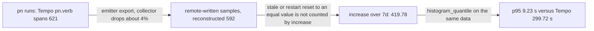

# pn / nix telemetry: Phase 8 observation findings

**Review date:** 2026-10-14 (chosen by the agent working `pg2-kqrrs.15`, which the bead text allows: "whoever works this after the window MAY pick the review date").
**Epic:** `pg2-kqrrs` (pn / nix build telemetry), Phase 8. Design: [ADR 0028](../adr/0028-pn-nix-telemetry.md), [ADR 0030](../adr/0030-pg-nix-log-wrapped.md).
**Verdict:** the data is useful and the span side (Tempo) is trustworthy, but the **Prometheus counter pipeline undercounts** and the Phase 6a pn panels inherit that error. Fix the pipeline before extending the dashboard (Phase 6b). Tailer lag is not material. Agents mostly use the wrapper, so the CETA hook is not added.

## Observation window and method

- Phase 7 (`pg2-kqrrs.14`) closed 2026-10-07T02:28:24Z. Seven days later is 2026-10-14T02:28:24Z, so the week has elapsed.
- Every comparison below uses ONE fixed window, `[2026-10-07T03:50:00Z, 2026-10-14T03:50:00Z]` = 7 d = 168 h. Its start is the earliest instant Prometheus can answer for: `storage.tsdb.retention.time` is `1w` (`/api/v1/status/flags`). The queries in this note return different numbers a few days from now.
- Tempo search is limited to a 168 h range (`start`/`end` > 168 h is rejected), so Tempo counts are taken in 12 h slices and de-duplicated by span id.
- "Tempo count" is the reference for how many runs happened. It is a lower bound (the wrapper can drop spans, see Q4), but it does not pass through the delta-to-cumulative conversion, so it isolates that conversion's error.
- "Reconstructed" means: take every raw remote-written sample of the counter (`pn_command_duration_count[8d]`), treat a sample that is not strictly greater than its predecessor as a reset (a run always adds at least 1 to a `_count`, so equal means reset), and sum the increments. It is the best estimate of what the collector actually emitted.
- Probes used only read-only `GET`s against `127.0.0.1` (Prometheus 9090, Tempo 3200, Loki 3100, Grafana 3000) and read-only local files. Nothing was restarted, paused or applied.

## Summary of answers

| Question                              | Answer                                                                                                                                                 |
| ------------------------------------- | ------------------------------------------------------------------------------------------------------------------------------------------------------ |
| Is the data useful?                   | Yes: slow builds, build-user waits and failures are all visible. The Prometheus pn/nix counters undercount (pn runs 67.6% of Tempo, nix errors 64.3%). |
| What is noise?                        | 44.2% of local builds by count last 1 s or less, but at most 4.0% of build time. 71.6% of pn runs are one probe verb, `workspace info`.                |
| Is tailer lag material?               | No. p99 78 ms, max 724 ms, 3 of 999 invocations (0.30%) above the 250 ms threshold.                                                                    |
| Do agents use the wrapper?            | Yes, mostly: 80.6% of in-scope agent commands wrapped from 2026-10-08. 74.9% of wrapper invocations are direct, not pn-driven.                         |
| Which panels are used?                | Not obtainable. The only signal (Grafana live-channel logs) shows no dashboard open since 2026-10-05.                                                  |
| Does `pn_command_duration` aggregate? | Not reliably. The cumulative series resets after about 5 min idle and on a collector restart, and an equal-value reset is invisible to `increase()`.   |

## Where counts are lost



## Q1. Is the data useful?

**Yes for traces and for the high-volume nix counters; no, not yet, for the low-volume pn counters.**

Volume in the window (Tempo counts; reconstructed counter totals in the same window):

| Signal                      | Tempo                                                                  | Reconstructed counter | Prometheus `increase(...[7d])` at 2026-10-14T03:50Z |
| --------------------------- | ---------------------------------------------------------------------- | --------------------- | --------------------------------------------------- |
| pn runs                     | 621 (`pn.verb` spans)                                                  | 592                   | 419.78                                              |
| pn runs with status=error   | 30                                                                     | 29                    | 10.33                                               |
| nix invocations             | 1,009 (`nix.invocation` spans)                                         | 969                   | 805.46                                              |
| nix invocations, error      | 171                                                                    | 161                   | 109.99                                              |
| nix derivations built       | not comparable (counter is plan/outcome based, spans are per activity) | 4,828                 | 4,745.32                                            |
| nix derivations substituted | not comparable                                                         | 6,501                 | 6,444.16                                            |
| nix derivations failed      | not comparable                                                         | 102                   | 82.89                                               |

Ratios (each is the quotient shown):

- Reconstructed pn runs / Tempo = 592 / 621 = 95.3%. Reconstructed pn errors / Tempo = 29 / 30 = 96.7%. Reconstructed nix invocations / Tempo = 969 / 1,009 = 96.0%. Reconstructed nix errors / Tempo = 161 / 171 = 94.2%.
- `increase()` / Tempo for pn runs = 419.78 / 621 = 67.6%; pn errors = 10.33 / 30 = 34.4%; nix invocations = 805.46 / 1,009 = 79.8%; nix errors = 109.99 / 171 = 64.3%.
- `increase()` / reconstructed for derivations: built 4,745.32 / 4,828 = 98.3%; substituted 6,444.16 / 6,501 = 99.1%; failed 82.89 / 102 = 81.3%.

Queries (PromQL evaluated at `time=2026-10-14T03:50:00Z`; TraceQL over 12 h slices):

```promql
sum(increase(pn_command_duration_count[7d]))                          # 419.78
sum(increase(pn_command_duration_count{status="error"}[7d]))          # 10.33
sum(increase(nix_invocation_duration_count[7d]))                      # 805.46
sum(increase(nix_invocation_duration_count{status="error"}[7d]))      # 109.99
sum by (outcome)(increase(nix_derivations[7d]))                       # built 4745.32, failed 82.89, substituted 6444.16
```

```traceql
{ resource.service.name = "pn" && name = "pn.verb" }                              # 621
{ resource.service.name = "pn" && name = "pn.verb" && status = error }            # 30
{ resource.service.name = "pg-nix-log-wrapped" && name = "nix.invocation" }       # 1,009
{ resource.service.name = "pg-nix-log-wrapped" && name = "nix.invocation" && status = error }  # 171
```

What the data answered that nothing else could (Tempo, full week from 2026-10-07T02:28:24Z, de-duplicated by trace id):

- `nix.build` spans: 6,195; spans longer than 300 s: 69 (`{ name = "nix.build" && duration > 300s }`). The slowest were `pg-desk-go-tests` at 9,082 s, `pg-task-focus-go-tests` at 8,411 s, `agent-activity-api` at 4,734 s and `base16-catppuccin-mocha.css` at 4,730 s. This is the "where does `cores = 1` hurt" evidence the plan wanted.
- `nix.build.wait` spans: 718, of which 708 are longer than 1 s, 283 longer than 10 s and 42 longer than 60 s, across 29 traces. Waits are real and large, which justifies a wait panel (Phase 6b).
- Failures: 102 failed derivations in the reconstructed counter.
- Linkage: of 999 `nix.invocation` spans, 216 sit in traces rooted at `pn` (pn to wrapper to nix is joined), 748 in traces rooted at the wrapper (direct calls), 35 in traces whose root span was never received. 216 + 748 + 35 = 999.

## Q2. What is noise (trivial local derivations)?

By count, a lot; by time, little.

Reconstructed `nix_build_duration_bucket` (cumulative bucket counts over the window, `+Inf` = 5,036):

| `le` (s)         | 0.1 | 0.25 | 0.5   | 1     | 2.5   | 10    | 30    |
| ---------------- | --- | ---- | ----- | ----- | ----- | ----- | ----- |
| cumulative count | 7   | 336  | 1,156 | 2,225 | 3,387 | 4,254 | 4,692 |

- Builds of 1 s or less: 2,225 / 5,036 = 44.2% of builds. Builds of 0.25 s or less: 336 / 5,036 = 6.7%.
- Total build time (reconstructed `nix_build_duration_sum`) = 55,265.2 s. An upper bound for the time in builds of 1 s or less is 2,225 × 1 s = 2,225 s, which is 2,225 / 55,265.2 = 4.0% at most. So the noise inflates `nix_derivations{outcome="built"}` but barely moves duration panels.
- Builds longer than 30 s: 5,036 − 4,692 = 344 = 6.8% of builds.
- Tempo agrees: `{ name = "nix.build" && duration < 1s }` = 2,557 of 6,195 spans = 41.3%; `< 100ms` = 52 spans = 0.8%.
- The two span counts do not reconcile: Tempo has 6,195 `nix.build` spans against 5,036 reconstructed `nix_build_duration_count` observations for the same window (5,036 / 6,195 = 81.3%). The cause was not isolated (the metric loss in Q4 is about 4%, which is not enough), so span-based ratios above are the more complete ones.
- What they are (spans under 1 s; 2,465 of the 2,557 were retrieved, because the Tempo `spss` cap of 50 spans per trace truncates the rest, 2,465 / 2,557 = 96.4%): `vendor-env` 170, `home-manager-generation` 56, `activation-phillipg` 56, `home-manager-fonts` 44, `hm-session-vars.sh` 43, `activation-script` 40, `home-manager-applications` 39, `com.phillipg.pg-router-daemon.plist` 37, `user-environment` 36, `install-pre-commit-hooks` 35. The top 15 names account for 742 / 2,465 = 30.1%. These are the always-local wrappers and generations the plan predicted.
- pn-level noise: reconstructed `workspace info` runs = 424 of 592 = 71.6% of all pn runs, with Tempo p50 3.3 ms for all pn runs and, over the 642 runs from 2026-10-07T02:28Z, 445 under 10 ms (445 / 642 = 69.3%). That verb is a machine-called probe, not human work. Latency and run-count panels that include it are dominated by it.

```promql
histogram_quantile(0.5, sum by (le)(increase(nix_build_duration_bucket[7d])))   # use the le="1" bucket share instead of a quantile for the noise ratio
```

## Q3. Is tailer lag material?

**No. A lag metric SHOULD NOT be added.**

`nix.tailer.lag` is a span attribute (max lag per invocation, seconds) on every one of the 999 `nix.invocation` spans from 2026-10-07T02:28Z (Tempo, `select(span.nix.tailer.lag)`). Sorted ascending with index = floor(n × p), n = 999:

| Statistic | Index                   | Value   |
| --------- | ----------------------- | ------- |
| p50       | floor(999 × 0.50) = 499 | 19.5 ms |
| p90       | floor(999 × 0.90) = 899 | 21.8 ms |
| p99       | floor(999 × 0.99) = 989 | 78.1 ms |
| max       | 998                     | 724 ms  |

- Above the ADR 0028 item 1 threshold of 250 ms: 3 of 999 = 0.30% (724 ms at 2026-10-08T15:54Z, 267 ms at 2026-10-12T23:59Z, 263 ms at 2026-10-13T12:28Z). Above 1 s: 0.
- The attribute is already queryable (`{ span.nix.tailer.lag > 0.25 }`), so a histogram adds no capability the traces do not have.

## Q4. Do agents use the wrapper?

**Mostly yes.** Two independent measures:

1. **Tempo (what the stack saw).** Of 999 `nix.invocation` spans, 748 are in traces rooted at the wrapper, i.e. called directly rather than by pn: 748 / 999 = 74.9%. Reconstructed `nix_invocation_duration_count` by `command` label: `nix` 925 of 969 = 95.5%, `darwin-rebuild` 38, `update-deps.sh` 4, `nix-instantiate` 1, `integrate-branch-support` 1. The last two show the wrapper is also used by hooks and scripts. Tempo cannot tell an agent from a human or a hook.
2. **Claude transcripts (what agents ran).** A scan of the Bash tool calls in `~/.claude/projects/**/*.jsonl` (3,066 files modified since 2026-10-07, 2,387 containing a candidate string; 897 in-scope commands) for a command segment that starts, after optional `timeout`/`nice`/`bgrun NAME --`/`sudo` prefixes, with `nix build|flake check|eval|run|fmt` or `darwin-rebuild`, classified as wrapped when the segment contains `pg-nix-log-wrapped`.

| Day (UTC)                     | Wrapped | Total | Wrapped share    |
| ----------------------------- | ------- | ----- | ---------------- |
| 2026-10-07 (rule landing day) | 62      | 174   | 62 / 174 = 35.6% |
| 2026-10-08                    | 114     | 131   | 87.0%            |
| 2026-10-09                    | 173     | 196   | 88.3%            |
| 2026-10-10                    | 121     | 171   | 70.8%            |
| 2026-10-11                    | 27      | 42    | 64.3%            |
| 2026-10-12                    | 18      | 31    | 58.1%            |
| 2026-10-13                    | 126     | 146   | 86.3%            |
| 2026-10-14 (partial)          | 4       | 6     | 66.7%            |

From 2026-10-08 on: wrapped = 114 + 173 + 121 + 27 + 18 + 126 + 4 = 583; total = 131 + 196 + 171 + 42 + 31 + 146 + 6 = 723; share = 583 / 723 = 80.6%. By verb (same period):

| Verb             | Wrapped | Total | Share             |
| ---------------- | ------- | ----- | ----------------- |
| `nix build`      | 342     | 368   | 342 / 368 = 92.9% |
| `nix run`        | 14      | 16    | 87.5%             |
| `nix fmt`        | 135     | 173   | 78.0%             |
| `nix eval`       | 92      | 150   | 61.3%             |
| `darwin-rebuild` | 0       | 16    | 0%                |

Caveats: the transcripts mix interactive and autonomous sessions (the scan cannot separate them); a command inside `bash -c '...'` or a script is not seen; `nix flake check` itself never appeared as a standalone Bash command (agents use `pn workspace flake-check` or `nix build .#checks...`), so the Phase 5 acceptance prompt ("run nix flake check") is not represented in organic use.

**Wrapper is not seeing every run it started.** In the user log directory (`~/.local/state/pn/nix-logs`) there are 319 raw log files for 2026-10-11T05:40Z to now, against 283 `nix.invocation` spans in the same period (Tempo): (319 − 283) / 319 = 11.3% of log files have no span, and root-run wrapper spans (sudo `darwin-rebuild`) would only widen the gap. Eight of the 319 files are zero bytes. The worst hour is 2026-10-13T18Z: 82 files, 52 spans. Contributing evidence from the collector, not proof: `otelcol_exporter_send_failed_metric_points_total` increased by 707,611.31 against `otelcol_exporter_sent_metric_points_total` 17,672,108.37, so 707,611.31 / (17,672,108.37 + 707,611.31) = 3.85% of metric points failed; `otelcol_exporter_send_failed_spans_total` 140.02 against sent 18,826.20 gives 0.74% of spans failed; the memory_limiter refused 2,794.28 spans and 2,870,675.35 metric points in the week; and Loki holds 742 otelcol "Dropping data" lines mentioning metrics and 8 mentioning traces (a text filter on the word, not a parsed field). Root-causing the missing spans needs `PG_NIX_LOG_DEBUG=1` output from a wrapper run during a gap, which is not available retroactively.

## Q5. Which panels are used?

**Not answerable from the data available; stated honestly rather than inferred.**

- Grafana 13.0.9 (no usage-insights feature configured here) records no per-dashboard or per-panel view counts. Its access log lists only failed requests (successful `GET /api/dashboards/uid/...` is not logged). Prometheus has no `query_log_file` configured, and `prometheus_http_request_duration_seconds_count{handler="/api/v1/query_range"}` has no dashboard or panel dimension (and includes this note's own queries).
- The only usable signal is Grafana's live-channel log line `Initialized channel handler channel=grafana/dashboard/uid/<uid>`, written when a dashboard is opened. Counts per uid across all retained Grafana logs: `pn-nix-telemetry` appears twice, both on 2026-10-05 (before the window); in the window other dashboards appear (`pg-desk-my-work` on 5 of the 7 days 2026-10-07 to 2026-10-13, all except 2026-10-10 and 2026-10-11; `host-metrics` on 2026-10-07 and 2026-10-09, `pg-router` on 2026-10-07). So there is **no sign that `pn-nix-telemetry` was opened between 2026-10-07 and 2026-10-14**, and no per-panel information at all. The line may be emitted once per Grafana process and channel, so absence is weak evidence of "not opened", not proof.
- Needed to answer properly: Grafana usage insights (an Enterprise feature) or `[server] router_logging = true` plus a Loki query on `path=/api/dashboards/uid/pn-nix-telemetry` and `/api/ds/query` (the latter carries panel ids), or a Prometheus `query_log_file`. Panel-level use cannot be recovered for this week.
- What can be said instead is whether each panel's query is trustworthy (Q6): panels 1 to 4 and 12 are not.

## Q6. Does `pn_command_duration` aggregate across runs and a collector restart?

**No, not reliably. Aggregation works within a burst of runs; it breaks across idle gaps and across restarts.**

Evidence, all from `pn_command_duration_count[8d]` raw samples (82 series in the window):

1. **Idle reset (about 5 min).** For consecutive samples of the same series: 332 pairs increased, 114 reset (strictly lower) and 122 stayed equal (a reset to the same value, e.g. 1 then 1). The largest gap between two samples where the value increased is 345 s; among 236 non-increasing pairs (114 + 122) the smallest gap is 215 s and only 1 of the 236 is under 300 s. This matches the collector's `deltatocumulative: {}` processor (`/nix/store/zil7izqvphzz57qi1iihrcyian0afvn5-otelcol-config.yaml` line 535) using its default `max_stale` (5 min upstream; the config does not set it, so this is inferred from behaviour, not read from a setting). Example, `workspace info`, version `0.0.0-5cdf1b24`, 2026-10-09: 12:43:58 = 1, 12:43:59 = 2, 12:53:46 = 1 (reset after 9 min 47 s), 14:49:27 = 3, 14:49:42 = 4, 14:49:45 = 5, 15:08:50 = 1.
2. **Restart reset.** The collector restarted 10 times in the window (detected as a drop in `otelcol_process_uptime_seconds_total`): 2026-10-07T11:23Z, 2026-10-07T12:13Z, 2026-10-09T04:42Z, 2026-10-10T19:54Z, 2026-10-12T23:27Z, 2026-10-13T16:30Z, 2026-10-13T16:40Z, 2026-10-13T19:43Z, 2026-10-13T23:37Z and 2026-10-13T23:57Z. The two restarts named in the task are covered, but **neither has a counter sample within 6 minutes on either side** (for 2026-10-12T23:27Z: last pn/nix sample 23:12:08Z, next 23:50:31Z; for 2026-10-13T23:57Z: last 23:18:23Z, next 2026-10-14T00:21:10Z), so they cannot show a restart-specific reset by themselves. The restart at about 2026-10-07T11:23Z can: `nix_invocation_duration_count{command="darwin-rebuild",status="ok"}` (version `0.0.0-4406d1b5`) was 1 at 11:21:51 and 1 again at 11:24:56, a gap of 3 min 5 s (under the 5 min idle limit) spanning the restart, so the accumulation was reset by the restart, not by staleness.
3. **Equal-value resets are invisible to `increase()`.** Prometheus counts a reset only when a sample is strictly lower. A series going 1, 1, 1 (each run after an idle reset) yields `increase()` = 0 although 3 runs happened. That is why `increase()` undercounts the low-volume series much more than the high-volume ones (Q1: pn 67.6% and nix errors 64.3% against derivations 98.3% to 99.1%).
4. **Series fragmentation.** The 82 series cover only 23 distinct (`pn_verb`, `status`) pairs, so 82 / 23 = 3.6 series per pair. Two resource attributes become labels (`resource_to_telemetry_conversion`): `service_version` (9 values for pn: one per build, e.g. `0.0.0-5cdf1b24`; and a `20260531-test` value) and `host_name` (`phillipg-mbp-02` on 75 series, `phillipg-mbp-02.lan` on 7, flipping with the network). The epic plan (Metric temporality) requires "every process of a service emits identical resource attributes"; these two violate it. A new series' first sample is also not counted by `increase()`.
5. **Hourly view, as a dashboard would see it.** Summing `increase(pn_command_duration_count[1h])` at hourly steps from 2026-10-07T04:00Z to 2026-10-14T02:00Z gives 438.50 against 638 Tempo runs in the same 167 hours: 438.50 / 638 = 68.7%; hours with a non-zero result 62 against 86 hours with at least one run (Tempo): 62 / 86 = 72.1%.
6. **Quantiles are wrong, not just low.** `histogram_quantile(0.95, sum by (le)(increase(pn_command_duration_bucket[7d])))` returns 9.23 s; the Tempo p95 of `pn.verb` duration is 299.72 s (index floor(621 × 0.95) = 589 of 621 sorted durations); the p95 reconstructed from raw bucket deltas is 279.65 s. 299.72 / 9.23 = 32.5 times too low, because rare slow runs sit in buckets that are one sample per series. The bucket series returned by `increase()` is also non-monotonic (`le="600"` = 427.07 but `le="1800"` = 423.81), which `histogram_quantile` is not defined for. The p50 is fine (6.0 ms against Tempo 3.3 ms and reconstructed 7.2 ms).

Reproduction:

```promql
sum(increase(pn_command_duration_count[7d]))     # 419.78 at time=2026-10-14T03:50:00Z
histogram_quantile(0.95, sum by (le)(increase(pn_command_duration_bucket[7d])))   # 9.23
count(count by (pn_verb, status)(pn_command_duration_count))                      # distinct pairs (instant queries are empty after 5 min; use query_range)
```

```text
GET http://127.0.0.1:9090/api/v1/query?query=pn_command_duration_count%5B8d%5D   # raw samples used for the reset analysis
```

The Phase 2 acceptance ("two sequential runs raise `increase(pn_command_duration_count[5m])` by two") holds only for runs inside one burst; it does not hold across idle or a restart. It was a valid but narrow test.

## Decisions this note drives

### Pipeline fix (new, blocks trust in the pn panels)

- The `pn` and `pg-nix-log-wrapped` emitters SHOULD NOT carry `service.version` or `host.name` into the metrics resource, so each (verb, status) is one series. Both are set in `otelsetup` (`phillipgreenii-x`); traces MAY keep them.
- The collector's `deltatocumulative` `max_stale` SHOULD be raised well above the longest expected idle gap (81 of the 167 hours in the window had no pn run: 167 − 86 = 81) and its memory cost checked against the 512 MiB `memory_limiter`; a restart still resets in-memory state, so this alone is not a complete fix.
- If the converted counters cannot be made exact, panels that need exact run counts and quantiles MUST read from Tempo instead (D5 fallback). TraceQL-metrics is capped at 3 h per query (`query_frontend.metrics.max_duration: 3h0m0s`; confirmed by the error "metrics query time range exceeds the maximum allowed duration of 3h0m0s"), and Prometheus has no `traces_spanmetrics_*` series, so Tempo's metrics-generator is NOT feeding Prometheus. The fallback therefore needs either a raised Tempo limit or enabling the generator first.
- No alert MAY be built on `increase()` of these counters until the above is fixed (alerts are already out of scope; this keeps it so).

### Phase 6b panels (`pg2-kqrrs.13`)

- MUST add: a "slowest builds" panel (data exists: 69 builds over 300 s) and a build-user-wait panel (`nix.build.wait`, 718 spans). Both are trace-table panels, so the counter defect does not affect them.
- MUST fix or replace before extending: panels 1, 2 (p50/p95 by verb), 3 (runs by status), 4 (pn failures) and 12 (pn failures by verb), which read `rate()`/`increase()` of the pn counters and are biased low (Q6). Panels 5, 6, 10 and 11 read nix counters and are closer (64.3% to 99.1%); panel 9 (nix duration quantiles) was not measured separately and SHOULD be re-checked with the Q6 method.
- SHOULD add a noise control: a `le="1"` bucket share panel or a toggle that separates sub-second builds (44.2% of builds, at most 4.0% of build time), and SHOULD exclude `pn_verb="workspace info"` (71.6% of runs) from latency panels.
- MAY drop any panel nobody opens once Q5 data exists; none can be dropped on evidence today.

### CETA advisory hook

- MUST NOT be added now. The Phase 5 deferral said to add it only if agents do not adopt the rule. Adoption from 2026-10-08 is 583 / 723 = 80.6%, at the 4-of-5 (80%) bar Phase 5 used, and `nix build` (the long-running verb) is 92.9%.
- The weakest verbs are `nix eval` (61.3%) and `darwin-rebuild` (0 of 16). The same transcript scan SHOULD be repeated after the next full week; if the overall share is below 80%, an advisory (not blocking) hook for bare `nix eval` and `darwin-rebuild` MAY be added.

### Tailer-lag metric

- MUST NOT be added (Q3: 0.30% of invocations above 250 ms, max 724 ms). Keep the `nix.tailer.lag` span attribute.

### Future items (from the epic's list)

| Item                                                     | Decision                                                                                                                              |
| -------------------------------------------------------- | ------------------------------------------------------------------------------------------------------------------------------------- |
| Custom vs should-have-been-cached classification         | MAY start. 4,828 builds a week is enough data, but it MUST apply a trivial-derivation filter first (44.2% of builds are 1 s or less). |
| Preflight gate on unexpected builds                      | Stays deferred; depends on the classification above.                                                                                  |
| Periodic analysis tool and skill                         | Stays deferred; it MUST NOT consume the Prometheus counters until the pipeline fix lands.                                             |
| Daemon for unwrapped nix runs, shadowing `nix` on PATH   | Stays deferred; 140 bare in-scope agent commands against 583 wrapped does not justify it.                                             |
| Spans for git via gitclient; hooks and `update-locks.sh` | Stays deferred. Hooks already appear (`update-deps.sh`, `integrate-branch-support` in the `command` label).                           |
| Nested activity spans; download-byte metrics             | Stays deferred.                                                                                                                       |
| Eval profiling                                           | Stays deferred; `nix eval` is the least-wrapped verb, so wrapper coverage comes first.                                                |
| Alerts on the new metrics                                | Stays deferred (see the pipeline fix).                                                                                                |
| CETA advisory hook                                       | Not added now (above).                                                                                                                |
| Load investigation; `nix.daemonProcessType`              | Stays deferred; nothing in this week's data bears on it.                                                                              |
| Tailer-lag histogram                                     | Dropped (Q3).                                                                                                                         |

### Other defects found (need their own work, not decided here)

- Missing spans: 319 raw log files against 283 spans from 2026-10-11 (11.3%), worst hour 2026-10-13T18Z (82 files, 52 spans). Needs a debug-enabled wrapper run during a collector refusal.
- Log retention: the user log directory holds files only from 2026-10-11T05:40Z, although W-10 keeps logs 7 days (it should reach back to 2026-10-07), and two files are 576,278,885 B and 523,507,339 B against the 268,435,456 B (256 MiB) W-12 cap (576,278,885 / 268,435,456 = 2.15 times). Total is 1,297,307,007 B, under the 2 GiB cap, so whether the size-cap sweep removed the older files is unverified. Only one invocation carries `nix.log.truncated = true` (trace `abb83ef8b059d22819117be07f77f909`, 2026-10-12T16:42:23Z, 5,859 s).
- Questions the week did not exercise: the Phase 0 acceptance (no more than 3 overlapping `nix.build` spans) and the D2 `2x2` re-evaluation were not queried in this pass; the root-run wrapper logs in `/var/log/pg-nix-log-wrapped` are not readable without elevated access, so sudo `darwin-rebuild` invocations are counted only through Tempo.

## Follow-up on the wrapper defects (`pg2-lur5p`, 2026-10-14)

Local evidence only (raw logs, the local collector's `stderr.log`, the wrapper code); no live Tempo or Prometheus query was made.

1. **Missing spans (36 of 319).** Ruled out in the wrapper: setup failure (it removes its own file, so every surviving file means CMD started); span-queue overflow (replaying all 459 local logs through the real state machine gives at most 298 spans per run against a 16,384 queue). Mechanism reproduced with the real binary against a loopback collector: one HTTP 503 on the first `/v1/traces` POST gives exactly 1 POST, no retry inside the 2 s flush, the batch (including `nix.invocation`) is lost, exit code 0. The collector log shows the memory limiter refusing data (`Refusing data`: 755 lines in the 12:48 to 19:27 local log of 2026-10-12, the first at 13:52) and 6 process starts in the following log (19:28 on 2026-10-12 to now). Both oversized logs finished inside a refusal window (14:20:02 and 19:12:11 local), and no `nix.log.truncated` span exists for the 576,278,885 B run (the note found only one truncated span in the week, yet this run must have been truncated), which ended 15 min before the collector restart at 19:27:57. Which 36 files lack spans cannot be listed without Tempo, so the 11.3% is a plausible match, not a proof. The fix (retry inside the flush budget) belongs in `otelsetup` (`phillipgreenii-x`); the collector memory limit is the other lever.
2. **Retention and cap.** The code matches W-10 and W-12: 7 days by mtime, then oldest-first to a 2 GiB directory total, and the 256 MiB cap bounds ingestion only (nix keeps writing). 97.2% of the 576 MB log is dropped progress lines: 6,846,493 of 7,041,894 lines. The earliest surviving file starts at 2026-10-11T05:40:07Z, right after a `pn workspace update` (03:42 to 04:32Z) whose wrapped nix runs would also have left logs, so every deleted file was younger than 7 days and only the size-cap path can have removed it; the deleted files are gone, so that cannot be shown directly. No code defect against the rulings.
3. **Span count vs metric count (6,195 vs 5,036).** The recorder emits a span and the metric from the same `Emit` call. By design a dependency-failed (instant) build gets a span but no duration observation, and an aborted build gets a span but no metric. Replaying the local logs: 1,808 `nix.build` spans, 45 instant and 6 aborted, so 1,808 − 45 − 6 = 1,757 duration observations (2.8% fewer). On the week's numbers that design explains at most 102 (the reconstructed failed derivations bound the instant builds) plus the aborted ones, against a gap of 6,195 − 5,036 = 1,159. So at least 1,159 − 102 = 1,057 (91.2%) of the gap is not wrapper emission. The Tempo side is the more complete one and the metric pipeline is the side that loses counts.
4. **Root logs unreadable.** The directory is `root:wheel` 0750 and the files are 0600; the observer is in `admin` but not `wheel`. This is the ruled behaviour (D6; Phase 7 pass bar 1), so the mode is unchanged. The documentation said "or as an admin-group member", which is wrong; it now says sudo only.

## Reproducing

The probes are plain `GET`s with the query URL-encoded, for example:

```text
http://127.0.0.1:9090/api/v1/query?query=<PromQL>&time=2026-10-14T03:50:00Z
http://127.0.0.1:3200/api/search?q=<TraceQL>&start=<epoch>&end=<epoch>&limit=5000&spss=50
http://127.0.0.1:3100/loki/api/v1/query?query=<LogQL>&time=<epoch>
```

Because retention is 7 days for Prometheus and the search window is 168 h for Tempo, a later re-run MUST use that run's own fixed window and will not reproduce these exact numbers. The transcript scan (Q4) is reproducible from `~/.claude/projects` for as long as those files are kept.
