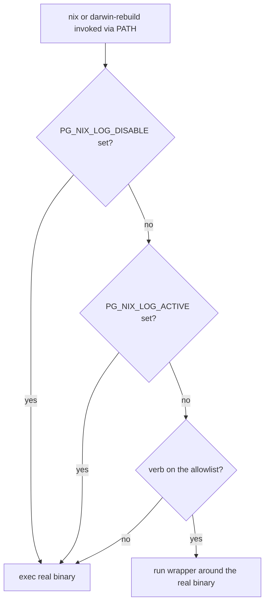

# pg-nix-shim: wrap nix and darwin-rebuild at the user and system level

Status: revision 5, after four independent review rounds. Owner repo: `nix-repo-base` (the wrapper,
the pn telemetry wiring and `darwinModules.default` already live there). Date: 2026-11-04.

## Why this exists

`pg-nix-log-wrapped` (ADR 0030) turns a nix run into OpenTelemetry spans. Today something has to
remember to put it in front of the command:

- Agents MUST prefix `nix build`, `nix flake check`, `nix eval`, `nix run`, `nix fmt` and
  `darwin-rebuild` with it (workspace `CLAUDE.md`, "Nix Runs Go Through pg-nix-log-wrapped"), and
  every subagent brief that runs nix MUST name it (global rule L-3).
- CETA carries a dedicated rule module (`pgnixlogwrapped`) so an approved wrapper does not launder a
  wrapped `darwin-rebuild switch`.
- `pn` wraps its own long-running nix calls with an explicit decorator (`exec.WithNixWrapper`,
  ADR 0028), chosen by call site, never by command name.

Operator direction (Phillip, 2026-11-04, verbatim): "perhaps this was applied at the wrong level
this whole time. what if we replace nix and darwin-rebuild with the wrapper at the system/user
level? ... then neither ceta nor pn would need to have special handling and things would already
work?"

## Goals and non-goals

Goals:

1. `nix` and `darwin-rebuild` typed by a human, an agent, a script or a job that has the shim on its
   `PATH` produce wrapper telemetry for the allowlisted long-running verbs, with no caller
   cooperation.
2. A user-level install (home-manager) and a system-level install (nix-darwin), covering a user
   shell, `sudo` from a user shell, and a true root shell.
3. A broken, disabled or misconfigured shim never stops a nix command from running (fail open).
4. For the caller, argv, stdin, stdout and stderr are untouched, and the exit code is untouched
   except where "Behaviour that is NOT unchanged" says otherwise.

Non-goals:

- Removing `pn`'s explicit decorator. It stays and coexists with the shim.
- Wrapping short stdout-parsed probes (`nix eval`, `nix flake metadata`, `nix --version`).
- Replacing `pkgs.nix`, `nix.package` or the daemon's nix. The shim is client-side only.
- Shadowing any other name the real nix package installs (`nix-env`, `nix-build`, ...). The shim
  provides exactly `bin/nix` and `bin/darwin-rebuild`.
- Retiring the agent rules, the workspace sections or the CETA rule. That is phase 7, after an
  operator apply has verified the shim.

## Facts this design rests on

Verified by reading code or ADRs (four review rounds re-checked them):

- The wrapper is a general launcher `pg-nix-log-wrapped [flags] [--] CMD ARGS...`. It resolves a bare
  CMD from `PATH` skipping a candidate only when it is the same file as the running wrapper (inode,
  following symlinks; `internal/resolve/resolve.go`, self from `os.Executable()` in
  `internal/app/app.go`). An absolute CMD is used as given.
- It appends `json-log-path` to `NIX_CONFIG` (`ChildEnv`), tails the file and exports once at exit.
  Today a nested wrapped run wins the log file and the outer run receives nothing (ADR 0028 item 6).
- Its fail-open path execs CMD with the environment untouched (ADR 0030 "Fail open is the
  invariant"; `TestFailOpenExecsWithUnmodifiedEnvironment`).
- No guard-like environment variable exists today. The wrapper reads `PG_NIX_LOG_DISABLE`,
  `OTEL_SDK_DISABLED`, `PG_NIX_LOG_DEBUG`, `PG_NIX_LOG_FLUSH_TIMEOUT`,
  `PG_NIX_LOG_ALLOW_UNMATCHED_OVERRIDE`, `TRACEPARENT`, `OTEL_EXPORTER_OTLP_ENDPOINT`, `XDG_STATE_HOME`
  and exports only `NIX_CONFIG`.
- A root wrapper reads flags only and always logs to `/var/log/pg-nix-log-wrapped`, ignoring
  `--log-dir`; with euid 0 and no endpoint flag it goes straight to passthrough and writes no log.
  Under `sudo`, `NIX_CONFIG`, `TRACEPARENT`, `OTEL_*` and every other variable outside `env_keep` are
  dropped, `HOME` is kept and `PATH` is NOT reset. `pn` runs a root wrapper only if its real path is
  under `/nix/store/` (`telemetrycfg.ValidateSudoWrapper`).
- Non-root endpoint precedence is: flag, then `enabled = false` in `~/.config/pn/telemetry.toml`,
  then `OTEL_EXPORTER_OTLP_ENDPOINT`, then the file's `endpoint`. An explicit flag beats even
  `enabled = false`.
- `config.ParseArgs` treats any leading `-x` argument as a wrapper flag and exits 2 on an unknown
  one, so `nix --version` or `nix -L build` cannot go through it.
- The unmatched `--override-input` guard turns a would-be exit 0 into exit 3 when a named override
  matches no input, because nix then silently uses the locked input. It runs even with telemetry off.
  `PG_NIX_LOG_ALLOW_UNMATCHED_OVERRIDE=1` disables it.
- The wrapper has no `runtimeDeps` on purpose (`wrapProgram` would break the inode check and add a
  hop). `homeModules.pn` installs `pkgs.pg-nix-log-wrapped` unconditionally; `lib.getExe` of it is
  `.../bin/pg-nix-log-wrapped`.
- Consumers set `home-manager.useUserPackages = true`, so home-manager packages land in
  `/etc/profiles/per-user/<user>`, a separate profile from the nix-darwin system profile. On this
  machine `PATH` lists `~/.nix-profile/bin` and `/etc/profiles/per-user/<user>/bin` before
  `/run/current-system/sw/bin`, and `nix` and `darwin-rebuild` resolve to the latter today.
- `pn` wraps by call site (`RunOptions.WrapNix`) and runs `nix` probes unwrapped. It invokes
  `<out>/sw/bin/darwin-rebuild activate` and `nix-env` by absolute path, so a shim never sees them.
- The `darwin-rebuild` script computes `systemConfig` from `$0` for `activate`
  (`readlink -f "${0%*/sw/bin/darwin-rebuild}"`, ADR 0038 item 6), so `$0` must keep that suffix.
- Services in the machine repos set `PATH = "/usr/bin:/bin"`; those jobs have no `nix` at all.

Not verified, carried as open items: `sudo -i` root `PATH`; how nix-darwin orders
`environment.systemPath` entries and whether `environment.etc` entries are store symlinks rather
than copies; latency; whether nix-darwin always installs `bin/nix` from `nix.package`.

## Design

### One program, one package, two ways onto PATH

The package `pg-nix-shim` contains `bin/nix` and `bin/darwin-rebuild` as symlinks to
`${pkgs.pg-nix-log-wrapped}/bin/pg-nix-log-wrapped`. There is no second Go build, no `-ldflags` and
no baked value. When `basename(argv[0])` is `nix` or `darwin-rebuild` the binary runs shim mode;
under any other name it behaves exactly as today. In both modes the wrapper's CMD lookup skips any
candidate whose fully resolved path (`EvalSymlinks`) has the final component `pg-nix-log-wrapped`,
in addition to today's inode check. A wrapper therefore never execs a shim, even one pointing at a
different wrapper build (a partial apply, a pinned `wrapper_path`, a second pkgs set), so a fail-open
passthrough never meets a shim and its environment can stay untouched.

- **User level (home-manager):** the module adds the package to `home.packages`. The per-user profile
  is a separate environment, so it wins over the system `nix` by `PATH` order alone.
- **System level (nix-darwin):** the module puts the package's `bin` directory first on the system
  path (`environment.systemPath` with `lib.mkBefore`), and does NOT add the package to
  `environment.systemPackages`. The real `nix` and `darwin-rebuild` therefore stay in
  `/run/current-system/sw/bin`, there is no `lib.hiPrio` and no profile collision, and the user
  shim and the system shim find the same real binaries. The module asserts the ordering at
  evaluation time and refuses to enable when the generated environment would not list the shim
  directory before `/run/current-system/sw/bin`. There is no fallback to `systemPackages`: it would
  replace the real `nix` that the lookup must reach. The module also writes a root-owned
  configuration file (component 4).
- **One package everywhere.** Both modules take the package from one option `package` (default
  `pkgs.pg-nix-shim`), and the overlay must expose it in every evaluation that enables a module, with
  an overlay-entry flake check like the one for `pg-nix-log-wrapped`. The explicit wrapper, the
  home-manager shim and the system shim then share one store binary and inode skipping also holds.

### Real-binary lookup

The shim walks `PATH`, skips every candidate by the rule above, then execs the first remaining one.
If nothing remains it exits 127, as a missing command does. It hands the real binary the PATH-found
absolute path as `argv[0]` (for `darwin-rebuild`, `/run/current-system/sw/bin/darwin-rebuild`), so
`$0` keeps its `/sw/bin/darwin-rebuild` suffix and the real nix is always the system's, never a
different version. Because a failed ordering would make every `nix` call exit 127, the module
assertion in the previous section is a hard gate, not a diagnostic.

### Dispatch (run on every call)

Passthrough is silent and leaves the environment untouched. `PG_NIX_LOG_DEBUG=1` makes the shim say
which branch it took on stderr; nothing else ever prints.

### Components

1. **Shim entry `app.RunShim`.** It does NOT call `config.ParseArgs`: it builds the command from the
   untouched argv, then reuses `Resolve`, `Disabled`, setup and run. Verb detection reuses
   `app.Subcommand()`. A flag it mis-parses (an unlisted value-taking flag whose value equals a verb)
   leads at worst to a wrapped probe, which is harmless because the wrapper never touches stdio.
   Shim-mode selection happens after the test harness's fake-command identification, which keys on
   a `fake-` prefix and cannot clash with `nix`.
2. **Allowlist.** One Go table shared with the metric labelling, plus a test that every allowlisted
   verb has a label other than `other`. Default: `nix build`, `nix flake check`, `darwin-rebuild
build|switch|check`. Opt-in verbs: `nix run`, `nix fmt`, `nix flake lock`, `nix flake update`,
   `nix eval`. Never wrapped: `nix develop`, `nix shell`, `nix repl`, `darwin-rebuild activate`, and
   everything off the list. `nix eval` stays off by default because it is the common stdout-parsed
   probe and a wrapped run pays an OTel initialisation, a log-directory sweep and a flush that can
   wait up to 2 s on a dead collector; `nix run` and `nix fmt` can be interactive, long-lived or in
   a commit path. Opt-in sources, merged additively and never removing a default verb: for a non-root
   shim, the file `~/.config/pn/shim.toml` (`verbs = [...]`, rendered by the home-manager module's
   `extraVerbs` option) and the environment variable `PG_NIX_SHIM_VERBS` (comma list); for a root
   shim, only the root-owned configuration file. `sudo` drops the environment variable, and root
   never reads a file under a user's home.
3. **Nesting guard `PG_NIX_LOG_ACTIVE=1`.** New. The wrapper sets it in CMD's environment when it
   WRAPS a run (next to `NIX_CONFIG`), not on its passthrough exec, which keeps the ADR 0030
   invariant and the tests that pin it. Only the shim honours it; an explicit wrapper keeps today's
   nested behaviour. Consequences, all stated: a shim under a wrapped run execs direct and the
   OUTER run's spans cover the whole tree, which is what `pn` needs; everything a wrapped command
   spawns inherits the guard, so a daemon started from a wrapped `nix run` is never wrapped again;
   under `sudo` the guard is dropped, so a root shim inside a wrapped user run starts a fresh,
   separately-filed run. Every wrapped command now sees one new variable, which is listed under
   "Behaviour that is NOT unchanged".
4. **Endpoint and enable precedence.** A non-root shim passes NO endpoint flag, so the existing
   flag, `enabled`, environment and file precedence applies unchanged and a user's `enabled = false`
   still wins. A root shim (effective uid 0) reads `/etc/pg-nix-shim.json`, written by the nix-darwin
   module. It resolves the path with `EvalSymlinks`, accepts the result only when it is a regular
   file under `/nix/store/` (the rule `ValidateSudoWrapper` applies to `pn`), and reads from the
   RESOLVED path, never the original, so a swap between check and read cannot redirect it. It never
   reads a file in a user's home. The file holds `rootEndpoint` and optional `verbs`. A root shim
   passes `--otlp-endpoint <rootEndpoint>` when one is set and otherwise passes through, because a
   root wrapper with no endpoint does nothing at all. Root runs are therefore observed only where
   the nix-darwin module is enabled and an endpoint is configured; this covers `sudo nix ...`,
   `sudo darwin-rebuild switch` from a user shell, and a true root shell alike, since the user shim
   and the system shim are the same program. The module asserts that its `environment.etc` entry is
   not a copy. It takes its own `rootEndpoint` option because it cannot read the home-manager
   `pn.telemetry.endpoint`; the machine repo sets both from one value and the doctor check reports
   a mismatch it can see.
5. **Override-input guard stays ON in shim mode,** for allowlisted verbs, as in explicit use. It only
   converts a would-be exit 0 into exit 3 when `--override-input` names no input, and the protection
   was what the agent prefix rule gave. `PG_NIX_LOG_ALLOW_UNMATCHED_OVERRIDE=1` stays the hatch.
   Coverage limit, stated: off-allowlist verbs (`nix eval`, `nix run`, `nix fmt`, `nix flake
lock|update` by default) lose the guard when phase 7 retires the prefix rule, unless opted in.
6. **Home-manager module** `phillipgreenii.pg-nix-shim`: `enable` (default off, so importing it
   changes nothing), `package`, `extraVerbs`. Exported as a path, following the
   `capability-framework` precedent, so a consumer cannot import it twice.
7. **nix-darwin module** (a new file under `darwinModules.default`): `enable` (default off),
   `package`, `rootEndpoint`, `extraVerbs`. Adds the shim directory to `environment.systemPath` and
   writes `/etc/pg-nix-shim.json`.
8. **sudo from a user shell.** `PATH` is not reset, so the per-user shim runs as root. That is how
   `sudo nix` already behaved; the shim does not widen it. Its safety rests on the shim being in
   `/nix/store` and on root reading only the store-backed file; `pn`'s `ValidateSudoWrapper`
   protects only `pn`'s own path. With the home-manager module on and the nix-darwin module off, a
   root run passes through silently; `--check` says so.

### Coexistence with pn

`pn` keeps `exec.WithNixWrapper`. Its explicit wrapped call sets the guard in the nix it runs, so any
shim inside it execs direct. `pn`'s probes hit the shim, are off the allowlist and exec direct. A
later simplification (drop the decorator, pass `TRACEPARENT`) is out of scope and would still need the
explicit root path, because `sudo` drops `TRACEPARENT`. The update-locks wrapper prefix
(`_ul_nix_wrap_prefix`, `PN_NIX_LOG_WRAPPER`) keeps working and becomes redundant (phase 7).

### Behaviour that is NOT unchanged

- Allowlisted verbs get the unmatched `--override-input` guard (exit 3), as in explicit use.
- Every command the wrapper wraps now sees `PG_NIX_LOG_ACTIVE=1` in its environment.
- The explicit wrapper now also skips any `PATH` candidate named `pg-nix-log-wrapped` after
  resolution, not only its own inode. This only matters for another copy of the wrapper.
- Signals follow ADR 0030 W-6: SIGINT is not forwarded (it reaches nix through the shared process
  group), SIGTERM and SIGHUP are forwarded, other signals are not, and a signalled child surfaces as
  exit `128+n`. A harness that signals only the shim's pid leaves nix running on SIGKILL. This
  applies only to allowlisted verbs.
- Allowlisted verbs add latency (initialisation, sweep, flush, tailer drain). Every other call adds
  one process hop that starts the full wrapper binary and walks `PATH` candidates. Phase 4 measures
  p50 and p95 for both a no-op `nix build` (live and dead collector) and `nix --version`, and
  records them in the README.

### Observability

- Every wrapper span gains `nix.started_by`, a closed set: `shim` (the wrapper was entered through
  shim mode; this wins over everything else), `pn` (entered through the explicit wrapper with
  `PG_NIX_LOG_STARTED_BY=pn` set by `pn`'s decorator; an older wrapper ignores it, so there is no
  skew failure), otherwise `explicit`. Under `sudo` the variable is dropped, so `pn`'s root runs read
  as `explicit`; this is documented, not fixed. A shim never runs under a `pn` wrapped call because
  the guard makes it pass through.
- `pg-nix-log-wrapped --check` additionally resolves `nix` and `darwin-rebuild` on the caller's
  `PATH`. A PATH entry is a shim when its basename is `nix` or `darwin-rebuild` and its resolved
  final component is `pg-nix-log-wrapped`. The check exits non-zero when EITHER name does not
  resolve to a shim, and prints the effective allowlist (defaults plus the file and environment
  additions), whether `/etc/pg-nix-shim.json` is present and a store regular file, and whether a
  root run would pass through for lack of it.
- `pn workspace doctor` runs the same check, reports "root config not a store symlink" when that is
  the case, and compares the home-manager and nix-darwin endpoints where it can see both.
- Passthrough decisions cannot be counted: a passthrough execs the real binary before any telemetry
  exists and must stay silent. This design does NOT claim a silent fail-open is visible. It is
  detected by `--check`, by `PG_NIX_LOG_DEBUG=1` on demand, and by the post-apply verification
  finding one real wrapped build in the trace backend.
- Root runs write root-only logs (mode 0600) that a non-root doctor cannot read; the doctor says so.
- Retention is by age (7 days) and size (2 GiB), not file count, and the sweep runs on every wrapped
  run. Phase 4 measures sweep cost under a loop of many short allowlisted runs.
- No new daemon, launchd job or Grafana rule.

### UX contract

- `PG_NIX_LOG_DISABLE=1` bypasses the shim for one command. `sudo` drops it, so for root runs the
  tldr page says `sudo env PG_NIX_LOG_DISABLE=1 nix ...`. The real binary's absolute path bypasses
  the shim permanently.
- `type -a nix` shows the shim and the real binary. `nix --version` and completion scripts pass
  through off-allowlist and print the real tool's output.
- The shim prints nothing of its own unless `PG_NIX_LOG_DEBUG=1`.

## Test plan (V-3, V-4)

Go unit tests in the wrapper's module, against real binaries in a hermetic environment:

- dispatch table: disabled, guard set, allowlisted, off-allowlist, `--version`, `--help`, completion
  calls, no subcommand, unknown subcommand, and value-flag argv such as `nix --option foo build eval
.#x`; shim mode never calls `ParseArgs`;
- `argv[0]` handling when the binary is invoked through a symlink named `nix`, `darwin-rebuild`, and
  under its own name (explicit use unchanged);
- a stub `darwin-rebuild` script on `PATH` that records `$0`: through the shim it must still end in
  `/sw/bin/darwin-rebuild` (this replaces a real-rebuild test, which would be slow and is phase 6);
- the guard is exported to CMD on a wrapped exec only, so the passthrough environment equals the
  caller's (the existing fail-open tests stay green unchanged); a nested shim honours it; an explicit
  nested wrapper ignores it;
- an explicit `pg-nix-log-wrapped nix build` with a shim first on `PATH` yields exactly one
  `nix.invocation`, both when the shim points at the same wrapper binary and when it points at a
  DIFFERENT wrapper build (two distinct binaries, so the name-based skip is what protects it);
- loop breaker: two shims pointing at different wrapper builds with nothing else on `PATH` terminate
  with exit 127, and with the real nix present they reach it, never looping;
- exit code passthrough and the documented signal limits, wrapped and direct;
- root path with a stubbed effective uid and a fixture root configuration: the endpoint arrives as a
  flag; a configuration whose resolved path is outside `/nix/store/`, or that is not a regular file,
  is refused; the file is read from the resolved path; no file under the user's home is read; with
  no configuration the run passes through;
- allowlist sources: `shim.toml` and `PG_NIX_SHIM_VERBS` add verbs and never remove defaults; root
  ignores both; `--check` prints the effective list and exits non-zero when either name is not a shim;
- `nix.started_by` is `shim` in shim mode even when `PG_NIX_LOG_STARTED_BY=pn` is set, `pn` for an
  explicit run with it set, `explicit` otherwise, and unknown values map to `explicit`;
- the override guard is on in shim mode for allowlisted verbs and absent off-allowlist;
- every allowlisted verb has a non-`other` label.

Nix checks: the package contains exactly the two symlinks and each target's final component is
`pg-nix-log-wrapped`; both modules evaluate with `enable` on and off (added to the existing
`darwinModules` evaluation check); the overlay exposes `pg-nix-shim` in every evaluation that
enables a module; the generated `/etc/pg-nix-shim.json` is a store path and not a copy; the
generated system environment lists the shim directory before `/run/current-system/sw/bin`.

Slow or whole-daemon tests stay out of the unit gate (V-4). Mutation testing is not part of this
work (V-5). What a test cannot prove, a gated post-apply bead covers: on the applied machine `nix`
resolves to the shim in a user shell, under `sudo` and under `sudo -i`; `sudo darwin-rebuild switch`
works through it; root can reach the collector; one real wrapped build appears in the trace backend.

## Work breakdown (sizes, not durations)

| Phase | Repo                                               | Size | Content                                                                                                                                                                                                                                                                                                                                                                                                                                 |
| ----- | -------------------------------------------------- | ---- | --------------------------------------------------------------------------------------------------------------------------------------------------------------------------------------------------------------------------------------------------------------------------------------------------------------------------------------------------------------------------------------------------------------------------------------- |
| 1     | nix-repo-base                                      | L    | Wrapper: `PG_NIX_LOG_ACTIVE` on wrapped execs, `RunShim`, shared allowlist table and label test, allowlist sources (`shim.toml`, `PG_NIX_SHIM_VERBS`, root file), name-based skip in `resolve.LookPath` for explicit and shim lookups, euid-0 root configuration read from the resolved store path, `nix.started_by`, unit tests above, and an ADR 0030 amendment noting the new guard variable and the broadened skip.                 |
| 2     | nix-repo-base                                      | S    | `pg-nix-shim` package (two symlinks), overlay entry, package checks.                                                                                                                                                                                                                                                                                                                                                                    |
| 3     | nix-repo-base                                      | M    | Home-manager and nix-darwin modules, options (`enable`, `package`, `extraVerbs`, `rootEndpoint`), exported path, `/etc/pg-nix-shim.json`, `environment.systemPath` ordering asserted in the module and proven by a check, the `/etc` entry required to be a store symlink, evaluation checks.                                                                                                                                           |
| 4     | nix-repo-base                                      | M    | `--check` shim detection and root-config report, `pn workspace doctor` check, tldr page, README, latency measurement (wrapped verbs and the off-allowlist hop) and sweep-cost measurement. Needs 2 and 3.                                                                                                                                                                                                                               |
| 4b    | nix-repo-base                                      | S    | `pn` sets `PG_NIX_LOG_STARTED_BY=pn` in its decorator. Needs 1.                                                                                                                                                                                                                                                                                                                                                                         |
| 5     | machine repos                                      | S    | Enable the modules where they apply; set both endpoints from one value.                                                                                                                                                                                                                                                                                                                                                                 |
| 6     | gated on an operator apply                         | S    | Verify on the applied machine (end of the test plan). Needs 4 and 5.                                                                                                                                                                                                                                                                                                                                                                    |
| 7     | nix-agent-support, nix-ziprecruiter, nix-repo-base | S    | After 6: retire the agent prefix rule and the L-3 clause, the workspace `CLAUDE.md` sections (agent-support, ziprecruiter and the workspace one), the `pgnixlogwrapped` CETA rule if nothing prefixes any more, the adoption script and its bats test (it becomes a shim-on-`PATH` check), the `_ul_nix_wrap_prefix` path and mentions in the workspace module. State that off-allowlist verbs lose the override guard unless opted in. |

Order: 1, then 2, then 3; 4 needs 2 and 3; 4b needs 1; 5 needs 3; 6 needs 4 and 5; 7 needs 6.

## Risks

- **Blast radius.** A broken shim touches every nix call. Mitigations: fail open, the lookup,
  `PG_NIX_LOG_DISABLE`, the real binary's absolute path, and `enable` defaulting to off.
- **PATH coverage.** Absolute store paths, and jobs whose `PATH` lacks the shim, are not wrapped.
  Adoption is visible through `nix.started_by`, not through a passthrough metric.
- **Ordering.** If `environment.systemPath` did not put the shim directory first, a root shell would
  reach the real `nix` unshimmed; user shells with the home-manager module stay shimmed. The module
  assertion refuses to enable in that case, so the failure is at evaluation, not at run time.
- **Guard inheritance.** A long-lived process started under a wrapped run is never wrapped again.
- **Override-guard coverage.** Narrowing the allowlist narrows where the override guard applies.

## Open items to resolve before or during implementation

1. `sudo -i` root `PATH`, and whether root can reach the collector on loopback (phase 6).
2. RESOLVED (phase 3, pinned nix-darwin-26.05): `environment.systemPath` is a list option whose
   `apply` joins it with `:` into one string (derivations as `${p}/bin`), so the final order is
   observable only as that string; profile directories sit at the default order and the system
   directories at order 1200, so `lib.mkBefore` puts the shim directory before
   `$HOME/.nix-profile/bin` and `/run/current-system/sw/bin`, and the module asserts on that
   effective string. `environment.etc` entries are always store symlinks (`ln -s <source>` in
   `system.build.etc`, `text` realised by `writeText`); a copy can arise only from a `source` outside
   the store or a disabled entry, which the second assertion rejects. The module uses `text`.
3. Whether every consuming machine has `nix.enable = true` so a real `bin/nix` exists in the system
   profile, and whether any uses a Determinate install (phase 5).
4. Whether any script in the workspace parses `nix run` or `nix fmt` output, which matters only if
   an operator enables those opt-in verbs (phase 5).
