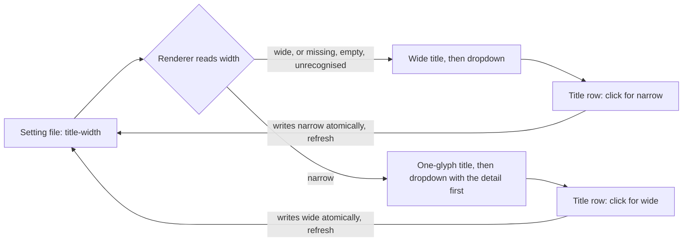
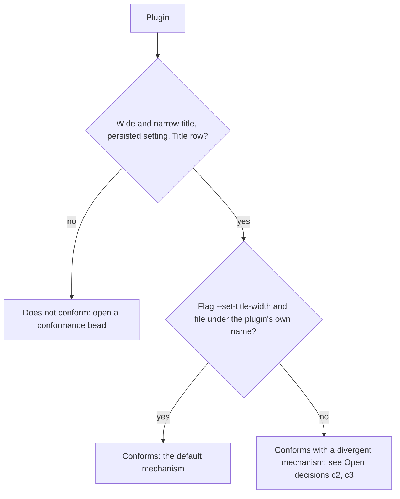
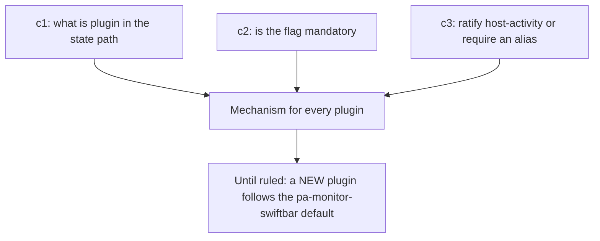

# SwiftBar title width

This page is the convention page for the menu-bar title of every SwiftBar plugin in the workspace
repos. It defines the wide and narrow title every plugin MUST offer, the setting that switches
between them, what belongs in the title versus the dropdown, the colour-coding expectation, the
refresh-rate guidance, and a test checklist every plugin MUST satisfy. The decision is recorded in
[ADR 0036](adr/0036-swiftbar-plugins-offer-wide-and-narrow-titles.md).

Contents: [Scope](#scope), [Why](#why), [The contract](#the-contract),
[Title versus dropdown](#title-versus-dropdown), [Colour coding](#colour-coding),
[Refresh rate](#refresh-rate), [Setting file and flag](#setting-file-and-flag),
[Reference implementation](#reference-implementation), [Plugin status](#plugin-status),
[Test checklist](#test-checklist), [Open decisions](#open-decisions), [Related](#related).

## Scope

This standard covers every SwiftBar menu-bar plugin that a workspace repo ships or installs, whether
the plugin is a bash script, a Go binary or a streaming process. Every such plugin MUST follow it.
A plugin written after this page lands MUST conform before it is installed; a plugin that predates
it MUST be brought into line by a conformance bead (see [Plugin status](#plugin-status)).

It does not cover plugins that other people ship, nor the content of a plugin's dropdown beyond the
rules about the first row and the Title row below.

## Why

The notch on a laptop display leaves very little room in the menu bar. With no external monitor the
operator needs a title only a few characters wide, but with room to spare a richer title is useful.
One width cannot serve both, so each plugin offers two and lets the operator switch (operator ruling,
Phillip, 2026-10-21/22: "important and must be done going forward for each").

## The contract

A plugin MUST offer both widths and MUST be wide until told otherwise.

| Width    | Title                                                                                     | First dropdown row                     |
| -------- | ----------------------------------------------------------------------------------------- | -------------------------------------- |
| `wide`   | The default. The plugin's primary state as short text, values included.                   | Not a duplicate of the title.          |
| `narrow` | SHOULD be ONE colour-coded glyph; MUST be as short as the plugin can make it, notch-safe. | The detail the wide title would carry. |

- The width MUST be a setting the operator changes from the dropdown, never by editing a file.
- The last block of the dropdown MUST contain a **Title row** that shows the current width and the
  action, `Title: wide (click for narrow)` or `Title: narrow (click for wide)`. Clicking it MUST
  write the other width and refresh the plugin.
- The setting MUST persist across plugin runs and restarts, so it is a file, not process memory.
- A missing, empty or unrecognised value MUST read as `wide` (fail-safe default: an unreadable
  setting never hides information). A read problem MUST NOT surface as an error in the menu bar.
- A plugin SHOULD choose its narrow glyph to look like what the plugin is about: for a task or focus
  plugin an icon that looks like a task or focus; for a usage plugin a pie; for an alert plugin a
  dot. The glyph MUST be one character wide.
- Degraded states (the tool is missing, the daemon is unreachable, no data) MUST still follow the
  width: the wide form MAY carry a short word, the narrow form MUST stay one glyph, and the message
  MUST be in the first dropdown row.
- The width MUST NOT change what the dropdown contains beyond the first row, except that the wide
  dropdown MUST NOT repeat in a row what the wide title already shows.
- Colours MUST be the same in both widths.
- The writer of the setting MUST write atomically (a temporary file in the same directory, then a
  rename), so a render that races a click never reads a half-written file.

## Title versus dropdown

The menu-bar title shows only the PRIMARY state of the plugin: for a task plugin the active task, for
a usage plugin the usage, for an alert plugin the worst severity.

- Alerts, errors, housekeeping prompts and every lower-priority state MUST go inside the dropdown,
  not in the title. An example is a prompt such as "New day: roll over" in a task plugin: it is a
  chore, not the primary state, so it is a dropdown row.
- The one exception is a state in which the plugin cannot show its primary state at all (the data
  source is missing or unreachable). The title then MAY show a degraded glyph, as in the contract
  above.
- The title SHOULD NOT change layout every refresh. A title whose width jumps shifts every item to
  its left in the menu bar.

## Colour coding

The title, and the narrow glyph in particular, SHOULD be colour-coded by state, so the one character
carries the meaning the words would have. A plugin SHOULD use a small, fixed palette (for example
green for fine, amber for at risk, red for act now, grey for stale or unknown) and MUST use it the
same way in both widths. A plugin that has a stale reading SHOULD show the stale variant of the
colour (darker or greyer) rather than the live one.

Colour MUST NOT be the only carrier of a state: the glyph shape SHOULD also differ between states,
so the title stays legible to a reader who cannot tell the colours apart.

## Refresh rate

A plugin MUST NOT refresh faster than it needs to. 5 to 10 seconds is fine for a plugin whose state
changes in seconds; a slower interval is fine when the data changes more slowly.

- A countdown MUST show a coarse clock (whole minutes, or buckets of tens of seconds when close),
  not a seconds-by-second display.
- A streaming plugin MAY redraw immediately on a real state change from its source, but its idle
  tick SHOULD follow the same guidance.
- A streaming plugin is a long-lived process and MUST re-read the setting on every frame or tick, so
  a click on the Title row takes effect without a restart.
- A polled plugin gets its interval from the plugin file name (the SwiftBar convention), and a
  render run reads the setting once per run.

## Setting file and flag

The mechanism below is the DEFAULT for NEW plugins, and it is the mechanism of the reference
implementation. Where the convention is not yet ruled (see [Open decisions](#open-decisions)), a new
plugin MUST use this default.

- **State file.** `$XDG_STATE_HOME/<plugin>/title-width`, where `XDG_STATE_HOME` defaults to
  `~/.local/state` and `<plugin>` is the plugin's own name. The file holds the word `wide` or
  `narrow` and a newline.
- **Flag.** `<plugin> --set-title-width wide|narrow` writes the file and exits without rendering.
  It MUST exit 0 on success, 2 on a missing or invalid value (writing nothing, so the existing
  setting stays), and 1 when the file cannot be written. No other path of the plugin may exit
  non-zero: a menu-bar plugin MUST NOT surface a raw error.
- **Title row.** The row runs the plugin itself with `--set-title-width` and the other width, with
  `terminal=false refresh=true`. The path it runs MUST NOT contain whitespace, or MUST be quoted: an
  installed plugin lives under a directory with a space in its name, so a nix-installed plugin SHOULD
  pass a whitespace-free store path to the row through an environment variable.
- **Documentation.** `--help` MUST document the width, the file and the flag.

## Reference implementation

`pa-monitor-swiftbar` (the `nix-agent-support` repo,
`packages/pa-monitor-swiftbar/pa-monitor-swiftbar/pa-monitor-swiftbar.sh`) is the reference. Its
wide title is `5h 63% · 1h 52m`; its narrow title is one pie glyph (or a status symbol) with the
detail moved to the first dropdown row; its Title row runs the script with `--set-title-width`; the
file is `$XDG_STATE_HOME/pa-monitor-swiftbar/title-width`, written atomically; and a missing, empty or
unrecognised value reads as wide. Its bats suite
(`tests/test-pa-monitor-swiftbar.bats`) is the model for the [Test checklist](#test-checklist).

## Plugin status

Verified on 2026-10-22 against the source of each plugin.

| Plugin                   | Setting file `$XDG_STATE_HOME/...` | Switch                                              | Status                                                                                                                      |
| ------------------------ | ---------------------------------- | --------------------------------------------------- | --------------------------------------------------------------------------------------------------------------------------- |
| `pa-monitor-swiftbar`    | `pa-monitor-swiftbar/title-width`  | `--set-title-width wide\|narrow`                    | Conforms. The reference.                                                                                                    |
| attention-items plugin   | `lat-menubar/title-width`          | `--set-title-width wide\|narrow`                    | Conforms in kind (wide: a dot and count per severity; narrow: one dot). Conformance check: `pg2-wpk91`.                     |
| `host-activity`          | `host-activity/title-width`        | `host-activity action run title-width-narrow\|wide` | Conforms with a divergent switch (an action, not a flag). Recorded as conforming; see open decision c3. `pg2-hpfsb` closed. |
| `pg-task-focus-swiftbar` | none yet                           | none yet                                            | Does not conform. Rework tracked in `pg2-incbn`.                                                                            |

## Test checklist

Every plugin MUST have automated tests (bats for a bash plugin, the language's own test framework for
a compiled one) that run against the real renderer in a hermetic environment (an isolated
`XDG_STATE_HOME`, a stubbed data source) and prove each item. A plugin MUST NOT be called conforming
until all are checked.

- [ ] No setting file reads as wide, and the Title row shows `wide`.
- [ ] An empty file, an unrecognised value and a missing state directory each read as wide, and none
      is an error.
- [ ] A `narrow` value is honoured, including with surrounding whitespace.
- [ ] Narrow: every title line is exactly one character before its colour parameter, and carries no
      leftover words or digits.
- [ ] Narrow: the first dropdown row carries the detail the wide title would show.
- [ ] Wide: the title carries the values and the dropdown does not repeat them in a row.
- [ ] Both widths: the colour for each state is identical.
- [ ] Every degraded state (tool missing, source unreachable, no data, malformed data) renders in
      both widths, and neither is a raw error.
- [ ] The Title row is present in every state and both widths, shows the current mode and the action,
      and is the last block above Refresh.
- [ ] The Title row runs the plugin itself, honours the nix wrapper's path override, and quotes a path
      that contains whitespace.
- [ ] The switch writes the file, prints nothing, and does not call the data source.
- [ ] The switch is atomic: no temporary file is left beside the setting.
- [ ] The switch rejects an unknown or missing value (exit 2 for the default mechanism), writes
      nothing, and keeps the existing setting.
- [ ] The switch with `XDG_STATE_HOME` unset falls back to `$HOME/.local/state`.
- [ ] The switch reports an unwritable state directory and exits non-zero.
- [ ] Running the switch flips the next render, and back.
- [ ] The switch works with only the tools the plugin ships on `PATH`.
- [ ] `--help` documents the width, the setting file and the switch.
- [ ] A primary-state-only title: an alert, error or housekeeping prompt appears in the dropdown,
      never in the title.
- [ ] A streaming plugin re-reads the setting on every frame or tick.
- [ ] The refresh interval, or tick, is not faster than the [Refresh rate](#refresh-rate) guidance
      and a countdown shows a coarse clock.

## Open decisions

These are recorded, not decided. They await the operator (Phillip). Until each is ruled, a NEW
plugin MUST use the default stated here, which is the `pa-monitor-swiftbar` mechanism: the flag
`--set-title-width` and the state file `$XDG_STATE_HOME/<plugin>/title-width` where `<plugin>` is
the plugin's own name.

| Id  | Question                                                                                                                                                                                                                                                                          | Default for a NEW plugin until ruled                                                |
| --- | --------------------------------------------------------------------------------------------------------------------------------------------------------------------------------------------------------------------------------------------------------------------------------- | ----------------------------------------------------------------------------------- |
| c1  | What does `<plugin>` mean in the state-dir path `$XDG_STATE_HOME/<plugin>/title-width`: the script name, the package name, or a fixed per-plugin id? The three plugins differ today (the script name, the package name and the plugin file name are not the same string).         | The plugin's own name.                                                              |
| c2  | Is the `--set-title-width wide\|narrow` flag MANDATORY for every plugin, or is the contract only "a dropdown Title row persisting the setting"? `host-activity` uses an action instead of a flag.                                                                                 | The flag, as in the reference.                                                      |
| c3  | Ratify the `host-activity` mechanism (action `title-width-narrow\|wide`) as conforming, or ask for a rename or alias to the `--set-title-width` flag contract? This is a decision under bead `pg2-np92m`; the plugin is already recorded as conforming and `pg2-hpfsb` is closed. | A NEW plugin uses the flag; `host-activity` is left as is until the operator rules. |

## Related

- [ADR 0036](adr/0036-swiftbar-plugins-offer-wide-and-narrow-titles.md): the decision to adopt this
  convention.
- The sibling convention page [Alert severity standard](alert-severity.md): the menu-bar indicator
  of alerts shows one dot for the worst active severity, which is that plugin's narrow glyph.
- Per-plugin follow-ups: `pg2-incbn` (the task-focus plugin rework), `pg2-wpk91` (the attention-items
  conformance check), `pg2-hpfsb` (closed: `host-activity` already conforms).
- Bead `pg2-np92m`: the convention bead, and the home of open decisions c1 to c3.
