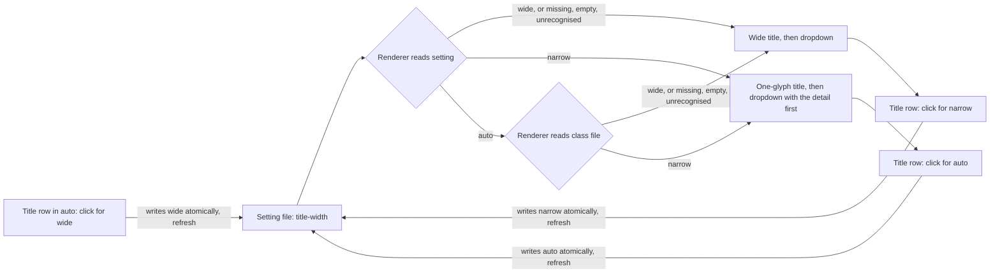
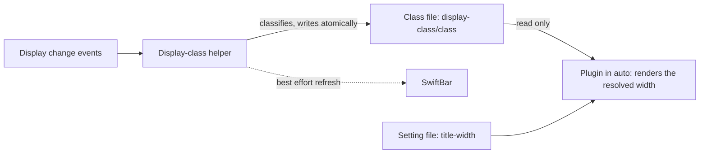
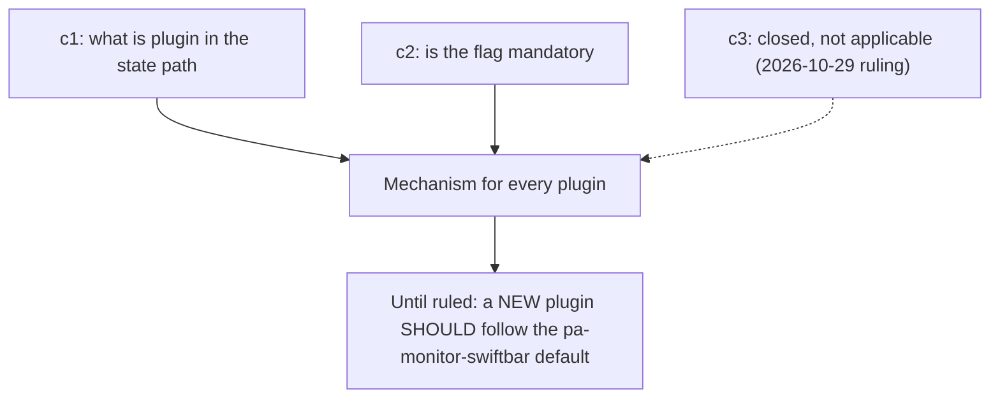

# SwiftBar title width

This page is the convention page for the menu-bar title of every SwiftBar plugin in the workspace
repos. It defines the wide and narrow title every plugin MUST offer, the third value `auto` that
follows the primary display, the setting that switches between them, the machine-wide class file that
`auto` reads, what belongs in the title versus the dropdown, the colour-coding expectation, the
refresh-rate guidance, and a test checklist every plugin MUST satisfy. The decisions are recorded in
[ADR 0036](adr/0036-swiftbar-plugins-offer-wide-and-narrow-titles.md) (wide and narrow) and
[ADR 0039](adr/0039-swiftbar-title-width-auto.md) (`auto`, which amends ADR 0036).

Contents: [Scope](#scope), [Why](#why), [The contract](#the-contract),
[Title versus dropdown](#title-versus-dropdown), [Colour coding](#colour-coding),
[Refresh rate](#refresh-rate), [Setting file and flag](#setting-file-and-flag),
[The class file](#the-class-file), [Reference implementation](#reference-implementation),
[Plugin status](#plugin-status), [Test checklist](#test-checklist),
[Open decisions](#open-decisions), [Overridable rulings](#overridable-rulings),
[Related](#related).

## Scope

This standard covers every SwiftBar menu-bar plugin that a workspace repo ships or installs, whether
the plugin is a bash script, a Go binary or a streaming process. Every such plugin MUST follow it.
A plugin written after this page lands MUST conform before it is installed; a plugin that predates
it MUST be brought into line by a conformance bead (see [Plugin status](#plugin-status)).

It does not cover plugins that other people ship, nor the content of a plugin's dropdown beyond the
rules about the first row and the Title row below.

## Why

The notch on a laptop display leaves very little room in the menu bar. With no external monitor the
operator needs a title only a few characters wide, but with room to spare a richer title is useful.
One width cannot serve both, so each plugin offers two and lets the operator switch (operator ruling,
Phillip, 2026-10-21/22: "important and must be done going forward for each").

The same laptop is sometimes alone (notched, little room) and sometimes docked to a large display, so
a third value, `auto`, follows whether the PRIMARY display currently has room for the wide title
(operator rulings, Phillip, 2026-10-27, recorded in [ADR 0039](adr/0039-swiftbar-title-width-auto.md)).
Only the primary display counts: SwiftBar renders on every display, but the operator uses it only on
the primary one.

## The contract

A plugin MUST offer the widths `wide` and `narrow` and the setting value `auto`, and MUST be wide
until told otherwise (the default stays `wide`; `auto` is opt-in per plugin, ruling D1 of ADR 0039).

| Width    | Title                                                                                     | First dropdown row                     |
| -------- | ----------------------------------------------------------------------------------------- | -------------------------------------- |
| `wide`   | The default. The plugin's primary state as short text, values included.                   | Not a duplicate of the title.          |
| `narrow` | SHOULD be ONE colour-coded glyph; MUST be as short as the plugin can make it, notch-safe. | The detail the wide title would carry. |

`auto` is a setting value, not a third title. It renders as `wide` or `narrow`, whichever the
[class file](#the-class-file) names, and that choice is the **resolved width**. The dropdown follows
the resolved width exactly as it would follow a setting of that width.

- The width MUST be a setting the operator changes from the dropdown, never by editing a file.
- The last block of the dropdown MUST contain a **Title row** that shows the current mode and the
  action, and cycles `wide`, then `narrow`, then `auto`, then `wide`. The text is exactly:
  - `Title: wide (click for narrow)`
  - `Title: narrow (click for auto)`
  - `Title: auto, <resolved> now (click for wide)`, where `<resolved>` is `wide` or `narrow`, for
    example `Title: auto, narrow now (click for wide)`.

  Clicking it MUST write the next value and refresh the plugin.

- The setting MUST persist across plugin runs and restarts, so it is a file, not process memory.
- A missing, empty or unrecognised setting value MUST read as `wide` (fail-safe default: an
  unreadable setting never hides information). A read problem MUST NOT surface as an error in the
  menu bar. A plugin that predates `auto` treats every value other than `narrow` as `wide`, so an old
  plugin reading `auto` shows `wide`; it never errors and never rewrites the file on read.
- A plugin SHOULD choose its narrow glyph to look like what the plugin is about: for a task or focus
  plugin an icon that looks like a task or focus; for a usage plugin a pie; for an alert plugin a
  dot. The glyph MUST be one character wide.
- Degraded states (the tool is missing, the daemon is unreachable, no data) MUST still follow the
  width: the wide form MAY carry a short word, the narrow form MUST stay one glyph, and the message
  MUST be in the first dropdown row.
- The width MUST NOT change what the dropdown contains beyond the first row, except that the wide
  dropdown MUST NOT repeat in a row what the wide title already shows.
- Colours MUST be the same in both widths.
- The writer of the setting MUST write atomically (a temporary file in the same directory, then a
  rename), so a render that races a click never reads a half-written file.

## Title versus dropdown

The menu-bar title shows only the PRIMARY state of the plugin: for a task plugin the active task, for
a usage plugin the usage, for an alert plugin the worst severity.

- Alerts, errors, housekeeping prompts and every lower-priority state MUST go inside the dropdown,
  not in the title. An example is a prompt such as "New day: roll over" in a task plugin: it is a
  chore, not the primary state, so it is a dropdown row.
- The one exception is a state in which the plugin cannot show its primary state at all (the data
  source is missing or unreachable). The title then MAY show a degraded glyph, as in the contract
  above.
- The title SHOULD NOT change layout every refresh. A title whose width jumps shifts every item to
  its left in the menu bar.

## Colour coding

The title, and the narrow glyph in particular, SHOULD be colour-coded by state, so the one character
carries the meaning the words would have. A plugin SHOULD use a small, fixed palette (for example
green for fine, amber for at risk, red for act now, grey for stale or unknown) and MUST use it the
same way in both widths. A plugin that has a stale reading SHOULD show the stale variant of the
colour (darker or greyer) rather than the live one.

Colour MUST NOT be the only carrier of a state: the glyph shape SHOULD also differ between states,
so the title stays legible to a reader who cannot tell the colours apart.

## Refresh rate

A plugin MUST NOT refresh faster than it needs to. 5 to 10 seconds is fine for a plugin whose state
changes in seconds; a slower interval is fine when the data changes more slowly.

- A countdown MUST show a coarse clock (whole minutes, or buckets of tens of seconds when close),
  not a seconds-by-second display.
- A streaming plugin MAY redraw immediately on a real state change from its source, but its idle
  tick SHOULD follow the same guidance.
- A streaming plugin is a long-lived process and MUST re-read the setting AND the
  [class file](#the-class-file) on every frame or tick, so a click on the Title row, or a change of
  display, takes effect without a restart. It MUST compare the RESOLVED width (`wide` or `narrow`),
  not the setting word, to decide whether to redraw: comparing the word means a class flip never
  redraws, or redraws every tick.
- A polled plugin gets its interval from the plugin file name (the SwiftBar convention), and a
  render run reads the setting once per run.

## Setting file and flag

The mechanism below is the DEFAULT a NEW plugin SHOULD use, and it is the mechanism of the reference
implementation. It is not a mandatory interface: the operator has not formalized any rules or best
practices for the interface of a SwiftBar plugin (ruling of 2026-10-29, quoted under
[Open decisions](#open-decisions)), so until that happens no plugin is an exception to it. What this
page does require is the behavior above: the widths, the Title row and the persisted setting.

- **State file.** `$XDG_STATE_HOME/<plugin>/title-width`, where `XDG_STATE_HOME` defaults to
  `~/.local/state` and `<plugin>` is the plugin's own name. The file holds the word `wide`,
  `narrow` or `auto` and a newline.
- **Flag.** `<plugin> --set-title-width wide|narrow|auto` writes the file and exits without
  rendering. It MUST exit 0 on success, 2 on a missing or invalid value (anything but those three
  words, a garbage value included; writing nothing, so the existing setting stays), and 1 when the
  file cannot be written. No other path of the plugin may exit non-zero: a menu-bar plugin MUST NOT
  surface a raw error.
- **Title row.** The row runs the plugin itself with `--set-title-width` and the NEXT value in the
  cycle `wide`, `narrow`, `auto` (the exact texts are in [The contract](#the-contract)), with
  `terminal=false refresh=true`. The path it runs MUST NOT contain whitespace, or MUST be quoted: an
  installed plugin lives under a directory with a space in its name, so a nix-installed plugin SHOULD
  pass a whitespace-free store path to the row through an environment variable.
- **Documentation.** `--help` MUST document the width (including `auto`), the file and the flag.

## The class file

In `auto` a plugin never classifies the display. A machine-wide **display-class helper** (a watcher
that reacts to display changes) computes the class and writes it to the **class file**; plugins only
read it. The originating beads call this file the "flag file"; this page and ADR 0039 call it the
class file because "flag" already names the `--set-title-width` command-line flag.

- **Path.** `<state base>/display-class/class`.
- **Contents.** One word, `wide` or `narrow`, plus a newline. No timestamp.
- **State base.** `$XDG_STATE_HOME` if it is non-empty AND absolute, else `$HOME/.local/state`. Every
  reader and every writer of the class file MUST use this one rule. A bash plugin's own setting file
  keeps its existing resolution (`${XDG_STATE_HOME:-$HOME/.local/state}`, with no absolute check), so
  for a relative `XDG_STATE_HOME` the setting file and the class file resolve differently; that is
  accepted. SwiftBar's environment and launchd's environment are not the same shell, which is why
  this is a rule and not an assumption.
- **Who writes it.** Only the display-class helper. It writes atomically (a temporary file in the
  same directory, then a rename), at startup and whenever the ON-DISK content differs from the
  computed class (compared against the file, not an in-memory copy, so a deleted or garbage file is
  repaired). A plugin MUST NOT write it.
- **How a plugin reads it.** In `auto`, read the file on each render (a streaming plugin: on every
  frame or tick). A missing, empty or unrecognised class file MUST read `wide`, even on a notched
  display (ruling D3 of ADR 0039: an unreadable setting never hides information). Consequence: a
  dead watcher on a notched laptop shows the wide title in the notch area until the operator picks
  `narrow`.
- **How the helper classifies.** The primary display is the one `CGMainDisplayID()` returns (it holds
  the menu bar; NOT `NSScreen.main`, which follows keyboard focus). A notched primary display is
  `narrow`. Otherwise it is `wide` when its width in POINTS (not pixels) is at least `minWideWidth`
  (config, default 1800 points), else `narrow`. Only the helper classifies.
- **Refresh.** After a change the helper asks SwiftBar to refresh, best effort. A plugin MUST NOT
  depend on that: the class file alone is correct, and a polled plugin picks the change up at its
  next interval.
- **Change both sides together.** The helper and every plugin reader MUST agree on the path, the
  word set and the fallback. A change to any of them MUST change the helper and every plugin in the
  same set of beads, or none. Each side asserts the literal contract path
  `<state base>/display-class/class` for unset, empty, relative and absolute `XDG_STATE_HOME`;
  neither side asserts the helper's log path, which does not apply the absolute check.
- **State tree.** `<state base>/display-class/` is a non-plugin directory in the state tree. Open
  decision c1 (what `<plugin>` means in the state path) is unaffected: the class file is not under
  any plugin's name.

## Reference implementation

`pa-monitor-swiftbar` (the `nix-agent-support` repo,
`packages/pa-monitor-swiftbar/pa-monitor-swiftbar/pa-monitor-swiftbar.sh`) is the reference. Its
wide title is `5h 63% · 1h 52m`; its narrow title is one pie glyph (or a status symbol) with the
detail moved to the first dropdown row; its Title row runs the script with `--set-title-width`; the
file is `$XDG_STATE_HOME/pa-monitor-swiftbar/title-width`, written atomically; and a missing, empty or
unrecognised value reads as wide. Its bats suite
(`tests/test-pa-monitor-swiftbar.bats`) is the model for the [Test checklist](#test-checklist).

## Plugin status

Verified on 2026-10-28 against the source of each plugin: the `pa-monitor-swiftbar.sh`,
`pg-task-focus-swiftbar.sh` and `lat-menubar.sh` scripts, and `host-activity`'s `titlewidth.go`,
`action.go` and `menu/sections.go`. Every plugin reads only `wide` and `narrow` today, and treats any
other value as `wide`.

| Plugin                   | Setting file `$XDG_STATE_HOME/...`   | Switch                                              | Auto                              | Status                                                                                                                                                                   |
| ------------------------ | ------------------------------------ | --------------------------------------------------- | --------------------------------- | ------------------------------------------------------------------------------------------------------------------------------------------------------------------------ |
| `pa-monitor-swiftbar`    | `pa-monitor-swiftbar/title-width`    | `--set-title-width wide\|narrow`                    | Not yet. Tracked in `pg2-ogkx1x`. | Conforms. The reference.                                                                                                                                                 |
| attention-items plugin   | `lat-menubar/title-width`            | `--set-title-width wide\|narrow`                    | Not yet. Tracked in `pg2-vs90xh`. | Conforms in kind (wide: a dot and count per severity; narrow: one dot). Conformance check: `pg2-wpk91`.                                                                  |
| `host-activity`          | `host-activity/title-width`          | `host-activity action run title-width-narrow\|wide` | Not yet. Tracked in `pg2-hzqqv1`. | Conforms. Its switch is an action rather than the new-plugin default flag, which is not a rule (open decision c3 is closed as not applicable). `pg2-hpfsb` closed.       |
| `pg-task-focus-swiftbar` | `pg-task-focus-swiftbar/title-width` | `--set-title-width wide\|narrow`                    | Not yet. Tracked in `pg2-7qj1yd`. | Conforms, and is a streaming plugin (it re-reads the setting each tick). It has wide and narrow, a setting file, the flag and a Title row. Rework `pg2-incbn` is closed. |

## Test checklist

Every plugin MUST have automated tests (bats for a bash plugin, the language's own test framework for
a compiled one) that run against the real renderer in a hermetic environment (an isolated
`XDG_STATE_HOME`, a stubbed data source) and prove each item. A plugin MUST NOT be called conforming
until all are checked. The items about `auto` and the class file become binding on a plugin when its
`auto` bead (see [Plugin status](#plugin-status)) lands; until then the plugin conforms to ADR 0036
alone.

- [ ] No setting file reads as wide, and the Title row shows `wide`.
- [ ] An empty file, an unrecognised value and a missing state directory each read as wide, and none
      is an error.
- [ ] A `narrow` value is honoured, including with surrounding whitespace, and so is an `auto`
      value.
- [ ] Narrow: every title line is exactly one character before its colour parameter, and carries no
      leftover words or digits.
- [ ] Narrow: the first dropdown row carries the detail the wide title would show.
- [ ] Wide: the title carries the values and the dropdown does not repeat them in a row.
- [ ] Both widths: the colour for each state is identical.
- [ ] Every degraded state (tool missing, source unreachable, no data, malformed data) renders in
      both widths, and neither is a raw error.
- [ ] The Title row is present in every state and every mode (`wide`, `narrow`, `auto`), is the last
      block above Refresh, and has the exact text of [The contract](#the-contract) for each mode, so it
      shows the click target and, in `auto`, the resolved width.
- [ ] The Title row cycles three ways: its action writes `narrow` from `wide`, `auto` from `narrow`
      and `wide` from `auto`.
- [ ] The Title row runs the plugin itself, honours the nix wrapper's path override, and quotes a path
      that contains whitespace.
- [ ] The switch writes the file, prints nothing, and does not call the data source.
- [ ] The switch is atomic: no temporary file is left beside the setting.
- [ ] The switch accepts `wide`, `narrow` and `auto`, and rejects an unknown, garbage or missing
      value (exit 2 for the default mechanism), writes nothing, and keeps the existing setting.
- [ ] The switch with `XDG_STATE_HOME` unset falls back to `$HOME/.local/state`.
- [ ] The switch reports an unwritable state directory and exits non-zero.
- [ ] Running the switch flips the next render, and back, through all three values.
- [ ] The switch works with only the tools the plugin ships on `PATH`.
- [ ] `--help` documents the width (including `auto`), the setting file and the switch.
- [ ] A primary-state-only title: an alert, error or housekeeping prompt appears in the dropdown,
      never in the title.
- [ ] `auto` reads the class file: a class file holding `wide` renders wide, and one holding
      `narrow` renders narrow.
- [ ] In `auto`, a missing, empty or garbage class file reads wide, and none is an error.
- [ ] A plugin that predates `auto` reading an `auto` setting shows wide, does not error and does not
      rewrite the setting file.
- [ ] The plugin and the display-class helper resolve the class file path identically for unset,
      empty, relative and absolute `XDG_STATE_HOME`. Each side asserts the literal contract path
      `<state base>/display-class/class`; neither imports the other and neither asserts the
      helper's log path.
- [ ] A streaming plugin re-reads the setting AND the class file on every frame or tick, and
      compares the resolved width (not the setting word) to decide whether to redraw: a class flip
      redraws, and an unchanged resolved width does not.
- [ ] The refresh interval, or tick, is not faster than the [Refresh rate](#refresh-rate) guidance
      and a countdown shows a coarse clock.

## Open decisions

These are recorded, not decided, except c3, which is closed. c1 and c2 await the operator (Phillip).
Until they are ruled, a NEW plugin SHOULD use the default stated here, which is the
`pa-monitor-swiftbar` mechanism: the flag `--set-title-width` and the state file
`$XDG_STATE_HOME/<plugin>/title-width` where `<plugin>` is the plugin's own name.

| Id  | Question                                                                                                                                                                                                                                                                                                                                | Default for a NEW plugin until ruled                                |
| --- | --------------------------------------------------------------------------------------------------------------------------------------------------------------------------------------------------------------------------------------------------------------------------------------------------------------------------------------- | ------------------------------------------------------------------- |
| c1  | What does `<plugin>` mean in the state-dir path `$XDG_STATE_HOME/<plugin>/title-width`: the script name, the package name, or a fixed per-plugin id? The three plugins differ today (the script name, the package name and the plugin file name are not the same string).                                                               | The plugin's own name.                                              |
| c2  | Is the `--set-title-width wide\|narrow` flag MANDATORY for every plugin, or is the contract only "a dropdown Title row persisting the setting"? `host-activity` uses an action instead of a flag.                                                                                                                                       | The flag, as in the reference.                                      |
| c3  | CLOSED, not applicable (operator ruling, Phillip, 2026-10-29, verbatim: "i don' think we have formalized any consisten rules or best practices on the interface for swiftbar plugins. until we do that, then there is no \"exception\" because there is no rule."). `host-activity` is recorded as conforming, with no exception label. | A NEW plugin SHOULD use the flag, as the default and not as a rule. |

## Overridable rulings

Two decisions of [ADR 0039](adr/0039-swiftbar-title-width-auto.md) were made by the plan author, not
the operator, and the operator (Phillip) MAY override either. An override MUST be a new ADR that
supersedes the affected part of ADR 0039, and MUST change the places named here in the same set of
beads.

| Id  | Decision                                                                             | Where an override is made                                                                                                                                                             |
| --- | ------------------------------------------------------------------------------------ | ------------------------------------------------------------------------------------------------------------------------------------------------------------------------------------- |
| D1  | A plugin's default stays `wide`; `auto` is opt-in per plugin.                        | The "MUST be wide until told otherwise" sentence of [The contract](#the-contract), and the default branch of each plugin's setting reader. A machine-wide switch needs a new setting. |
| D3  | A missing, empty or unrecognised class file reads `wide`, even on a notched display. | The read rule in [The class file](#the-class-file), and the `auto` branch of each plugin's reader. A different fallback also needs the helper to write the file at every start.       |

## Related

- [ADR 0036](adr/0036-swiftbar-plugins-offer-wide-and-narrow-titles.md): the decision to adopt this
  convention.
- [ADR 0039](adr/0039-swiftbar-title-width-auto.md): the `auto` value, the class file and the
  three-way Title row (amends ADR 0036).
- The sibling convention page [Alert severity standard](alert-severity.md): the menu-bar indicator
  of alerts shows one dot for the worst active severity, which is that plugin's narrow glyph.
- Per-plugin follow-ups: `pg2-wpk91` (the attention-items conformance check). Closed:
  `pg2-incbn` (the task-focus plugin rework) and `pg2-hpfsb` (`host-activity` already conforms).
- The `auto` plugin beads: `pg2-ogkx1x` (`pa-monitor-swiftbar`), `pg2-7qj1yd`
  (`pg-task-focus-swiftbar`), `pg2-vs90xh` (attention-items plugin) and `pg2-hzqqv1`
  (`host-activity`); the helper is `pg2-ijejjy`.
- Bead `pg2-np92m`: the convention bead, and the home of open decisions c1 and c2 (c3 is closed).
