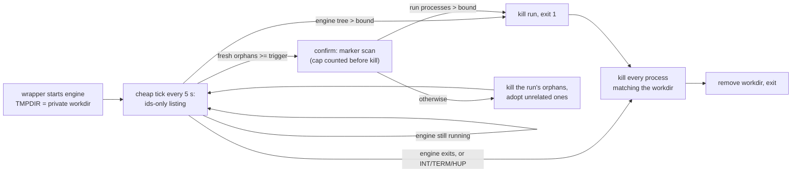

# pg-go-mutate

> Report which assertions a Go package's tests are missing.
> Every surviving mutant is an assertion you do not make.
> More information: <https://github.com/phillipgreenii/nix-repo-base>.

- Analyze the current package:

`pg-go-mutate`

- Analyze a specific package (a directory, walked recursively):

`pg-go-mutate ./internal/collect`

- Include tests behind build tags:

`pg-go-mutate --tags {{contract,smoke}} ./internal/collect`

- Emit machine-readable output:

`pg-go-mutate --json ./internal/collect`

- Widen parallelism on an idle machine (default is 1; above 1, per-mutant verdicts are not reproducible against the same source):

`pg-go-mutate --workers {{4}} ./internal/collect`

- Raise the per-mutant test timeout for a slow suite (does NOT bound the compile phase):

`pg-go-mutate --timeout {{180}} ./internal/collect`

- Keep the harvested engine report instead of deleting it on exit, and print its path (the worklist output is unchanged; this only preserves the underlying per-mutant report file):

`pg-go-mutate --keep-report ./internal/collect`

- Show usage:

`pg-go-mutate --help`

## Reading the output

Real output from `pg-go-mutate modules/jira`, **truncated** — the full worklist ran to 202 entries,
and the repository root is abridged to `…`:

```
pg-go-mutate: 202 surviving mutants in …/modules/jira

cmd/pjira/main.go
    L40   Replace != with >   [conditional_binary]
    L52   Replace branch condition "path == \"\"" with true   [branch_condition]
    L52   Replace branch condition "path == \"\"" with false   [branch_condition]
    L52   Replace == with <   [conditional_binary]
    L56   Replace branch condition "err != nil" with false   [branch_condition]
    L57   Replace return err with return nil   [error_nilify]
    L64   Replace branch condition "cfg.BaseURL == \"\"" with false   [branch_condition]

pkg/pjira/adf.go
    L12   Replace branch condition "len(raw) == 0" with false   [branch_condition]
    L12   Replace == with <   [conditional_binary]

[… 193 further entries omitted, including 3 more files …]

Each surviving mutant is an assertion your tests do not make.

  killed 214  survived 208 (202 actionable, 6 no-op)  not-viable 21  timed-out 0  errors 0
```

Counts move by a mutant or two between runs on identical source — including which mutants are
viable — so verify a fix by re-running and checking that **that specific mutant** is now killed,
never by comparing totals.

- Each entry is a **file**, a **line**, the mutation, and the operator that produced it. Write an
  assertion that would fail under that mutation, then re-run and confirm that specific mutant —
  matched on `file:line:type` — is now killed.
- `survived 208 (202 actionable, 6 no-op)` reconciles the summary with the first line: the raw
  bucket counts every survivor so the five statuses sum to the mutant total, while **no-op** mutants
  (where the mutated code is identical to the original, so no assertion can ever kill them) are
  excluded from the worklist and from the headline count.
- The exit status is **0** whenever an analysis completed, however many mutants survived. This is a
  diagnostic and gates nothing; a non-zero exit means the run itself failed.

| Code | Meaning                                                                          |
| ---- | -------------------------------------------------------------------------------- |
| `0`  | Analysis completed, however many mutants survived.                               |
| `1`  | Operational failure not covered by a more specific code below.                   |
| `2`  | Usage error: invalid flags or arguments.                                         |
| `3`  | Every concurrency semaphore slot is held by another mutation run.                |
| `10` | Target has no test files.                                                        |
| `11` | Target not enumerable (not a Go module, or the module does not load).            |
| `12` | Target unhealthy: does not vet, or tests already fail on unmutated source.       |
| `13` | Environment precondition failed: `go` or the pinned engine absent or mismatched. |
| `14` | Target path is absent or not a directory.                                        |

## Process containment

The engine enforces `--timeout` per mutant, but a test that hangs can leave processes behind (a re-executed test binary, a child that called `setpgid`). `pg-go-mutate` therefore contains every run:

- Each run uses a private working directory. The engine starts with `TMPDIR` and `PGM_RUN_WORKDIR` set to it, and every test binary is built beneath it, so the directory path appears in the environment or command line of every process the run starts. Those processes are the run's own; no concurrent run's can match.
- Before the wrapper exits, it MUST kill every such process, including ones in their own process group and ones orphaned to pid 1. This happens on normal exit, on an error, and on `INT`, `TERM` and `HUP`. The exit status and the report are unchanged.
- During the run, a watchdog keeps the run bounded and its orphans reaped. It works in two tiers so that it stays cheap:
  - **Cheap tick.** Every `PGM_WATCHDOG_INTERVAL` seconds (default 5) it takes one ids-only listing of every process (`ps -ax -o pid=,ppid=`, about 59 ms on a 900-process host, against about 237 ms for the full scan). From that listing alone it counts the engine's process tree, and the "fresh" orphans: processes re-parented to pid 1 that are neither in the engine's tree nor in the baseline of orphans that were already there when the run started. Fresh orphans that fork count with their whole subtree, because a timed-out test binary that is orphaned and then forks (the `pg2-a0trg` shape) has children whose parent is neither the tree nor pid 1.
  - **Confirm.** Only when that count reaches `PGM_WATCHDOG_ORPHAN_TRIGGER` (default 16) does it run the expensive marker scan (`ps -axwwE`, the same scan the final kill uses) to find the run's own processes, and kills the run's orphans and what they spawned. Unrelated orphans that the scan shows are not the run's are added to the baseline, so they cannot trigger it again.
- The watchdog also bounds the run. If the engine's process tree holds more than `PG_GO_MUTATE_MAX_PROCS` processes (default 256), or a confirm finds more than that many processes belonging to the run, the run is aborted: all its processes are killed and the wrapper exits 1 with a message naming the bound. The confirm counts BEFORE it kills anything, so a storm of orphans cannot hide from the bound by being reaped first. `0` disables the bound. A non-numeric value is a usage error (exit 2), as is a `PGM_WATCHDOG_INTERVAL` that is not a positive number or a `PGM_WATCHDOG_ORPHAN_TRIGGER` that is not a positive integer.

The bound counts the engine, the compilers, the test binaries and everything the tests spawn. A healthy run holds a few dozen; the incident this guards against (bead `pg2-a0trg`) reached about 5000. `ulimit -u` is deliberately not used: it limits the whole user, not one run, so a low value would starve unrelated processes.

Accepted limits of the cheap tier:

- A few lone leftovers (fewer than the trigger) are not killed mid-run. They accumulate until the trigger is reached, or are killed by the final kill at exit.
- A fork storm gets up to one tick (5 s by default) of head start. A faster bomb needs `ulimit -u`, which is deliberately not used.
- The listing is not atomic: a child whose parent has just exited briefly shows as re-parented to pid 1 and counts as fresh. That is harmless below the trigger.
- Concurrent runs can trigger each other's confirm, since their orphans look fresh to every watchdog. That is harmless, because the marker scan only matches this run's own workdir, but it is not free.
- Where orphans are re-parented to a subreaper instead of pid 1 (a Linux systemd user session, some containers), the cheap tier cannot see them; the final kill still can.


