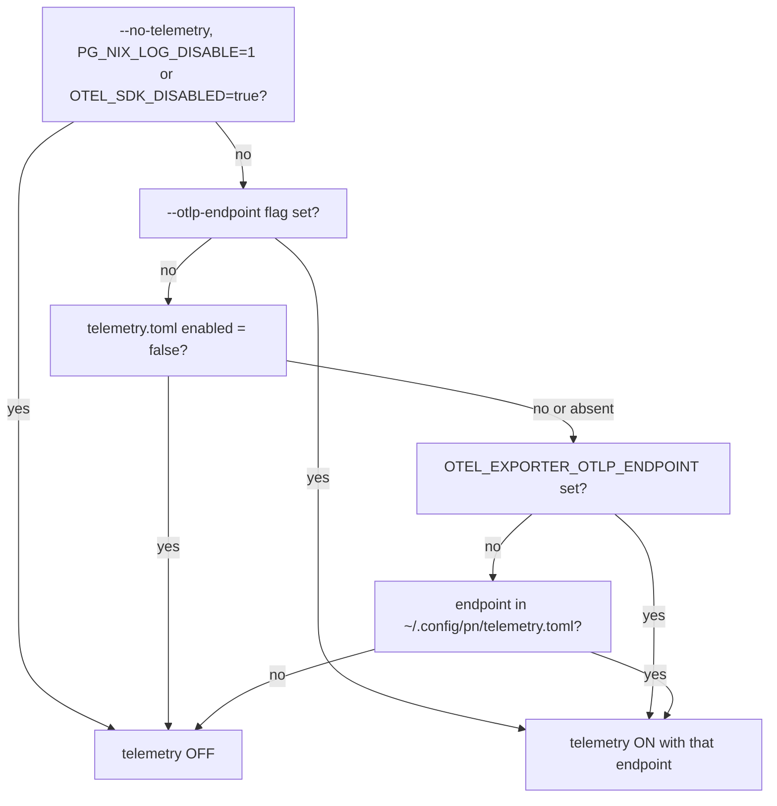

# pn — workspace flake orchestration

`pn` is a Go program that bootstraps and maintains a `pn-workspace.toml` project, coordinating nix flake dependencies across multiple local git repositories.

## Telemetry (always built, switched at run time)

pn is always built to emit OpenTelemetry traces and metrics over OTLP/HTTP to a collector, and to
route long-running nix calls through the `pg-nix-log-wrapped` wrapper (design and rationale: ADR
0028, "Amendment 2026-10-08"). The `pg-nix-log-wrapped` package is installed on every system.
Whether a given system actually emits is a **runtime** setting in `~/.config/pn/telemetry.toml`
(endpoint URL, `enabled`, `wrapper_path`), read on every run, so flipping it needs no rebuild or
re-install. When off, pn creates no exporter, opens no connection, starts no goroutine and writes no
file: its behavior and output are byte-identical to a build without telemetry, and `pn workspace
doctor` raises no finding. When on, pn assumes the collector is there; an unreachable collector is
tolerated (see below) and a visible error is acceptable.

For a non-root process the decision is, first match wins:



`~/.config/pn/telemetry.toml` is generated by the home-manager module
(`phillipgreenii.pn.telemetry.{enable, endpoint, wrapperPath}`) on every system and has three
optional keys: `enabled` (boolean, the per-system runtime switch; absent means "on iff an endpoint
resolves"), `endpoint` (the OTLP/HTTP URL) and `wrapper_path`. `enable` in the module is the value
written to `enabled`; it is not an install gate. A root process never reads the file. Under `sudo`,
pn runs the wrapper only if `wrapper_path` resolves (after symlinks) into `/nix/store`; there is no
environment override. `enabled = true` with no endpoint anywhere leaves telemetry off, and doctor
warns about it.

When telemetry is on and `wrapper_path` is an executable file, the long-running nix calls
(`build`, `apply`, `flake-check`, `format`, `nix`, the propagate step of `update`, and `tree`'s lock
call) run as `pg-nix-log-wrapped --traceparent TP --otlp-endpoint URL --log-dir DIR -- <command>`
(`sudo <wrapper> ... -- <command>` for the exact `sudo darwin-rebuild|nixos-rebuild|nix` form, without
`--log-dir`). Probes, `sudo nix-store`, any other `sudo` form and a `build_command` such as `sh -c ...`
run unwrapped, as does everything when the wrapper is missing or telemetry is off. The command's own
arguments, including every `--override-input`, reach it unchanged, and `--show-nix-commands-only`
prints the unwrapped command (ADR 0028).

With telemetry on, hooks and `update-locks.sh` additionally get `TRACEPARENT` (the `pn.exec` span of
their own call) in their environment, so nix they run nests under the `pn.verb` trace; their argv is
never rewritten and with telemetry off their environment is untouched (ADR 0028).

### Escape hatches

| Control                            | Effect                                                                                                             |
| ---------------------------------- | ------------------------------------------------------------------------------------------------------------------ |
| `telemetry.toml` `enabled = false` | Off for the system, no rebuild (module: `phillipgreenii.pn.telemetry.enable = false`; the wrapper stays installed) |
| `pn --no-telemetry`                | Off for one pn run                                                                                                 |
| `PG_NIX_LOG_DISABLE=1`             | Off for pn; the wrapper execs its command unmodified (the pre-wrapper behavior)                                    |
| `pg-nix-log-wrapped --check`       | Prints the resolved endpoint, whether it is reachable, and whether the log directory is writable                   |
| `OTEL_SDK_DISABLED=true`           | Both binaries off                                                                                                  |
| `PG_NIX_LOG_DEBUG=1`               | The wrapper prints diagnostics to stderr (it is otherwise silent when it fails open)                               |

The same table is printed by `pn --help`.

### Finding a run's trace

stdout never changes. Two stderr/file affordances exist:

- `trace: <trace_id>` is printed to **stderr** at the end of a run only under `-v`/`--verbose` or
  `PN_TRACE_HINT=1`.
- `pn workspace update` writes the same id as `trace_id` on its `run_start` and `run_end` records in
  `${XDG_STATE_HOME}/pn/events.jsonl`, so it can be found from Loki or the file.

When telemetry is enabled, pn probes the collector with one bounded TCP connect. If it does not
answer, pn runs with telemetry off for that run; under `-v` it prints
`telemetry disabled: collector unreachable (<endpoint>)` to stderr, otherwise it is silent. If the
collector answers the probe but a later export fails, the OpenTelemetry SDK's own error line may
appear on stderr; that visible error is accepted, and `enabled = false` is the remedy for a system
with no collector.

`-v`/`--verbose` is a global flag. (`pn -v` used to print the version via cobra's default shorthand;
use `pn --version`.) `pn workspace nix` forwards everything after `nix` to nix untouched, so a `-v`
there is nix's.

`pn workspace doctor` has a `telemetry` check: when telemetry is on it runs `pg-nix-log-wrapped --check`
and reports a missing wrapper or a failing check as a warning (never an error); a configured-on
system whose collector is unreachable, and `enabled = true` with no endpoint, are warnings too. It is
silent when telemetry is off.

## pn workspace build and apply: one pipeline

Agents may not run `pn workspace apply`, so `pn workspace build` exists to reproduce what apply
would hit. Both verbs therefore run ONE shared prelude (`Workspace.rebuild`, a Template Method in
`internal/workspace/rebuild.go`), in this order: require a terminal, open the `pn.repo` span, resolve
the `--override-input` set once, check follows, substitute the command template (one shared
hostname resolver for `{hostname}`; an unresolvable hostname is an error when the template uses
it), the dry-run exit, tool resolution (below), the workspace trust gate, the single-flight lock (below), the workspace-id uniqueness check, and the nix
daemon health check (`nix eval --expr true`). A parity contract test
(`rebuild_parity_test.go`) records the prelude step names for both verbs and fails if they diverge.

After the prelude the verbs differ, deliberately:

- **build** prints one read-only line, then builds. It evaluates apply's skip gate without writing
  anything and reports `apply would: skip (unchanged)` or
  `apply would: rebuild (<reason>)`, where the reason is `dirty`, `head_changed` (a repo's HEAD
  differs from the recorded applied ref) or `no_record` (no applied-state record). `forced` is the
  fourth rebuild reason and only `apply --force` produces it. If the gate itself fails (an unreadable
  record, a failing `git`) the line reads `apply would: fail (<error>)`, which is what apply would
  do, and the build still runs. Build NEVER skips and NEVER writes applied state. Its output is retained in a build log like apply's (see "the apply log" below).
- **apply** runs the skip gate for real (skipping when nothing changed), opens the apply log, captures
  each repo's HEAD, runs the apply command (or, with `activate_command` set, the build-as-user flow
  below), diffs the system profile with nvd, restarts a stale fsmonitor daemon, and records the
  applied state.

### Build-as-user apply (`activate_command`, ADR 0038)

With the optional `[workspace].activate_command` UNSET, apply runs the single `apply_command`
(`sudo darwin-rebuild switch ...`) exactly as before. With it set (for example
`activate_command = "sudo {out}/sw/bin/darwin-rebuild activate"`), apply builds as YOU and only
the profile set and the activation run as root:

1. **Preflight** (no process): `/run/current-system/sw/bin/nix-env` is executable and the per-run
   directory can be created. If not, one line is printed and the legacy `apply_command` runs before
   anything is built.
2. **Build**, as the invoking user, wrapped like `pn workspace build` (so its nix JSONL lands in
   `~/.local/state/pn/nix-logs`, not in root's `/var/log/pg-nix-log-wrapped`), with the working
   directory a private mode-0700 directory `${XDG_STATE_HOME:-$HOME/.local/state}/pn/apply-build/run-<random>`.
   `darwin-rebuild build` leaves `./result` in its cwd, so the link is private to the run. Removed
   afterwards on success, failure and cancel; a stale one older than 24 h is pruned at the next apply.
   `build_command` MUST therefore leave `./result` in its cwd (a `darwin-rebuild build`).
3. **Read and validate** the out path from `R/result`, once, before any root process: absolute,
   clean, one element under `/nix/store`, with an executable `activate` and `sw/bin/darwin-rebuild`.
   The invoked path is validated, not its realpath. A missing or invalid result is an error, never a
   second build.
4. **Probe** the built system as the user: `<out>/sw/bin/darwin-rebuild --help` must exit 1 with a
   usage line listing `activate`, `switch` and `build` on stderr. Otherwise pn announces
   `apply: built system has no usable 'darwin-rebuild activate' (<reason>); falling back to: ...` and
   runs `apply_command` (root re-evaluates); with no `apply_command` it fails naming the reason.
5. **Set the profile** (hard-coded, not templated): `sudo env -i HOME=/var/root NIX_REMOTE=daemon
PATH=/run/current-system/sw/bin:/usr/bin:/bin /run/current-system/sw/bin/nix-env -p
/nix/var/nix/profiles/system --set <out>`.
6. **Activate**: the `activate_command` expansion (`sudo <out>/sw/bin/darwin-rebuild activate`).

The sudo prompt now comes after the build; pn prints `apply: waiting for sudo ...` first. A cancel
during the build stops its whole process tree and starts no root step; once the profile set has
started, both root steps run to completion and the cancel is reported afterwards. `{out}` is valid
only in `activate_command`, whose `argv[0]` MUST be `sudo` and whose program MUST be one element
beginning with `{out}/`. `pn-workspace-toml-enforce --activate-command` enforces the key (an empty
value leaves it untouched and never deletes it). The step errors are `apply failed: build:`,
`read build result:`, `set system profile:` and `activate:`; the apply log's `failed_step` names
the step and the process exit code is the failed step's own.

### Single-flight lock: two runs cannot overlap

On 2026-10-26 an apply and a build ran at the same time with the same 423-derivation plan, doubling
the work on the same build slots. The prelude therefore takes `flock(2)` locks (the `acquire_lock`
step, after the trust gate and before any probe or build; `internal/workspace/rebuildlock.go`)
under `$XDG_STATE_HOME/pn/locks/` (fallback `~/.local/state/pn/locks/`). The kernel drops a flock when
pn dies, so a killed run never leaves a stale lock and there is nothing to clean up. The holder writes
one JSON object into the file (`pid`, `verb`, `root`, `terminal`, `started`). Two keys:

| Key   | File                                       | Scope                              | Who holds it                                                                                             |
| ----- | ------------------------------------------ | ---------------------------------- | -------------------------------------------------------------------------------------------------------- |
| apply | `apply-<terminal>-<hostname>.lock`         | host-wide, from ANY workspace root | `apply`, exclusively; `build` only probes it (fails while an apply holds it)                             |
| build | `build-<sha256 of root and terminal>.lock` | one workspace root and terminal    | `build`, exclusively; `apply` ALSO takes its own root's build key for its whole run, not for other roots |

So an apply from any root blocks a second apply, a build in the same root blocks an apply in that root
(and the reverse), two builds in one directory (which would rewrite the same `./result`) conflict, and
a build in a workforest set fails while the canonical apply runs, while builds in different sets do
not conflict. An apply does not wait for builds in other roots. The apply's build key is defense in
depth (it de-duplicates identical plans); the real pin of `./result` is the private per-run directory
(pg2-sdbhh4.9).

On contention the run fails fast with exit status **75** (sysexits `EX_TEMPFAIL`; distinct from 1,
2, and 69) and a message naming the holder (pid, verb, root, start time). Pass `--wait=<duration>`
(for example `--wait=5m`) to block up to that long instead; a bare `--wait` waits indefinitely. The
value MUST be written with `=`: `--wait` takes an optional value, so `--wait 5m` is NOT parsed as the
value (pn rejects the stray `5m` argument rather than waiting forever). A waiting run holds nothing
while it polls, so a waiting build and a waiting apply in one root cannot deadlock. `--show-nix-commands-only`
takes no lock.

The lock is held until the build or apply returns and is NOT held across post-hooks (the CLI runs
them afterwards). `pn workspace flake-check` is NOT covered by this lock; its concurrency is
tracked separately (pg2-sdbhh4.16).

### Finding darwin-rebuild when PATH lacks it

A shell that does not have the system profile on `PATH` (a fresh agent or workforest session) used to
make `build` and `apply` exit 127 instantly with no `nix.invocation`. The prelude now has a
`resolve_tool` step, after the dry-run exit and before the trust gate, so it runs before any other
subprocess or side effect. It resolves the command's bare tool name (`darwin-rebuild`,
`nixos-rebuild`, `nix`, or the name after a leading `sudo`):

- On `PATH`: nothing changes.
- Not on `PATH` but in `/run/current-system/sw/bin` or `/nix/var/nix/profiles/system/sw/bin` (both
  exist on a nix-darwin machine): that directory is appended to the `PATH` of the child (via
  `RunOptions.Env`; the real runner also looks the name up in that `PATH`). argv is NOT rewritten to
  an absolute path, because the nix wrapper rewrite only recognises the bare names, so the call still
  runs wrapped and keeps its `nix.invocation` telemetry. Under `sudo`, sudo's own `secure_path` /
  `env_reset` policy still decides what the privileged child sees.
- Nowhere: the verb fails at once with `darwin-rebuild not found on PATH (also tried <dirs>); run from
a shell with the system profile on PATH`, exit status 69 (not the 127 a shell reports, so it is
  countable apart from the old failures), no trust-gate, lock or applied-state effect, and one
  `pn.exec` span with `process.executable.name=<tool>`, `process.exit.code=69` and
  `pn.exec.tool_not_found=true`.

Both verbs get this through the shared prelude. `--show-nix-commands-only` only prints and is exempt.

Build's command template has no required `#{hostname}`; when `build_command` includes `{hostname}` it
addresses the same flake output as apply. Neither verb changes how the workspace root is resolved.

## Build-plan size: telemetry and the large-plan warning

While `pn workspace build` or `apply` runs its nix command, pn watches the output for nix's own plan
message (`these N derivations will be built:` / `this derivation will be built:` and
`these M paths will be fetched (X MiB download, Y MiB unpacked):`, with or without ANSI colors, split
across writes in any way). Both verbs share one implementation (`Workspace.runPlanned`,
`internal/workspace/plan.go`). The tap passes the child's bytes through unchanged, so the terminal and
the apply log are byte-identical to before; nothing in pn stops, signals or cancels the command
because of plan size (operator ruling, Phillip, 2026-10-26: monitor first, decide on an abort later
from the data; bead `pg2-sdbhh4.21`).

- **Span attributes** on the `pn.repo` span of the run: `pn.plan.build` (derivations to build),
  `pn.plan.fetch` (paths to fetch) and, when the fetch message carries a size, `pn.plan.download_mib`.
  A run that reached the build step but whose nix printed no plan records 0 builds and 0 fetches. If a
  run prints several plan messages their counts add up.
- **Metric** `pn.plan.builds`: a histogram (unit `{derivation}`), one observation per build or apply
  run that reached the build step (0 when no plan was printed), labelled only by `pn.verb`
  (`workspace build` or `workspace apply`, the same values as `pn.command.duration`). Its bucket boundaries (0, 25, 50, 100, 200, 300, 400, 600, 1000, 2000) are in
  the shared catalog (`x/otelsetup/metrics.go`, `PlanBuildsBuckets`) so that 400, the alert point, is an
  exact edge; a Prometheus bucket is `le`-inclusive, so a plan of exactly 400 counts in `le="400"`.
- **Known limit**: pn's delta metrics undercount (pn runs were 67.6% of the Tempo count in
  `docs/reviews/2026-10-14-pn-nix-telemetry-observation-findings.md`), so the metric can miss a run.
  The `pn.repo` span attributes in Tempo are the complete record; trend and alert on the metric, count
  runs from Tempo.
- **Warning**: when the run's plan has MORE than `workspace.warn_builds` derivations (default 300), pn
  prints ONE line, once per run, at the first line boundary after the plan block ends:
  `pn: WARNING: nix plans to build N derivations and fetch M paths (X MiB download) ... First 10: ...`.
  It also says how to proceed (Ctrl-C to stop; `--cores N` on the nix command for a one-off cap) and that
  pn does not stop the run. At or below the threshold nothing extra is printed. The warning is added to
  the terminal output and the apply log; it never changes the exit code.

`workspace.warn_builds` (in `pn-workspace.toml`):

```toml
[workspace]
warn_builds = 300 # derivations; unset = 300, 0 = never warn, negative = error at config load
```

It is validated when the config is parsed (a negative or non-integer value is an error naming the key)
and survives pn's own rewrites of the file. It only controls the warning: the metric and span attributes
are always recorded.

## Rebuild, hook and exec span attributes

What a trace answers beyond "how long" (bead pg2-sdbhh4.13). The same table is in the
`pg-nix-log-wrapped` skill of the `pn-workspace-rules` plugin.

| Span      | Attribute                      | Values and meaning                                                                                                                                                                                                                                                                                                 |
| --------- | ------------------------------ | ------------------------------------------------------------------------------------------------------------------------------------------------------------------------------------------------------------------------------------------------------------------------------------------------------------------ |
| `pn.repo` | `pn.terminal`                  | The terminal repo key the verb builds or applies.                                                                                                                                                                                                                                                                  |
| `pn.repo` | `pn.hostname`                  | The `{hostname}` the command template used.                                                                                                                                                                                                                                                                        |
| `pn.repo` | `pn.builder`                   | The `{builder}` (activation tool) the template used, e.g. `darwin-rebuild`.                                                                                                                                                                                                                                        |
| `pn.repo` | `pn.override.count`            | How many `--override-input` pairs pn passed.                                                                                                                                                                                                                                                                       |
| `pn.repo` | `pn.apply.force`               | `true` only for `apply --force` (always `false` for build).                                                                                                                                                                                                                                                        |
| `pn.repo` | `pn.apply.rebuild`             | Apply's skip-gate verdict: `false` for a skipped apply (about 1 s), `true` for a real rebuild. For `build` it is the read-only "apply would" verdict. Absent when the gate itself failed.                                                                                                                          |
| `pn.repo` | `pn.apply.rebuild_reason`      | Why: `forced`, `dirty`, `head_changed`, `no_record` or `unchanged`.                                                                                                                                                                                                                                                |
| `pn.repo` | `pn.plan.build`                | Derivations nix planned to build (bead pg2-sdbhh4.10; see the build-plan section).                                                                                                                                                                                                                                 |
| `pn.repo` | `pn.plan.fetch`                | Paths nix planned to fetch (same bead).                                                                                                                                                                                                                                                                            |
| `pn.hook` | `pn.hook.when`                 | `pre` or `post`. One `pn.hook` span per fired hook event, a child of `pn.verb` (outside every `pn.repo`), so hook time is no longer hidden in the verb duration. An event with no matching hook has no span.                                                                                                       |
| `pn.hook` | `pn.hook.name`                 | The pn command the event belongs to (`apply`, `rebase`, ...), not the hook command line.                                                                                                                                                                                                                           |
| `pn.hook` | `process.exit.code`            | The failing hook command's exit status (1 when it has none), 0 on success. A post-hook failure is warn-only for the command but still marks the span Error.                                                                                                                                                        |
| `pn.exec` | `pn.exec.subcommand`           | Closed allowlist, `other` otherwise: `darwin-rebuild build\|switch\|activate\|check`, `nixos-rebuild build\|switch\|test\|boot`, `nix-env`, `nix-store`, `nix build\|eval\|fmt\|run\|path-info\|flake check\|flake update\|flake lock\|flake metadata\|store gc`. Tells `sudo darwin-rebuild switch` from `build`. |
| `pn.exec` | `pn.exec.wrapped`              | Set on a call that asked to run under `pg-nix-log-wrapped`: `true` if it did.                                                                                                                                                                                                                                      |
| `pn.exec` | `pn.exec.wrap_skip_reason`     | When `pn.exec.wrapped` is `false`: `telemetry_off`, `no_endpoint`, `no_wrapper_path`, `unrecognized_form`, `sudo_wrapper_not_in_store`, `wrapper_not_absolute` or `wrapper_not_executable`. A lost wrapper no longer looks like a missing nix run.                                                                 |
| `pn.exec` | `error.type`, `process.signal` | `error.type=signal` and `process.signal` (`SIGINT`, `SIGTERM`, ...) when the command exited 130, 143 or died on a signal (exit status -1). `pn.verb` marks 130 and 143 the same way.                                                                                                                               |

These are span attributes only. `pn.command.duration` keeps its `pn.verb` and `status` dimensions
and gains none of them (cardinality). The `pn.exec.subcommand` normalizer looks through a leading
`sudo`, then `env` with `-i` and `NAME=VALUE` tokens, and takes the basename of an absolute `argv[0]`
(so `sudo env -i HOME=... nix-env ...` and `sudo <out>/sw/bin/darwin-rebuild activate` are named
correctly); flag values are skipped with the same table the nix deny-list uses. None of this changes
argv: the attributes are observations only.

## pn workspace apply: the apply log

Every `pn workspace apply` (and the apply step of `upgrade`) that actually REBUILDS, and every
`pn workspace build`, keeps a copy of everything it printed, so a post-apply check can read what the apply said instead of inferring it.
Before this existed nothing retained the output: `events.jsonl` holds workspace-update events only,
`nix-logs/*.jsonl` holds the nix wrapper's raw nix JSON (for a build-as-user apply, the user build's,
in your own `nix-logs` directory; for a legacy `sudo darwin-rebuild switch` apply or a fallback that
is root-only, under `/var/log/pg-nix-log-wrapped`; either way it carries nix messages, not the
activation script's own output), and `~/.local/share/pn-workspace/applied/` holds applied-state records.

- **Location**: `${XDG_STATE_HOME:-$HOME/.local/state}/pn/apply-logs/<verb>-<UTC start, yyyymmddThhmmssZ>-<pid>.log`
  with `<verb>` `apply` or `build` (mode 0644, outside the nix store). `apply-logs/latest` is a symlink
  to the newest APPLY log (it never moves for a build) and `apply-logs/latest-build` to the newest
  build log. The directory is a subdirectory so the Loki `pn/*.jsonl` glob never ingests it.
- **When**: from the moment pn has decided to rebuild, for exit 0 and non-zero alike. An apply that
  is skipped because nothing changed, a `--show-nix-commands` dry run, and a failure before the
  rebuild (untrusted workspace, nix daemon down) write no log, so they never evict a real one. A
  `pn workspace build` always builds, so it always writes one (bead pg2-sdbhh4.14; before it a 29,037 s
  failed build left no human-readable record). Both verbs retain through the same code path
  (`Workspace.rebuild`).
- **Contents**: a header (`started_at`, `terminal`, `command`, then `log_format: 2`, `trace_id` (the
  `pn.repo` span's trace, `none` with telemetry off), `rebuild_reason` (`forced`, `dirty`,
  `head_changed`, `no_record`, `unchanged` or `unknown`; for build the read-only "apply would"
  verdict), `max_jobs` and `cores` (read from `/etc/nix/nix.conf` only, as a bare token such as `3` or
  `auto`, `unknown` when absent: no subprocess, and nothing else from the file because the log is
  world-readable)); for the build-as-user apply, the set-profile, activate and fallback commands
  (`<out>` for the out path); for apply, the `applied refs` section (each repo's `git rev-parse HEAD`,
  taken immediately before the build, i.e. the `applied_ref` the applied-state record gets); then the
  combined stdout and stderr exactly as the terminal received them (for build, starting at the
  `apply would:` line); then a trailer: `ended_at`, `exit_status` (the command's exit code; `143` and
  `130` for a signalled wrapper exit, `-1` = killed directly by a signal, `none` = it never started),
  `failed_step` (build-as-user apply only: `build`, `read-result`, `probe`, `set-profile`, `activate`
  or `none`), `result` (`success` or `failed`, and `error:` when failed), then the phase times
  `prelude_seconds`, `build_seconds`, `activate_seconds` (apply only: set-profile plus activate,
  including the wait for sudo; a legacy single-command apply folds this into `build_seconds`) and
  `post_steps_seconds` (apply only: nvd diff, fsmonitor restart, markApplied), and
  `plan: builds=N fetches=M [download_mib=X]` when the build step ran. Phase times and the plan live
  in the trailer ONLY, never in the output section, whose contract is verbatim terminal output; a
  phase the run never reached has no line. Post-HOOK time is not a phase: hooks run after the trailer
  is written, and show only as `pn.hook` spans in the trace.
  A file with NO `--== pn apply end ==--` (build: `--== pn build end ==--`) trailer is a run that was
  killed before pn could finish (SIGKILL, power loss): read it as incomplete, never as success.
- **Format version**: `log_format: 2` in the header. A log without that line is version 1 and keeps
  every key it had; the version-2 keys (`trace_id`, `rebuild_reason`, `max_jobs`, `cores`, the phase
  lines, `plan`) are absent from it, so a reader treats a missing key as unknown.
- **Retention**: the newest 30 logs PER VERB are kept; opening a new log removes that verb's older
  ones (ordering by file name, which embeds the start time), so builds never evict apply logs or the
  reverse. Only `apply-*.log` and `build-*.log` files are ever removed.
- **Never in the way**: the terminal output is unchanged; the log is a tee. If the log cannot be
  created pn prints one `warning: could not retain the apply log` (build: `build log`) line and
  carries on. A grandchild that keeps the output pipe open after the command exits is bounded by the
  same `WaitDelay` as before (pg2-gb5ng), so the log cannot make a run hang.

To verify "the apply output shows X": `grep -n X "${XDG_STATE_HOME:-$HOME/.local/state}/pn/apply-logs/latest"`
(a build: `latest-build`), after checking the trailer's `ended_at` and `exit_status` belong to the run
under test.

## pn workspace flake-check --no-build

`pn workspace flake-check` runs `nix flake check` in every workspace repo (topological order) with the
sibling `--override-input` set, which builds the checks. `pn workspace flake-check --no-build` is the
**land check**: it evaluates and builds nothing.

```text
pn workspace flake-check --no-build [--rev <rev>] [--caller manual|ff-1c] [--no-ifd] [<repo-or-path>]
```

For each repo (or the selected one) it runs, from the repo's directory,
`nix eval --no-write-lock-file <override args> --json <flake>#<set>.<system> --apply 'set: builtins.mapAttrs (n: v: v.drvPath or null) set'`
for `checks`, `packages` and `devShells`, so an evaluation error (a missing option, a throw, a bad
import) fails the check while no derivation is built and `flake.lock` is never written. The override
set is the one `build`, `apply` and the plain `flake-check` use, read from the siblings' working trees,
so a repo whose locked siblings lag the local clones needs no push and no relock.

It is **not** nix's own `nix flake check --no-build`: that mode runs read-only, so a source tree copied
into the store during evaluation reads back as `path '...' is not valid` unless the same copy is
already there, and the verdict depends on store warmth. The drvPath evaluation is not read-only, so it
gives the same verdict on a cold and a warm store.

`<repo-or-path>` selects one repo: a workspace repo key (the canonical clone), or a path to the repo or
one of its git worktrees (that directory is evaluated, against the canonical siblings). `--rev <rev>`
evaluates that commit of the selected repo instead of its working tree. A failure is a failure: no
retry and no inconclusive class. Exit 0 all evaluated, 10 a check ran and a repo failed, 2 a bad invocation, 1 any other (generic) error. Every run
appends one JSON line per repo to `${XDG_STATE_HOME:-$HOME/.local/state}/pn/flake-check-no-build.jsonl`
(`ts`, `repo`, `caller`, `duration_s`, `outcome`, `nix_exit`, `failed_sets`, `first_error`); an unwritable
state directory only warns. `docs/hooks.md` ("The eval-only pre-land check") has the full contract and
describes `pre-land-eval`, the land step's caller of this command.

## pn workspace doctor

`pn workspace doctor` audits a pn workspace against the build-equality invariant and (with `--fix`) repairs the safe drifts.

**The Invariant (one sentence):** If `doctor` reports no errors, a local override build (`--override-input git+file://<clone>` for each workspace dependency) and a pure-remote build (a plain nix build that uses each repo's committed `flake.lock`, no local overrides) produce the same output.

### Modes

- **Primary mode**: Compares local checkouts against the remote default branch (obtained via `git ls-remote` on the canonical URL).
- **Worktree mode**: Relaxes to branch-name uniformity across the set and drops remote checks; dirty trees become warnings instead of errors.

### Flags

- `--fix` — Apply safe, auto-fixable repairs (respects dependency order).
- `--dry-run` — Print the fix plan without applying changes (requires `--fix`).
- `--offline` — Skip remote-dependent checks; reported as skipped, never silently ok.
- `--json` — Machine-readable output (on stdout only; no banner or progress).
- `--strict` — Treat warnings as errors for the exit code.

### Exit Codes

- `0` — No errors (and, under `--strict`, no warnings). Local and remote builds will match.
- `10` — Errors present (or any finding under `--strict`): the check ran and reported failures.
- `1` — Doctor itself failed (e.g., `ls-remote` unreachable without `--offline`): a generic error, not a finding.

### Important Note: flake-lock-fresh Fix

The `flake-lock-fresh` fix delegates to `pn workspace update`, which is the only fix that pushes. It relocks affected repos, commits the new lock, and pushes to remote — the one auto-fix that modifies remote state. It is always gated behind `--fix` and shown in `--dry-run`.

### Important Note: ruff-pin (single-ruff-version invariant)

A uv Python package's `ruff` dependency and the nixpkgs `ruff` that the hook bundle's hooks (`prek-config.json`) execute format the SAME files. They are pinned independently — the uv one by `pyproject.toml`, the nixpkgs one by the flake's `nixpkgs` input — so unless they name the same version they can disagree, and a mutating pre-commit formatter then trips pre-commit's "files were modified by this hook" rule mid-commit.

The `ruff-pin` check asserts they agree:

- `ruff-pin-drift` (ERROR) — the package is exact-pinned, but to a different version than the hooks run. This is what a nixpkgs ruff bump produces, and surfacing it is the point: the pin must be bumped in the same change.
- `ruff-pin-floating` (WARN) — the package's spec is not an exact pin (`>=`, `~=`, `==x.y.*`, a range, or unbounded), so a `uv lock` can float it across a formatter-behaviour boundary.
- `ruff-pin` (SKIP) — the hook bundle's `prek-config.json` exists only once the hooks are installed (ADR 0032), so it is absent in a fresh clone until then. The nixpkgs side is then unknown and nothing is asserted; run `nix run .#install-pre-commit-hooks` and re-run doctor.

The check is read-only and **not** auto-fixable: the remedy is a pin edit plus a `uv lock` relock plus, across a formatter boundary, a reformat of the affected sources. Each finding carries that sequence as its `Manual` hint. Repos that declare no `ruff` dependency, or whose generated config runs no nixpkgs ruff hook, produce no findings.

### Example: Clean Run

```
$ pn workspace doctor
workspace doctor — primary checkouts (origin/main is the baseline)

=== workspace ===

=== phillipg-nix-repo-base ===

=== phillipgreenii-nix-support-apps ===

workspace doctor: no errors (0 warnings). local and remote builds will match.
```

### Example: Run with Findings

```
$ pn workspace doctor --fix --dry-run
workspace doctor — primary checkouts (origin/<branch> is the baseline)

=== dep ===
  ERROR branch-current        repo "dep" is not on its default branch "main" (on "feature") [manual]
          ↳ git -C /workspace/dep switch main
  WARN  repos-extra            git repo "stray" is on disk but not in pn-workspace.toml [fixable]

=== lib ===
  ERROR flake-lock-fresh      flake.lock input "dep" (→ "dep") pins abc1234 but "dep" is at def5678 [would fix]
  SKIP  branch-synced         remote comparison skipped [—]

workspace doctor: 1 errors, 1 warnings.
```
