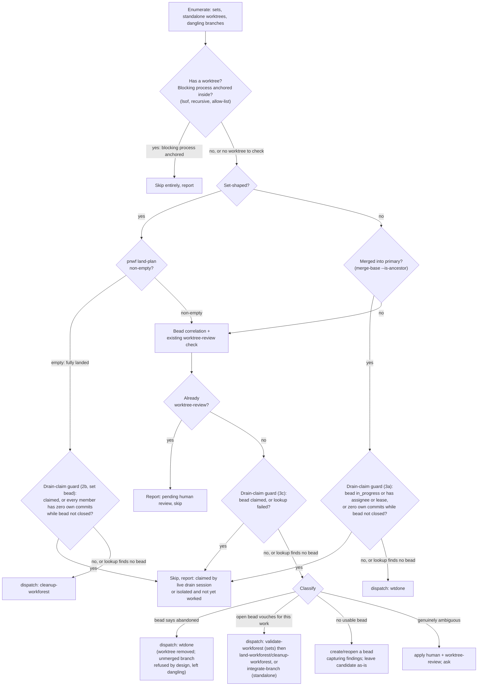

# audit-worktrees

**RUN FROM: the canonical pn-workspace root.** Confirm with `pn workspace discover`; a non-zero
exit or "no workspace found" means this skill does not apply here — halt and report. This skill
is scoped to the repos the workspace declares, not to arbitrary git repos on the machine.

## Purpose

A **Facade** over existing primitives (`pa-monitor`, `wtdone`, `integrate-branch`,
`validate-workforest`, `land-workforest`, `cleanup-workforest`, `bd`) that answers one question,
workspace-wide, for every branch and worktree that exists but is not the canonical checkout of a
repo's primary branch: **is anything still using this, and if not, what disposes of it?** It adds
no new git or landing mechanics of its own beyond the classification logic — every mutating
action it takes is executed by a skill or tool that already implements that action correctly.

## Disambiguation

- **Not a single-target tool.** For one already-identified branch or set, call `integrate-branch`,
  `land-workforest`, or `cleanup-workforest` directly — this skill's only job is the workspace-wide
  sweep and the classification that decides which of those to invoke, on what.
- **Not a bead-quality pass.** It reads and writes beads only to record disposition and hand off
  unfinished work; it does not groom titles/acceptance-criteria (`bead-grooming`'s job).
- **Never finishes the underlying work itself.** This skill MUST NOT write, edit, or complete any
  code toward a branch's own goal. The **orchestrator** — this skill's own execution — takes only
  three kinds of direct action: read-only research, bead bookkeeping (create/reopen/close/
  annotate), and applying/checking the `human`/`worktree-review` labels. Every action that
  mutates a candidate's git state (landing it or removing it) is delegated to a **dispatched
  action subagent** (Command pattern: the orchestrator decides _which_ disposition applies, the
  subagent executes it). The action subagent itself invokes the highest-level existing mechanism
  that does the job — `wtdone`, `integrate-branch`, `land-workforest`/`cleanup-workforest` — and
  MAY fall through to direct git plumbing (`git worktree add`, `git worktree remove`) only as
  that mechanism's own documented low-level step, never as a substitute for it (see Step 3's
  "no force-delete" policy below for the one place this matters).

## Safety contract (MUST)

- MUST run the liveness check (Step 2a) before any research or action on a candidate that has a
  worktree. MUST NOT act on, or write a bead about, a candidate a blocking process (per Step 2a's allow-list) is anchored in.
- MUST run the drain-claim guard (Step 3a) before dispatching `wtdone` (or `integrate-branch`,
  whose FF-4 runs `wtdone` on a successful land) for ANY candidate, not only a merged one: Step 2b
  (sets), Step 3a (merged) and Step 3c (abandoned, vouched, stopped) each apply it, and Step 3d
  lists every `wtdone` path with its guard or its reason it cannot hit a live drain worktree.
  MUST NOT remove a candidate whose correlated bead is not `closed` and is `in_progress` or has a
  non-empty assignee or lease ("claimed by live drain session"), and MUST
  NOT treat a branch with zero commits of its own ahead of the primary as merged while its bead is
  not `closed`: a freshly isolated drain worktree is vacuously an ancestor of the primary, and the
  Step 2a `lsof` probe cannot see a drain-pool session. If the bead lookup fails, MUST fail closed
  (leave the candidate in place).
- MUST check a correlated bead's **existing** labels before classifying it (Step 2c/3b). A bead
  already carrying `worktree-review` is, per `beads-lifecycle` W-3/W-4, **not to be re-labeled,
  re-promoted, or re-classified** — it stays exactly as a prior pass left it until a person
  records a verdict. Report it as "already pending human review" and move on.
- MUST NOT act on a candidate whose disposition is genuinely ambiguous — apply
  `human`+`worktree-review` and move on to the next candidate instead.
- MUST invoke the `beads-lifecycle` skill before any `bd create`/`update`/`close`, and before
  applying or removing the `human`/`worktree-review` labels, per its always-on tripwire.
- MUST run every `bd` lookup/write for a candidate from inside that candidate's own repo (its
  canonical clone or worktree), never from an unrelated cwd — `bd` resolves its database by
  filesystem walk-up, and a token extracted from a branch name resolved against the wrong
  tracker context could coincidentally hit an unrelated bead. Prefer the `bd search`/`bd list
--label <repo-label>` fallback's title match to corroborate a bare id-token hit.
- MUST NOT force-delete a branch (`git branch -D`) anywhere in this skill, even when a bead
  confirms the work is abandoned. `wtdone` deliberately only ever does a plain `-d` (refuses an
  unmerged branch) — see Step 3's removal policy. This skill does not reintroduce a force path
  `wtdone` itself declined to provide.
- MUST serialize action-subagent dispatches (land/remove) within a single repo — at most one
  in-flight per repo — but MAY run them concurrently across different repos. Research
  (read-only) MAY be parallelized freely across candidates.
- MUST NOT use `subagent_type: "fork"` for any dispatch if this skill itself is running inside an
  already-dispatched subagent (FK-1) — use `general-purpose` there instead.
- When self-triggered opportunistically (noticing clutter mid unrelated task, rather than an
  explicit "audit worktrees" ask), MUST say one line up front — what triggered it and roughly how
  many candidates were found — before taking any action. This is a courtesy heads-up, not an
  approval gate: the dispositions below still proceed without waiting for a reply.

## Step 1 — Enumerate candidates (read-only)

1. **Coordinated sets:** `pn workspace workforest list`.
2. **Standalone worktrees:** per repo, `git worktree list --porcelain`, excluding that repo's own
   canonical entry and anything under `.workforests/` (already covered by step 1).
3. **Dangling branches:** per repo, every `refs/heads/*` that is neither the primary branch nor
   checked out in any worktree found above.

Every candidate is one of: **set**, **standalone worktree**, or **dangling branch**.



## Step 2 — Per-candidate gates and set handling

**2a. Liveness check (MUST run first, before any research, for anything with a worktree).**
`pa-monitor`'s `path:` selector is an **exact string match** on a session's cwd
(`sv.Cwd == t.Path` in the daemon), so it does **not** catch a session cwd'd into a subdirectory
of the worktree — do not rely on it as the primary signal. Instead run the same recursive probe
`wtdone` itself uses: `lsof -a -d cwd +D <worktree-path> -F pcn` (`-F` yields one `p<pid>` /
`c<command>` / `n<path>` record per process, so a name with spaces stays one name and no header
row appears; empty output = nothing anchored; a non-zero exit is expected/normal and not itself a
failure), and apply the SAME allow-list `wtdone` uses: only an anchored process whose command
name is on the list means "actively working". Normalize the name first (strip one leading `.`,
strip one trailing `-wrapped`, compare case-insensitively — `lsof` reports a nix-wrapped
program as `.claude-wrapped`); an entry ending in `*` is a prefix match. Default list:
`claude git bash zsh sh python* vim nvim emacs go nix`; `WTDONE_BLOCKING_COMMANDS`
(space-separated, same syntax; unset or empty = the default) replaces it, exactly as for
`wtdone`. A language server (`node`), a `caffeinate` timer or any other unlisted process
anchored under the tree does NOT count and MUST NOT make you skip the candidate (the operator
accepted that fail-open trade-off for `wtdone`, bead `pg2-qs7lp`; the same reasoning applies
here, and the removal that follows still goes through `wtdone`'s own guard). This catches a
Claude session, shell, git or editor anchored anywhere under the tree, which is the correct,
broader-than-cwd-exact reading of "actively working" here. Treat `pa-monitor status`/`info path:<worktree-path>` as a
**secondary, informational** signal only (useful for naming _which_ session it is in the report),
never as the sole gate. A dangling branch has no worktree to check — skip straight to
classification for it.

Residual gap, disclosed rather than solved: for the **landing** disposition (Step 3's
"open bead vouches" path), `integrate-branch`'s own liveness guard (inside `ff-merge-to-main`'s
FF-4) only runs _after_ the rebase and fast-forward merge have already happened — a session that
starts in the worktree after this check but before FF-4 would have its branch merged out from
under it, with only the final worktree/branch deletion blocked. This is the same window every
other `integrate-branch` invocation in this workspace already accepts; this skill does not widen
it, and does not attempt to close it.

**2b. Set-shaped candidate — same four-way classification as a standalone branch, gated by a
fast path.** Do not skip straight to landing.

0. **Drain-claim guard for a set (MUST, before anything in this step dispatches).** Every route
   below ends in `cleanup-workforest` (which tears each member down through `wtdone`) or in
   `land-workforest` (whose per-repo FF-4 runs `wtdone`), and a freshly forked set for a claimed
   drain bead is vacuously "fully landed" for the same reason a freshly isolated worktree is
   vacuously merged: every member has zero commits of its own, and a drain-pool session's cwd is
   the workspace root, so Step 2a's `lsof` probe cannot see it. Extract the bead-id token from the
   set's branch name (Step 3b's token rule), run Step 3a's guard steps 1, 2 and 4 against it, and
   run step 3 with "zero commits of its own" read as true of EVERY member's branch. A claimed or
   not-yet-worked set MUST NOT be dispatched to any action subagent and MUST NOT cause any bead
   write: report it under the same "claimed by live drain session / isolated, not yet worked"
   line and move on.
1. `pnwf land-plan <branch>`. **Empty** (every member already an ancestor of its primary, or its
   worktree already gone) → this set is fully landed with nothing left to do — dispatch an action
   subagent to run `cleanup-workforest` alone. **No approval, no bead needed** beyond closing one
   if it was already open for this set.
2. **Non-empty** → real unlanded work exists. Run the same bead-correlation-and-classification as
   Step 3b/3c below (branch-id extraction from the set's branch name, existing-`worktree-review`
   short-circuit, abandoned/vouched/no-bead/ambiguous). Only on the **vouched** branch does this
   skill dispatch an action subagent to run, in order, `validate-workforest` then
   `land-workforest` then `cleanup-workforest` inside the set (mirroring what
   `/pn-workspace-sync` already does — `validate-workforest` immediately precedes landing per
   its own contract, never skip it). On `stopped:<reason>`/`pr-opened`/`pr-updated` from
   `land-workforest`, handle identically to Step 3c's standalone `stopped` case: refresh the bead,
   do not force anything, do not run `cleanup-workforest` (a partially-landed set must not be torn
   down — `land-workforest`'s own partial-block policy already refuses this). On **abandoned**,
   dispatch `cleanup-workforest` with no force flags — it keeps any member with real unlanded
   commits and reports it, which is the correct, non-destructive outcome (this skill does not pass
   `--force-unlanded-branch-removal`; that flag is reserved for an operator's own explicit call).

## Step 3 — Standalone worktree / dangling branch: classify and act

**3a. Merged check, then drain-claim guard.** `git merge-base --is-ancestor <branch> <primary>`
(exit 0), or the branch is already absent from `git branch --list` (already torn down elsewhere).
"Is an ancestor of the primary" alone is NOT proof that nothing is using the branch: a freshly
isolated `drain/<bead-id>` worktree has zero commits of its own, so it is vacuously an ancestor of
the primary while its bead is claimed and an implementer is working in it, and Step 2a's `lsof`
probe cannot see a drain-pool session (its cwd is the workspace root, not the worktree). So a
merged candidate MUST pass the drain-claim guard below BEFORE any `wtdone` dispatch.

_Drain-claim guard (MUST; run from inside the candidate's own repo, read-only)._

1. Extract the bead-id token from the branch name (`drain/<bead-id>` yields `<bead-id>`; for any
   other shape use Step 3b's token rule) and validate it with `bd show <token> --json`, exactly as
   Step 3b does. For the fields use the shape-agnostic J-1 prelude, tolerating a not-found reply
   that carries no array:
   `bd show <token> --json | jq -r '(if type=="object" and has("data") then .data else . end)[0]? | select(type=="object") | [.status, (.assignee // ""), (.lease_expires_at // "")] | @tsv'`
   (empty output = no such bead).
2. If a bead resolves and its `status` is not `closed`, and its `status` is `in_progress` OR its
   `assignee` or `lease_expires_at` is non-empty (an expired lease still counts: only a drain
   session's own release clears it) → the candidate is claimed. A `closed` bead is never claimed:
   `bd close` leaves the closing session's `assignee` on the row, so reading a bare non-empty
   `assignee` on a closed bead as a claim would make step 5's `closed` branch unreachable. MUST NOT dispatch `wtdone`, and MUST NOT write or close any bead. Report
   "claimed by live drain session" with the bead id and assignee, then move on to the next
   candidate.
3. If a bead resolves and its `status` is not `closed`, and the branch has ZERO commits of its own
   ahead of the primary (`git rev-list --count <primary>..<branch>` prints `0`, which includes
   HEAD level with the primary tip) → the work has not been done yet, so it is NOT "merged". MUST
   NOT dispatch `wtdone`. Report "isolated, not yet worked (bead `<id>` `<status>`)" and move on.
4. If `bd` is unreachable or its output is unparsable, fail closed: MUST NOT dispatch `wtdone`;
   report "bead lookup failed, left in place". Only a clean "no such issue" reply (no bead) or a
   `closed` bead lets the candidate proceed.
5. Otherwise (no bead, or a `closed` bead, or an unclaimed non-closed bead whose branch has commits
   of its own that are all on the primary): dispatch an action subagent to run `wtdone <branch>` —
   it is the uniform handler for _every_ removal in this skill, whether or not a worktree exists
   (per `wtdone.sh`, a branch with no worktree simply skips the worktree steps and goes straight
   to the branch delete). **No approval; no bead write needed** unless a bead was already open for
   it, in which case close it with a landed reason.

Known limitation: `drain-one`'s own landing retirement runs `wtdone` before its bead is closed,
but that path does not go through this skill, so this guard belongs here only. `wtdone` and
`drain-one` are unchanged by it. Whether `wtdone` should grow a defence-in-depth
`--require-unclaimed` flag is analysed in
`docs/design/pg2-des38-wtdone-require-unclaimed.md` (recommendation: not now).

**3b. Not merged — research (parallelizable across candidates, read-only, run from inside the
candidate's own repo per the Safety contract's `bd`-cwd rule).**

- Extract a bead-id-shaped token from the branch/directory name; validate it with `bd show
<token>` rather than assuming a fixed prefix (this workspace shares one tracker across repos with
  no cross-repo naming guarantee). If nothing matches, fall back to `bd search`/`bd list --label
<repo-label>` (the repo's label per its own `CLAUDE.md` "Beads Labels" section) for a title/body
  match on the branch name.
- If a bead is found, read its full state: `bd show <id> --json` — status, **labels** (check for
  `worktree-review` first — see Safety contract), notes, comments.
- Pull light context regardless of whether a bead was found: `git log <primary>..<branch>`
  (commit messages, last-commit date) and, if present, the worktree's own Claude transcript
  (`~/.claude/projects/<slugified-cwd>/*.jsonl`, the same path convention `pa-monitor` uses) for
  what a prior session said it was doing there.

**3c. Classify from the research and act:**

- **Drain-claim guard first (MUST, before any disposition below that mutates git state).** The
  abandoned, vouched and `stopped` dispositions all end in `wtdone` (directly, or through
  `integrate-branch`'s FF-4) and an unmerged `drain/<bead-id>` worktree with commits can still be
  live: a bead can carry an abandoned-looking comment or an open "vouching" description while a
  drain session holds its claim and works in that worktree, and the Step 2a `lsof` probe cannot
  see a drain-pool session. So run Step 3a's guard steps 1, 2 and 4 against the bead 3b
  correlated (the `bd show <id> --json` already read there carries `status`, `assignee` and
  `lease_expires_at`; no second lookup is needed). A claimed bead → MUST NOT dispatch `wtdone`
  or `integrate-branch`, MUST NOT write or close any bead; report "claimed by live drain
  session" and move on. A failed or unparsable lookup fails closed. No bead at all, or a
  `closed` bead, proceeds. Step 3a's "zero commits" step does not apply here: a 3c candidate is
  unmerged, so it has commits of its own.

- **Already `worktree-review`-labeled** → report "pending human review" and stop here. Do not
  re-classify, re-promote, or touch the worktree/branch (W-3/W-4).
- **Bead evidence rules this abandoned** — closed wontfix/moot, or a comment/note explicitly
  deciding against it (in the spirit of `beads-lifecycle`'s `decided-against?` probe, though that
  probe's own runnable form is designed for an absent-artifact check across _all_ beads, not
  strictly this bead's own history — treat this as the same kind of check, not a literal
  citation) — dispatch an action subagent to run `wtdone <branch>`. If the branch turns out to be
  genuinely unmerged, `wtdone` removes the worktree and then refuses the branch delete (exit
  non-zero) **by design** — that is the expected, correct outcome here, not a failure to recover
  from: report "worktree reclaimed, branch `<name>` left dangling (unmerged; not force-deleted per
  policy)." If the bead is still open, close it with that reason first. **No approval.**
- **An open bead already vouches for this exact work** — its title/description plausibly matches
  what's actually in the worktree (not merely present; drifted-and-no-longer-matching counts as
  "no usable bead" below) — dispatch an action subagent to invoke `integrate-branch`. For a
  dangling branch, it creates a throwaway worktree first (`git worktree add`) purely so
  `integrate-branch` has a cwd to run from.
  - `landed` / `pr-opened` / `pr-updated` → close or annotate the bead accordingly. **No
    approval.**
  - `stopped:<reason>`, or `integrate-branch` itself reaches an unresolvable "ask the user" (null
    strategy) — treat both identically: never let the subagent block on a live prompt. Re-run the drain-claim
    guard (claim state can change while `integrate-branch` runs), then run
    `wtdone <branch>` — its expected outcome here (worktree removed, unmerged branch refused, per
    3a above) is exactly what's wanted: the throwaway worktree is reclaimed and the branch's real
    work is preserved untouched. Refresh the _same_ bead with the concrete stop reason so a
    `/drain-beads` session can pick it up next. **No approval.**
- **No usable bead** — none found, or a found bead is closed as done/landed while the branch is
  provably unmerged (a premise-freshness violation per `beads-lifecycle` F-1's `landed?` probe),
  or a found bead's content has drifted from what's actually in the worktree — create a new bead
  (or reopen the stale one, noting the drift) capturing the research from 3b: what's there, since
  when, what a prior session said. Leave the worktree/branch untouched for a future drain session
  to claim and finish. **No approval.**
- **Genuinely ambiguous** — cannot tell keep vs. discard: no bead and no discernible purpose from
  git log/transcript, or the signals conflict (e.g. a bead says abandoned but the branch has
  commits newer than that ruling) — apply `human`+`worktree-review` per `beads-lifecycle`
  W-1/W-2 (entry marker, priority-promotion record, in the same `bd update`). Leave the
  worktree/branch untouched. **This is the one disposition that asks a person.**

**3d. `wtdone` dispatch path audit (the complete list).** Every route in this skill that can
remove a worktree, and what protects a live drain worktree on it. A new route MUST be added here
with a guard or a reason before it ships.

| route                                                                | protection                                                                                         |
| -------------------------------------------------------------------- | -------------------------------------------------------------------------------------------------- |
| 3a merged standalone worktree or dangling branch → `wtdone`          | drain-claim guard steps 1-5 (claim check plus zero-commit check)                                   |
| 2b set, `land-plan` empty → `cleanup-workforest`                     | set variant of the guard (2b step 0), run before the fast path                                     |
| 2b set, vouched → `land-workforest`/`cleanup-workforest`; abandoned  | the same 2b step 0 guard, run before either branch                                                 |
| 3c abandoned → `wtdone`                                              | 3c guard steps 1, 2, 4 (closed bead proceeds; open and claimed skips)                              |
| 3c vouched → `integrate-branch` (FF-4 runs `wtdone` on `landed`)     | 3c guard, before dispatch                                                                          |
| 3c vouched, `stopped`/null strategy → `wtdone` on the throwaway tree | 3c guard, re-run immediately before this `wtdone`                                                  |
| 3c already `worktree-review`, no usable bead, genuinely ambiguous    | no `wtdone` or `integrate-branch` dispatch exists on these routes; they only report, label or file |

Residual gap, disclosed: a candidate with NO correlated bead has nothing for the guard to read.
That is acceptable because a drain worktree is always created for a bead, so a live one always
resolves to a bead; a no-bead candidate is, by construction, not a drain claim.

## Step 4 — Report

One end-of-run table, in the same spirit as `session-wrapup:wrap-up-session`'s summary:

```
Audit-worktrees — <N> candidates (<sets>, <standalone worktrees>, <dangling branches>)

| candidate                      | kind      | disposition                | bead                 |
|---------------------------------|-----------|-----------------------------|----------------------|
| feat-x (nix-personal)            | worktree  | removed (merged)            | —                    |
| pg2-9k2ab (repo-base)            | worktree  | landed                      | pg2-9k2ab closed     |
| drain/pg2-4f1qz (support-apps)   | worktree  | stopped (rebase-conflict)   | pg2-4f1qz refreshed  |
| old-spike (personal)             | dangling  | bead created                 | pg2-new1 (P3)        |
| stale-try (personal)             | worktree  | reclaimed (abandoned, unmerged branch left dangling) | pg2-old3 closed |
| mystery-wt (ziprecruiter)        | worktree  | flagged for review          | pg2-new2 (human)     |

Skipped (active/anchored): 1 (feat-y, blocking process anchored in ziprecruiter worktree)
Already pending review: 1 (pg2-oldrev, left untouched)
Skipped (claimed by live drain session / isolated, not yet worked): 1 (drain/pg2-7c3dd, bead in_progress)
Degraded detection: pa-monitor unreachable for <repo> — relied on lsof only (no functional loss)
```

A `landed` outcome sits on that repo's local `main`, unpushed — as with `wrap-up-session`, this is
expected and MUST NOT get its own report section; mention it only in the one case it blocks work,
as a single line.

## Frontmatter constraint: never set `disable-model-invocation`

This skill MUST NOT carry `disable-model-invocation` in its frontmatter. Doing so drops it from
the model-visible skill listing and makes it unreachable by the Skill tool — for every sibling
stage skill in this plugin that mistake was made once and reverted (bd `pg2-dytfv`,
`pg2-okzl0`), each reachable afterward only because a pipeline command (`/pn-workspace-sync`)
still dispatched it directly. This skill has no such pipeline fallback: it is meant to be reached
both by an explicit ask and by an agent's own opportunistic noticing, so setting the flag here
would make it unreachable outright, not just less discoverable.

## Command quick reference

| need                                             | command                                                                                       |
| ------------------------------------------------ | --------------------------------------------------------------------------------------------- |
| coordinated sets                                 | `pn workspace workforest list`                                                                |
| standalone worktrees per repo                    | `git worktree list --porcelain`                                                               |
| dangling branches per repo                       | `git for-each-ref --format='%(refname:short)' refs/heads/`, diffed against the above          |
| merged check                                     | `git merge-base --is-ancestor <branch> <primary>`                                             |
| liveness check (primary)                         | `lsof -a -d cwd +D <worktree-path> -F pcn`, then keep only allow-listed names (Step 2a)       |
| liveness check (informational only)              | `pa-monitor status` / `info path:<worktree-path>` — exact-match cwd, not subdirectory-aware   |
| set fast path                                    | `pnwf land-plan <branch>` (empty → already fully landed)                                      |
| drain-claim guard (before every `wtdone` route)  | `bd show <token> --json` + `git rev-list --count <primary>..<branch>` (Steps 2b, 3a, 3c, 3d)  |
| remove a worktree and/or branch (uniform)        | `wtdone <branch> [--cc <canonical>]` — handles no-worktree case natively, never force-deletes |
| land a standalone branch                         | invoke `integrate-branch:integrate-branch` (Skill tool)                                       |
| validate + land + cleanup a set                  | invoke `validate-workforest`, then `land-workforest`, then `cleanup-workforest` (Skill tool)  |
| bead correlation (run from candidate's own repo) | `bd show <token>`, `bd search`, `bd list --label <repo-label>`                                |
| existing-review short-circuit                    | check `bd show <id> --json`'s labels for `worktree-review` before classifying                 |
| abandoned-ruling probe                           | in the spirit of `beads-lifecycle`'s `decided-against?` (F-9)                                 |
| landed-claim verification                        | `beads-lifecycle`'s `landed?` (F-3)                                                           |
| doubt path                                       | `beads-lifecycle`'s `worktree-review` lifecycle (W-1..W-8)                                    |
