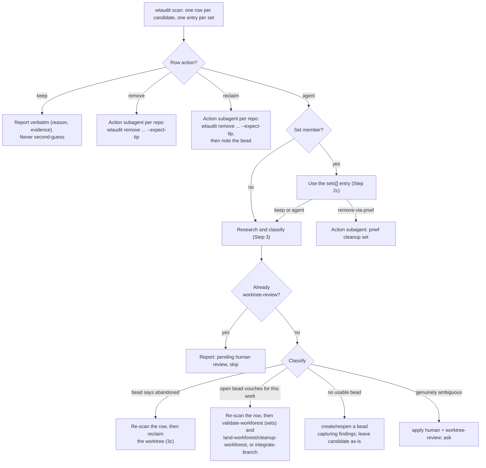

# audit-worktrees

**RUN FROM: the canonical pn-workspace root.** Confirm with `pn workspace discover`; a non-zero
exit or "no workspace found" means this skill does not apply here — halt and report. This skill
is scoped to the repos the workspace declares, not to arbitrary git repos on the machine.

## Purpose

A **Facade** over `wtaudit` (the tested command that does the deterministic half of the sweep) and
the existing primitives (`integrate-branch`, `validate-workforest`, `land-workforest`,
`cleanup-workforest`, `bd`) that answers one question, workspace-wide, for every branch and
worktree that exists but is not the canonical checkout of a repo's primary branch: **is anything
still using this, and if not, what disposes of it?** `wtaudit scan` classifies every candidate
(landed or not, clean, anchored by a live process, bead state) and prints one row per candidate;
`wtaudit remove` re-verifies and performs the removals it classified as safe. The agent never
re-derives those facts by hand: it acts on each row by its `action` and spends its judgment only on
the rows marked `agent`. This skill adds no git or landing mechanics of its own — every mutating
action is executed by `wtaudit remove` or by a skill that already implements that action.

## Disambiguation

- **Not a single-target tool.** For one already-identified branch or set, call `integrate-branch`,
  `land-workforest`, or `cleanup-workforest` directly — this skill's only job is the workspace-wide
  sweep and the routing of each row.
- **Not a bead-quality pass.** It reads and writes beads only to record disposition and hand off
  unfinished work; it does not groom titles/acceptance-criteria (`bead-grooming`'s job).
- **Never finishes the underlying work itself.** This skill MUST NOT write, edit, or complete any
  code toward a branch's own goal. The **orchestrator** — this skill's own execution — takes only
  three kinds of direct action: running `wtaudit scan` and read-only research, bead bookkeeping
  (create/reopen/close/annotate), and applying/checking the `human`/`worktree-review` labels. Every
  action that mutates a candidate's git state (landing it or removing it) is delegated to a
  **dispatched action subagent** (Command pattern: the orchestrator decides _which_ disposition
  applies, the subagent executes it). The action subagent runs `wtaudit remove`, `pnwf cleanup`,
  or invokes `integrate-branch` / `land-workforest` / `cleanup-workforest`.

## Safety contract (MUST)

- MUST drive the sweep from `wtaudit scan` and MUST NOT re-derive its facts by hand: the
  anchored-process probe, the landed test (ancestor or patch-equivalent), the dirty-tree check and
  the bead claim check are all computed by the tool and reported in each row. A hand-run substitute
  is a second, untested copy of the guard and MUST NOT be used.
- MUST NEVER second-guess a `keep` row: do not remove, relabel or otherwise act on it, and do not
  run `git` or `wtdone` directly against it to "double-check" or "finish" it. Report it verbatim
  with its `reason` and `evidence`.
- MUST NOT act on, or write a bead about, a candidate the scan reported `keep` for
  `anchored-process`, `claimed` or `bead-lookup-failed` (a live session or an unreadable bead means
  fail closed).
- MUST check a correlated bead's **existing** labels before classifying an `agent` row (Step 3).
  A bead already carrying `worktree-review` is, per `beads-lifecycle` W-3/W-4, **not to be
  re-labeled, re-promoted, or re-classified** — it stays exactly as a prior pass left it until a
  person records a verdict. Report it as "already pending human review" and move on.
- MUST NOT act on a candidate whose disposition is genuinely ambiguous — apply
  `human`+`worktree-review` and move on to the next candidate instead.
- MUST invoke the `beads-lifecycle` skill before any `bd create`/`update`/`close`, and before
  applying or removing the `human`/`worktree-review` labels, per its always-on tripwire.
- MUST run every `bd` lookup/write for a candidate from inside that candidate's own repo (its
  `repo_path`), never from an unrelated cwd — `bd` resolves its database by filesystem walk-up.
- MUST NOT force-delete a branch (`git branch -D`, or `pnwf cleanup --force-unlanded-branch-removal`)
  anywhere in this skill, even when a bead confirms the work is abandoned. MUST NEVER pass
  `--force-dirty-worktree-removal`. The ONE sanctioned carve-out (operator rulings, Phillip,
  2026-10-09 and 2026-11-03, verbatim: "if a branch/worktree is patch-equivalent to main and the
  bead is closed, then the branch/worktree can be removed"): `wtaudit remove` deletes a landed
  branch (an ancestor of the primary, or patch-equivalent to it with a closed, exactly-matched
  bead) with a compare-and-swap `git update-ref -d refs/heads/<branch> <expected-tip-sha>`, which
  fails if the tip moved, and never a bare `-D`. Nobody else deletes a branch this way; the agent
  never runs `update-ref -d` itself. Accepted limits, not to be re-litigated: a squash-merged
  branch shows `+` lines, classifies as unlanded and stays an `agent` row; a patch that landed and
  was later reverted on the primary still counts as landed.
- MUST serialize action-subagent dispatches (land/remove) within a single repo — at most one
  in-flight per repo — but MAY run them concurrently across different repos. Research
  (read-only) MAY be parallelized freely across rows.
- MUST NOT use `subagent_type: "fork"` for any dispatch if this skill itself is running inside an
  already-dispatched subagent (FK-1) — use `general-purpose` there instead.
- MUST stop and report, without falling back to manual removal, when `wtaudit scan` exits 2 or 3,
  when `wtaudit remove` exits 2, or when the scan output fails `jq -e '.schema_version == 1'`
  (Step 1).
- When self-triggered opportunistically (noticing clutter mid unrelated task, rather than an
  explicit "audit worktrees" ask), MUST say one line up front — what triggered it and roughly how
  many candidates were found — before taking any action. This is a courtesy heads-up, not an
  approval gate: the dispositions below still proceed without waiting for a reply.

## Step 1 — Scan (read-only)

Run `wtaudit scan > <fresh scratch file>` (JSON is the default; use a fresh, uniquely named
scratch path, never an existing one). `scan` needs `pn` and `bd` on PATH, runs from anywhere,
enumerates every workspace repo through `pn workspace discover`, and is offline. Then:

1. Validate: `jq -e '.schema_version == 1' <scratch file>`. A scan exit of 2 or 3, or a failed
   validation (a schema mismatch), means **stop and report**; do not fall back to manual
   enumeration or manual removal.
2. Read `candidates[]` (one row per standalone worktree, coordinated-set member, or dangling
   branch; every candidate appears exactly once) and `sets[]` (one entry per coordinated set).
   Never re-derive a row's facts by hand.

A `repo-unreadable` row (`action: agent`) is reported as-is; it is never researched by running git
in the unreadable path.



## Step 2 — Act on each row by its action

The `action` field is a closed enum (`keep`, `remove`, `reclaim`, `agent`); each value has exactly
one handling below.

**2a. `keep` — report, never act.** Put the row in the end-of-run table verbatim with its `reason`
and `evidence` (reasons: `canonical-checkout`, `anchored-process`, `bead-lookup-failed`, `claimed`,
`worktree-unreadable`, `dirty`, `patch-equivalent-no-bead`, `isolated-not-worked`). A `keep` row of
reason `claimed` is reported as "claimed by live drain session"; `isolated-not-worked` as
"isolated, not yet worked"; `dirty` as dirty. MUST NOT remove, relabel, write any bead about it,
or run `git` or `wtdone` directly to second-guess it.

**2b. `remove` and `reclaim` — dispatch `wtaudit remove`.** For each such row, dispatch one action
subagent per repo (serialized within a repo, concurrent across repos) that runs

```text
wtaudit remove --repo <repo_path> --branch <branch> --expect-tip <tip>
```

with the row's own `repo_path`, `branch` and `tip`, and returns the JSON object the command prints
(`id`, `removed_worktree`, `removed_branch`, `exit`, `reason`, `message`). The tool re-classifies
the candidate from scratch and refuses unless the verdict is still `remove` or `reclaim` and the
tip equals `--expect-tip`, so the subagent MUST NOT add its own pre-checks. Handling, exactly one
per exit code, and none of them is ever retried:

| exit | meaning                                                                                      | handling                                                                                      |
| ---- | -------------------------------------------------------------------------------------------- | --------------------------------------------------------------------------------------------- |
| 0    | the worktree (if any) and the branch are gone                                                | report "removed" (reason `landed-ancestor` / `landed-patch-equivalent`) or reclaimed (below)  |
| 10   | refused before acting: the verdict changed or the tip moved (`verdict-changed`, `tip-moved`) | report the reason and move on; do NOT retry                                                   |
| 11   | the worktree is gone but the branch remains (`branch-refused`, `tip-moved-late`)             | report it with the reason; for a reclaim, write the note (below) with "remains"; do NOT retry |
| 12   | the candidate is a set member (`set-member`)                                                 | report it and handle the set through its `sets[]` entry (Step 2c); do NOT retry               |
| 13   | the tool's teardown failed and the worktree is still present (`teardown-refused`)            | report the reason and the tool's message; no bead note; move on; do NOT retry                 |
| 2    | usage error (bad flag, malformed `--expect-tip`, unreadable `--repo`)                        | **stop and report**; do not fall back to manual removal                                       |

**Reclaim note.** After a `reclaim` row's `wtaudit remove` returns with `removed_worktree: true`
(exit 0 or 11), and only then, the orchestrator MUST add one note to the row's bead. Write the note
text to a FRESH, uniquely named scratch file (`mktemp` style, or the Write tool), through a QUOTED
heredoc, never `echo "..."` and never an unquoted heredoc, so shell substitution cannot eat
identifiers. The candidate worktree no longer exists, so run `bd comment <bead id> --file
<scratch-file>` from the row's `repo_path` (the repo's canonical clone), then delete the scratch
file. Fill `<date>` from the scan's `generated_at`, `<primary>` from the row, and choose "was
removed with it, as it held nothing" when `removed_branch` is true and "remains" otherwise. The
note text is:

```text
audit-worktrees clean-up pass ran on <date>. The worktree for branch <branch> had no
changes (clean tree, no commits of its own ahead of <primary>) and the bead was unclaimed,
so the worktree was removed. The branch <was removed with it, as it held nothing | remains>.
```

MUST NOT write the note when nothing was removed (exit 10, 12 or 13, or `removed_worktree` false),
and MUST NOT change the bead's status, assignee or labels. Report "reclaimed (clean, no changes)"
with the bead id. A `remove` row never gets a bead write: the scan only emits it for a candidate
with no bead or a closed one. Accepted properties of the reclaim rule: a clean tree does not show
gitignored files, and removal discards them (this matches the operator's "no changes" criterion,
ruling Phillip, 2026-10-22: a worktree with no changes MUST be removed, the branch MAY remain); the
rule does not read bead labels, so the clean zero-commit worktree of a parked bead is reclaimed too,
and `pb drain isolate` recreates it when the bead is resumed.

**2c. Sets — use the `sets[]` entry; sets go through `pnwf cleanup`.** `wtaudit remove` never
removes a set member (exit 12). Per set, by the entry's `action`:

- `remove-via-pnwf` — every member is landed and `pnwf land-plan` agrees. Dispatch an action
  subagent to run `pnwf cleanup <set>` (the `cleanup-workforest` skill's mechanism), no force flags
  (`--force-unlanded-branch-removal` and `--force-dirty-worktree-removal` are never passed).
  No approval, and no bead write beyond closing one that was already open for this set.
- `keep` — report the set verbatim with the entry's reason and evidence, like a `keep` row.
- `agent` — if the blocking member's reason is `idle-clean-unworked` or `isolated-not-worked`,
  report the set only as "isolated, not yet worked": MUST NOT research, land or reclaim it, and MUST
  NOT write any bead about it. Any other `agent` set (reasons such as `unlanded-work`,
  `bead-match-weak`, `repo-unreadable`, `pnwf-disagrees`, `pnwf-unavailable`) is researched and
  classified like a standalone `agent` row (Step 3), with the set's branch name supplying the bead
  token; only the **vouched** route lands it, by `validate-workforest`, then `land-workforest`, then
  `cleanup-workforest` inside the set (mirroring what `/pn-workspace-sync` does —
  `validate-workforest` immediately precedes landing per its own contract, never skip it). On
  `stopped:<reason>`/`pr-opened`/`pr-updated` from `land-workforest`, handle it like Step 3c's
  `stopped` case: refresh the bead, force nothing, and do not run `cleanup-workforest` (a
  partially-landed set must not be torn down). On **abandoned**, dispatch `cleanup-workforest` with
  no force flags: it keeps any member with real unlanded commits and reports it.

**2d. `agent` — research and classify (Step 3).** Every remaining row, including a detached-HEAD
worktree (`detached-worktree`: it has no branch to compare, so it is NEVER removed by this skill;
research it and report or file a bead like any other `agent` row).

## Step 3 — `agent` rows: research, classify, act

The scan's row already carries the facts: `bead` (id, status, labels, title), `bead_lookup`,
`bead_match`, `last_commit_date`, `subjects` (up to five), `ahead`, `behind`, `dirty`, `anchored`,
`reason` and `evidence`. Use them; do not re-derive them.

**3a. Reasons an `agent` row can carry and what to do first.**

- `unlanded-work` — commits not on the primary (including a squash-merged branch, a branch that
  merged the primary into itself, or a patch that has not landed). Research per 3b.
- `bead-match-weak` — the bead id came only from a longest-suffix guess, which the tool never
  trusts for removal. Corroborate the bead (title and body against the row's `subjects`) before
  relying on it; if it holds up, treat the row by 3b/3c, never as removable.
- `patch-equivalent-bead-open` — the work is already on the primary but its bead is still open.
  Deciding whether to close that bead is a judgment: read the bead, and close it with a landed
  reason only if it plainly matches the landed work; otherwise label for review (3c).
- `detached-worktree`, `repo-unreadable`, `pnwf-disagrees`, `pnwf-unavailable` — report them and
  file or refresh a bead per 3c; never remove them.

**3b. Research (parallelizable across rows, read-only, `bd` run from the row's `repo_path`).**

- The row's bead is the starting point. If `bead_lookup` is `none`, the agent MAY fall back to
  `bd search`/`bd list --label <repo-label>` (the repo's label per its own `CLAUDE.md` "Beads
  Labels" section) for a title/body match on the branch name; this fallback only informs an
  `agent` row and never turns a row into a removal.
- If a bead is found, read its full state: `bd show <id> --json` — status, **labels** (check for
  `worktree-review` first — see Safety contract), notes, comments.
- For more commit context than the row's `subjects`, `git log <primary>..<branch>`, and, if
  present, the worktree's own Claude transcript (`~/.claude/projects/<slugified-cwd>/*.jsonl`).

**3c. Classify from the research and act.**

- **Before any disposition that mutates git state** (the abandoned and vouched routes below),
  re-run `wtaudit scan --repo <repo_path>` and require that the row (same `id`) is still
  `action: agent` with the same `tip`; a row that turned `keep` (for example a bead claim, a new
  anchored process, a dirty tree) means: report the new reason and do nothing else. Claim state can
  change while you research.
- **Already `worktree-review`-labeled** → report "pending human review" and stop here. Do not
  re-classify, re-promote, or touch the worktree/branch (W-3/W-4).
- **Bead evidence rules this abandoned** — closed wontfix/moot, or a comment/note explicitly
  deciding against it (in the spirit of `beads-lifecycle`'s `decided-against?` probe) — close the
  bead with that reason first if it is still open, then dispatch an action subagent to reclaim the
  row's worktree. `wtaudit remove` refuses this row (its branch has commits not on the primary), so
  this is the one route that uses the existing remover directly: the action subagent runs
  `wtdone <branch> --cc <repo_path>`, which removes the worktree and then refuses the branch delete
  **by design** (a plain `-d`); that refusal is the expected outcome, not a failure. Report
  "worktree reclaimed, branch `<name>` left dangling (has commits not on the primary; not
  force-deleted)." **No approval.**
- **An open bead already vouches for this exact work** — its title/description plausibly matches
  what is actually in the branch (drifted-and-no-longer-matching counts as "no usable bead") —
  dispatch an action subagent to invoke `integrate-branch`. For a dangling branch it creates a
  throwaway worktree first purely so `integrate-branch` has a cwd to run from.
  - `landed` / `pr-opened` / `pr-updated` → close or annotate the bead accordingly. **No
    approval.**
  - `stopped:<reason>`, or `integrate-branch` itself reaches an unresolvable "ask the user" (null
    strategy) — treat both identically: never let the subagent block on a live prompt. Re-scan the
    repo as above, then reclaim only the throwaway worktree the same way as the abandoned route (its expected outcome: worktree
    removed, branch with unlanded commits kept). Refresh the _same_ bead with the concrete stop
    reason so a `/drain-beads` session can pick it up next. **No approval.**
- **No usable bead** — none found, or a found bead is closed as done/landed while the branch is
  provably unmerged (a premise-freshness violation per `beads-lifecycle` F-1's `landed?` probe),
  or a found bead's content has drifted from what is actually in the branch — create a new bead
  (or reopen the stale one, noting the drift) capturing the research: what is there, since when,
  what a prior session said. Leave the worktree/branch untouched for a future drain session to
  claim and finish. **No approval.**
- **Genuinely ambiguous** — cannot tell keep vs. discard: no bead and no discernible purpose from
  the row's commits/transcript, or the signals conflict (e.g. a bead says abandoned but the branch
  has commits newer than that ruling) — apply `human`+`worktree-review` per `beads-lifecycle`
  W-1/W-2 (entry marker, priority-promotion record, in the same `bd update`). Leave the
  worktree/branch untouched. **This is the one disposition that asks a person.**

**3d. Removal route audit (the complete list).** Every route in this skill that can remove a
worktree, and what protects a live drain worktree on it. A new route MUST be added here with a
guard or a reason before it ships. The tool's own mechanism is named in the right-hand column only
to say what is protected; none of it is an instruction to run by hand.

| route                                                                    | protection                                                                                                                                                                                                                           |
| ------------------------------------------------------------------------ | ------------------------------------------------------------------------------------------------------------------------------------------------------------------------------------------------------------------------------------ |
| `remove` row (landed ancestor or patch-equivalent) → `wtaudit remove`    | the tool re-runs its classification and the tip compare as the guard immediately before acting: claim, dirty tree and anchored-process (`lsof`) checks, then its pinned `wtdone` teardown, then the `update-ref -d` compare-and-swap |
| `reclaim` row (zero commits, unclaimed bead) → `wtaudit remove`          | the same guard re-run; the tool refuses a claimed or dirty worktree; the bead note is written only after the worktree is confirmed gone                                                                                              |
| set, `remove-via-pnwf` → `pnwf cleanup <set>`                            | the scan classified every member and `pnwf land-plan` as the final parity check; a claimed, dirty, anchored or unlanded member makes the set `keep` or `agent`, never `remove-via-pnwf`                                              |
| set, vouched → `land-workforest`/`cleanup-workforest`; abandoned         | the re-scan in 3c, then those skills' own landing guards                                                                                                                                                                             |
| `agent` abandoned → worktree reclaim through `wtdone`                    | the re-scan in 3c (a claim, anchored process or dirty tree turns the row into `keep`); `wtdone` itself refuses a dirty tree or an anchored allow-listed process and does a plain `-d` only                                           |
| `agent` vouched → `integrate-branch` (its FF-4 runs `wtdone` on land)    | the re-scan in 3c before dispatch                                                                                                                                                                                                    |
| `agent` vouched, `stopped`/null strategy → reclaim of the throwaway tree | the re-scan in 3c, re-run immediately before this removal                                                                                                                                                                            |
| `keep`, already `worktree-review`, no usable bead, genuinely ambiguous   | no removal or `integrate-branch` dispatch exists on these routes; they only report, label or file                                                                                                                                    |

Residual gap, disclosed: a candidate with NO correlated bead has nothing for the claim guard to
read. That is acceptable because a drain worktree is always created for a bead, so a live one always
resolves to a bead; a no-bead candidate is, by construction, not a drain claim. A check-then-remove
window also remains on every route: a claim can land between the tool's last bead read and the
removal. The tool's own re-verification inside `wtaudit remove` and `wtdone`'s refusals (a dirty or
untracked tree, an anchored allow-listed process) are the only backstops once the dispatch starts.

Deliberate behavior differences from the previous, hand-run version of this skill (so nobody
"fixes" them back):

- A dirty worktree is reported `keep` (`dirty`) before any disposition; a dirty ancestor with no
  bead is no longer dispatched to a remover to be refused there.
- A zero-commit candidate with an open, unclaimed bead and a DIRTY tree is reported `dirty` (the
  old text called it "isolated, not yet worked ... dirty"); only the reason name changed.
- The `bd search`/`bd list --label` fallback no longer decides a row; it is available to the agent
  for `agent` rows only.
- A patch-equivalent branch is removable when its bead is `closed`; a closed bead that still carries
  an assignee is NOT a claim.
- A bead matched only through the longest-suffix token rule is never trusted for removal or reclaim
  (`bead-match-weak`).
- A not-yet-worked set (zero-commit members, open unclaimed bead) used to be "skip, report"; it is
  now an `agent` set whose blocking member reason is `idle-clean-unworked` or
  `isolated-not-worked`. The agent MUST still report it as "isolated, not yet worked" and MUST NOT
  research or land it.

## Step 4 — Report

One end-of-run table, in the same spirit as `session-wrapup:wrap-up-session`'s summary:

```text
Audit-worktrees — <N> candidates (<sets>, <standalone worktrees>, <dangling branches>)

| candidate                      | kind      | disposition                | bead                 |
|---------------------------------|-----------|-----------------------------|----------------------|
| feat-x (nix-personal)            | worktree  | removed (landed-ancestor)   | —                    |
| pg2-9k2ab (repo-base)            | worktree  | landed                      | pg2-9k2ab closed     |
| drain/pg2-4f1qz (support-apps)   | worktree  | stopped (rebase-conflict)   | pg2-4f1qz refreshed  |
| old-spike (personal)             | dangling  | bead created                 | pg2-new1 (P3)        |
| stale-try (personal)             | worktree  | reclaimed (abandoned, branch with unlanded commits left dangling) | pg2-old3 closed |
| rebased-x (personal)             | worktree  | removed (patch-equivalent to main, bead closed) | pg2-old4 closed |
| drain/pg2-5kq1x (repo-base)      | worktree  | reclaimed (clean, no changes) | pg2-5kq1x noted      |
| mystery-wt (ziprecruiter)        | worktree  | flagged for review          | pg2-new2 (human)     |

Kept (anchored-process / dirty / other, verbatim reason): 1 (feat-y, anchored-process in ziprecruiter worktree)
Already pending review: 1 (pg2-oldrev, left untouched)
Reclaimed (clean, no changes): 1 (drain/pg2-5kq1x, bead pg2-5kq1x unclaimed; worktree removed, bead noted)
Kept (claimed by live drain session / isolated, not yet worked): 1 (drain/pg2-7c3dd, bead in_progress)
Remove refused or partial (wtaudit exit 10/11/12/13, reason): 0
```

A `landed` outcome sits on that repo's local `main`, unpushed — as with `wrap-up-session`, this is
expected and MUST NOT get its own report section; mention it only in the one case it blocks work,
as a single line.

## Frontmatter constraint: never set `disable-model-invocation`

This skill MUST NOT carry `disable-model-invocation` in its frontmatter. Doing so drops it from
the model-visible skill listing and makes it unreachable by the Skill tool — for every sibling
stage skill in this plugin that mistake was made once and reverted (bd `pg2-dytfv`,
`pg2-okzl0`), each reachable afterward only because a pipeline command (`/pn-workspace-sync`)
still dispatched it directly. This skill has no such pipeline fallback: it is meant to be reached
both by an explicit ask and by an agent's own opportunistic noticing, so setting the flag here
would make it unreachable outright, not just less discoverable.

## Command quick reference

| need                                          | command                                                                                              |
| --------------------------------------------- | ---------------------------------------------------------------------------------------------------- |
| classify every candidate and set              | `wtaudit scan > <fresh scratch file>`, then `jq -e '.schema_version == 1'` on it                     |
| re-check one repo before a git-mutating route | `wtaudit scan --repo <repo_path>` (row must still be `agent`, same `tip`)                            |
| remove or reclaim a `remove`/`reclaim` row    | `wtaudit remove --repo <repo_path> --branch <branch> --expect-tip <tip>` (exit 0, 10, 11, 12, 13, 2) |
| remove a fully landed set                     | `pnwf cleanup <set>` for a `remove-via-pnwf` entry of `sets[]`, no force flags                       |
| reclaim note (after `removed_worktree: true`) | `bd comment <bead id> --file <scratch-file>` from the row's `repo_path`                              |
| land a standalone branch                      | invoke `integrate-branch:integrate-branch` (Skill tool)                                              |
| validate + land + cleanup a set               | invoke `validate-workforest`, then `land-workforest`, then `cleanup-workforest` (Skill tool)         |
| bead research for an `agent` row              | `bd show <id> --json`, `bd search`, `bd list --label <repo-label>` (from the row's `repo_path`)      |
| existing-review short-circuit                 | check `bd show <id> --json`'s labels for `worktree-review` before classifying                        |
| abandoned-ruling probe                        | in the spirit of `beads-lifecycle`'s `decided-against?` (F-9)                                        |
| landed-claim verification                     | `beads-lifecycle`'s `landed?` (F-3)                                                                  |
| doubt path                                    | `beads-lifecycle`'s `worktree-review` lifecycle (W-1..W-8)                                           |
