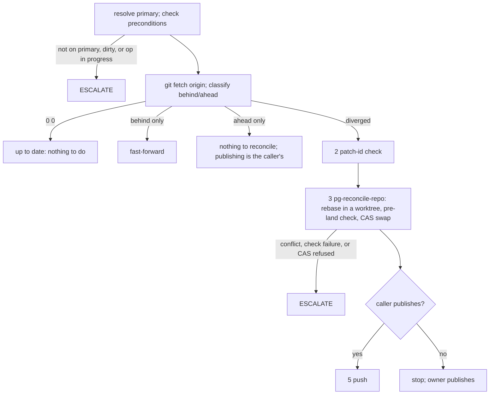

# reconcile-repo

**Purpose.** Bring ONE repo's primary branch and `origin/<primary>` back into
line, replaying only the genuinely new local commits on top of the moved
origin. This is the single home of that procedure: callers (the
`/pn-workspace-sync` command, tracker beads) MUST reference this skill and MUST
NOT copy its steps.

**Input.** One repo path, `<CC>` (the canonical clone). Nothing else is
required; the skill does not read `pn-workspace.toml` and does not call `pn`.

**Publish step is the caller's parameter.** Step 5 (push) runs only when the
caller says it publishes. `/pn-workspace-sync` publishes (pushes). A caller that
only reconciles MUST stop after step 4 and leave publishing to its owner. When
the caller is the pg-repo-runner's diverged bead, the agent MUST NOT push: the
runner pushes after a green check of the new tip (ADR 0108 of
`nix-agent-support`).

**Who carries it out.** An agent, including an unattended drain, carries the
whole reconciliation out itself and closes its bead; it does not hand the
rebase to the user. Operator ruling (Phillip, 2026-11-03), verbatim: "2b should
be agents do all of it. (there should be a caveat that if problems are detected
that they are esclated) . use recommended for the remaining". The same ruling
moved the rebase out of the canonical clone: the diverged procedure rebases in a
temporary worktree and then swaps the canonical clone's primary branch by
compare-and-swap (see below). When a problem is detected the agent MUST escalate
instead of finishing (see "Escalation").

**Authorization limits (MUST honor).** This skill does NOT itself authorize an
agent to run `/pn-workspace-sync` (not ruled on) or `pn workspace update` /
`pn workspace apply`. Every nix run (`nix flake update`, `nix build`, `nix fmt`)
MUST go through `pg-nix-log-wrapped`, run with `bgrun NAME -- ...` then
`bgwait NAME --timeout 540` (Bash `timeout: 600000`), or with an explicit
`timeout`. A full `nix flake check` is not a gate (operator ruling 2026-10-01);
the gate is `pg-hooks run pre-land`.



## Step 0 — Resolve the primary branch and check preconditions

1. Resolve `<primary>` in this order: `git -C <CC> config
pgii-integrate-branch.primaryBranch`; then
   `git -C <CC> symbolic-ref --short refs/remotes/origin/HEAD` (strip the
   `origin/` prefix); then `main`.
2. The canonical clone MUST be on `<primary>` (`git -C <CC> branch
--show-current`), MUST be clean (`git -C <CC> status --porcelain` empty), and
   MUST have no rebase, merge, or cherry-pick in progress (no `rebase-merge`,
   `rebase-apply`, `MERGE_HEAD`, or `CHERRY_PICK_HEAD` under
   `git -C <CC> rev-parse --git-dir`). This is the steady state; the swap below
   requires it.
3. If any precondition fails, ESCALATE (see "Escalation"). You MUST NOT reset,
   check out, or stash the canonical clone to make it pass; it is a genuine
   anomaly, not routine state. (This is the off-branch or dirty case; the
   swap's ref update and working-tree move on a clean canonical clone in steady
   state is not it.)

## Step 1 — Fetch and classify

Run `git -C <CC> fetch origin`. If `origin/<primary>` does not resolve after the
fetch, ESCALATE (the remote branch may have been renamed or deleted).

Then classify with
`git -C <CC> rev-list --left-right --count <primary>...origin/<primary>`
(left = local-only commits, right = origin-only commits):

| left (ahead) | right (behind) | State       | Action                                                              |
| ------------ | -------------- | ----------- | ------------------------------------------------------------------- |
| 0            | 0              | up to date  | nothing to do                                                       |
| 0            | >0             | behind only | `git -C <CC> merge --ff-only origin/<primary>`; done                |
| >0           | 0              | ahead only  | nothing to reconcile; publishing is the caller's step (see above)   |
| >0           | >0             | diverged    | run the procedure below (a locally-ahead clone with a moved origin) |

Diverged is the ROUTINE case, not an anomaly: a canonical clone sitting locally
ahead of a moved `origin` is the expected starting state.

## Diverged procedure

1. **Fetch.** `git -C <CC> fetch origin` (done in Step 1).
2. **Check who pushed.** List the origin-only commits' authors and committers:
   `git -C <CC> log --format='%an <%ae> | %cn <%ce>' <primary>..origin/<primary>`.
   If any is not the operator or a known workspace agent or automation, ESCALATE
   before rebasing (see "Escalation").
3. **Confirm the local-only commits are genuinely new.** A commit already landed
   upstream under a different sha needs no replay (the rebase drops it):

   ```bash
   git -C <CC> log --format='%H' origin/<primary>..<primary> | while read -r sha; do
     git -C <CC> show --no-ext-diff "$sha" | git -C <CC> patch-id --stable
   done
   ```

   Compare against the same patch-id computed for each commit in
   `<primary>..origin/<primary>`. A match means that local commit already
   landed upstream (under a different sha).

4. **Rebase, check and swap with `pg-reconcile-repo <CC>`.** One script does all
   three mechanical steps; do not reimplement them. It:
   1. creates a worktree on a temporary branch at the local `<primary>` tip,
      rebases it onto `origin/<primary>`, and runs `pg-hooks run pre-land` there
      (`--check-cmd CMD` / `--no-check` override it);
   2. in `<CC>` (steady state re-verified), runs
      `git update-ref refs/heads/<primary> <rebased> <old-local-tip>`, which
      fails safely if `<primary>` moved, then moves the index and working tree
      to the rebased tip;
   3. removes the temporary worktree and branch.

   `<CC>` is never mid-rebase, and on any failure nothing in it changes. The
   last stdout line is the outcome (`reconciled <old> <new>`). Exit codes: `3`
   not in steady state, `4` rebase conflict, `5` check failed on the rebased
   tip, `6` compare-and-swap refused, `7` working-tree move failed (ref
   restored), `8` fetch failed. Every non-zero exit leaves `<CC>` unchanged.
   Run it as a background job or with an explicit timeout: the check can be
   slow.

5. **Publish** (only when the caller publishes; otherwise stop after step 4).

### Rebase-conflict discipline

Exit `4` means the rebase hit a conflict and was aborted, with the conflicted
paths printed (`conflict: <path>`). `<CC>` is untouched.

- A `flake.lock`-only conflict is mechanical: in your own temporary worktree
  (never in `<CC>`) rebase onto `origin/<primary>`, pick either side, stage it,
  `git rebase --continue`, then force-refresh the specific inputs that were
  actually in conflict with `nix flake update <input...>` there. You MUST NOT use
  a bare `nix flake lock`: it only fills MISSING lock entries and silently leaves
  an already-pinned input stale (verify by diffing the result against the repo's
  `flake.lock` on `origin/<primary>`). Commit the relock only if it changed the
  file.
- Any other conflicted path is hand-authored content: resolve it in that
  worktree if you are confident, summarizing the resolution, then
  `git rebase --continue`.
- Then run `pg-hooks run pre-land` there and perform steps 2 and 3 of the
  script by hand with the same commands (`git -C <CC> update-ref
refs/heads/<primary> <rebased> <old-local-tip>`, then
  `git -C <CC> read-tree -m -u <old-local-tip> <rebased>` on the unchanged
  clean `<CC>`, then remove the worktree and branch). A refused
  `update-ref` is an escalation, not a retry loop.
- If you are NOT confident in a resolution, abort and ESCALATE. `<CC>` stays
  untouched.

### Bounded fix-breakage rule

A fix-breakage step is bounded; it is not a license to patch over a regression.

- In scope (MAY do): a MECHANICAL fix only: regenerating a generated file (lock
  file, formatting), a one-line reference or import fix the rebase itself
  broke, or re-running a codegen step.
- Out of scope (MUST NOT do), regardless of how small it looks: rewriting
  logic, silencing or skipping a failing check, or adding exception handling
  around the failure. ESCALATE instead.

## Escalation

When a problem is detected the agent MUST escalate instead of finishing, and
MUST NOT push or close the bead as done. An agent caller escalates through
`pb:drain-stuck` (the `escalated` label plus a findings comment; never the
`human` label directly). An interactive caller MAY ask the user instead. Escalate
at least when:

- a rebase conflict is not one the agent is confident resolving;
- hooks (`pg-hooks run pre-land`) fail on the rebased tip, or the bounded
  fix-breakage rule does not cover the failure;
- the compare-and-swap swap refuses (the primary branch moved);
- the canonical clone is not in steady state (not on `<primary>`, dirty, or a
  rebase, merge or cherry-pick in progress);
- `origin` gained commits whose author or committer is not the operator or a
  known workspace agent or automation (an earlier `nix-agent-support`
  divergence had an unexplained origin push).

The findings comment names the repo, the old local tip, `origin/<primary>`, the
script's exit code and output, and which condition above fired.

## Rules summary

- The skill MUST operate on exactly one repo path and MUST NOT depend on
  `pn-workspace.toml` or `pn`.
- The skill MUST NOT reset, check out, or stash the canonical clone to get it
  into steady state; the swap itself runs only from steady state.
- The skill MUST rebase in a temporary worktree, never in the canonical clone,
  and MUST swap the canonical primary branch by compare-and-swap; it MUST NOT
  invent another landing mechanism.
- The gate is `pg-hooks run pre-land`, not a full `nix flake check`.
- The skill MUST escalate on the conditions listed under "Escalation".
- Publishing (step 5) MUST happen only when the caller says it publishes, and
  never when the caller is the pg-repo-runner's diverged bead.
- The skill MUST NOT run `/pn-workspace-sync` or `pn workspace update|apply`
  on its own initiative.
