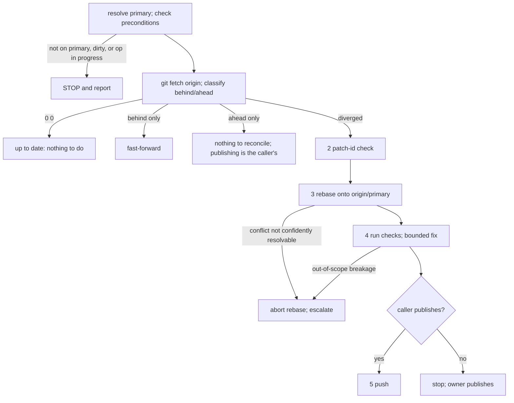

# reconcile-repo

**Purpose.** Bring ONE repo's primary branch and `origin/<primary>` back into
line, replaying only the genuinely new local commits on top of the moved
origin. This is the single home of that procedure: callers (the
`/pn-workspace-sync` command, tracker beads) MUST reference this skill and MUST
NOT copy its steps.

**Input.** One repo path, `<CC>` (the canonical clone). Nothing else is
required; the skill does not read `pn-workspace.toml` and does not call `pn`.

**Publish step is the caller's parameter.** Step 5 (push) runs only when the
caller says it publishes. `/pn-workspace-sync` publishes (pushes). A caller that
only reconciles MUST stop after step 4 and leave publishing to its owner.

**Authorization limits (MUST honor).** This skill does NOT itself authorize an
agent to run `/pn-workspace-sync` (not ruled on) or `pn workspace update` /
`pn workspace apply`. Every nix run (`nix flake check`, `nix flake update`,
`nix build`, `nix fmt`) MUST go through `pg-nix-log-wrapped`, run with
`bgrun NAME -- ...` then `bgwait NAME --timeout 540` (Bash `timeout: 600000`),
or with an explicit `timeout`.



## Step 0 — Resolve the primary branch and check preconditions

1. Resolve `<primary>` in this order: `git -C <CC> config
pgii-integrate-branch.primaryBranch`; then
   `git -C <CC> symbolic-ref --short refs/remotes/origin/HEAD` (strip the
   `origin/` prefix); then `main`.
2. The canonical clone MUST be on `<primary>` (`git -C <CC> branch
--show-current`), MUST be clean (`git -C <CC> status --porcelain` empty), and
   MUST have no rebase, merge, or cherry-pick in progress (no `rebase-merge`,
   `rebase-apply`, `MERGE_HEAD`, or `CHERRY_PICK_HEAD` under
   `git -C <CC> rev-parse --git-dir`).
3. If any precondition fails, STOP and report it. You MUST NOT reset, check out,
   or stash the canonical clone to make it pass; it is a genuine anomaly, not
   routine state.

## Step 1 — Fetch and classify

Run `git -C <CC> fetch origin`. If `origin/<primary>` does not resolve after the
fetch, STOP and ask the user (the remote branch may have been renamed or
deleted).

Then classify with
`git -C <CC> rev-list --left-right --count <primary>...origin/<primary>`
(left = local-only commits, right = origin-only commits):

| left (ahead) | right (behind) | State       | Action                                                              |
| ------------ | -------------- | ----------- | ------------------------------------------------------------------- |
| 0            | 0              | up to date  | nothing to do                                                       |
| 0            | >0             | behind only | `git -C <CC> merge --ff-only origin/<primary>`; done                |
| >0           | 0              | ahead only  | nothing to reconcile; publishing is the caller's step (see above)   |
| >0           | >0             | diverged    | run the procedure below (a locally-ahead clone with a moved origin) |

Diverged is the ROUTINE case, not an anomaly to escalate: a canonical clone
sitting locally ahead of a moved `origin` is the expected starting state.

## Diverged procedure

Run these in `<CC>`, in order.

1. **Fetch.** `git -C <CC> fetch origin` (done in Step 1).
2. **Confirm the local-only commits are genuinely new.** A commit already landed
   upstream under a different sha needs no replay:

   ```bash
   git -C <CC> log --format='%H' origin/<primary>..<primary> | while read -r sha; do
     git -C <CC> show --no-ext-diff "$sha" | git -C <CC> patch-id --stable
   done
   ```

   Compare against the same patch-id computed for each commit in
   `<primary>..origin/<primary>`. A match means that local commit already
   landed upstream (under a different sha) and does not need to be replayed as
   new work.

3. **Rebase.** `git -C <CC> rebase origin/<primary>`, resolving any conflict
   per the rebase-conflict discipline below.
4. **Run the repo's checks** (pre-commit hooks, `nix flake check` where
   applicable) against the rebased tree, within the bounded fix-breakage rule
   below.
5. **Push** (only when the caller publishes; otherwise stop after step 4).

### Rebase-conflict discipline

Conflicts are expected here; resolve them yourself in `<CC>`.

- List the conflicted paths with `git -C <CC> diff --name-only --diff-filter=U`
  before judging confidence. You MUST NOT guess or eyeball which files git
  flagged.
- A `flake.lock`-only conflict is mechanical: pick either side, stage it, run
  `git -C <CC> rebase --continue`, then force-refresh the specific inputs that
  were actually in conflict with `nix flake update <input...>` in `<CC>`. You
  MUST NOT use a bare `nix flake lock`: it only fills MISSING lock entries and
  silently leaves an already-pinned input stale (verify by diffing the result
  against the repo's `flake.lock` on `origin/<primary>`). Commit the relock only
  if it changed the file.
- Any other conflicted path is real hand-authored content: resolve it if you
  are confident in the fix, summarizing the resolution, then
  `git -C <CC> rebase --continue`.
- If you are NOT confident in a resolution, you MUST abort the rebase
  (`git -C <CC> rebase --abort`), leaving the clone and branch untouched, and
  escalate to the user.

### Bounded fix-breakage rule

A fix-breakage step is bounded; it is not a license to patch over a regression.

- In scope (MAY do): a MECHANICAL fix only: regenerating a generated file (lock
  file, formatting), a one-line reference or import fix the rebase itself
  broke, or re-running a codegen step.
- Out of scope (MUST NOT do), regardless of how small it looks: rewriting
  logic, silencing or skipping a failing check, or adding exception handling
  around the failure. Stop and ask the user instead.
- Likewise stop and ask when the rebase lands a real conflict in hand-authored
  code you are not confident resolving.

## Rules summary

- The skill MUST operate on exactly one repo path and MUST NOT depend on
  `pn-workspace.toml` or `pn`.
- The skill MUST NOT reset, check out, or stash the canonical clone.
- The skill MUST rebase in the canonical clone as described; it MUST NOT invent
  another landing mechanism.
- Publishing (step 5) MUST happen only when the caller says it publishes.
- The skill MUST NOT run `/pn-workspace-sync` or `pn workspace update|apply`
  on its own initiative.
